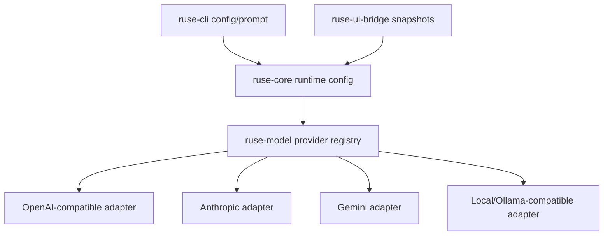

# M57 Multi-Provider Runtime Spec

## Purpose

Make provider choice a product capability instead of a hidden configuration detail. M57 gives `agent` a typed, diagnosable model-provider layer that can support OpenAI, Anthropic, Gemini, OpenAI-compatible, and local/Ollama-style providers while preserving the M56 golden path and shared runtime contracts.

## Product Context

M56 proved the local coding-agent workflow with deterministic fixtures. The next product blocker is provider diversity: users need to configure, inspect, and switch real providers, and the runtime must reject unsupported turns before model invocation when a provider lacks required capabilities such as streaming, tool calls, structured output, context size, or image input.

## Scope

This spec delivers:

- provider capability matrix with typed, serializable provider/model capability profiles
- capability mismatch diagnostics before a turn starts
- native Anthropic adapter with streaming and tool-use mapping
- native Gemini adapter with streaming and tool-use mapping
- local/Ollama-compatible provider profile and diagnostics
- provider UX for CLI/JSON configuration checks, fallback selection, and redacted support output
- regression coverage proving tool-capable providers can run the M56 golden path where supported

Owned by other specs:

- repo-aware context retrieval belongs to M58
- CLI/TUI daily-driver polish belongs to M59
- Desktop settings and provider onboarding UX belongs to M60 unless a bridge-safe contract is needed in M57
- packaging, keychain setup, and beta install flows belong to M65

## Architecture

Provider behavior remains owned by `ruse-model` and runtime selection remains owned by shared runtime/config paths. CLI, TUI, and Desktop must consume typed summaries through existing config/runtime contracts rather than duplicating provider rules.



## File Layout

```text
crates/
  ruse-model/
    src/
      config.rs
      registry.rs
      openai_compatible.rs
      anthropic.rs
      gemini.rs
      local.rs
    tests/
      provider_capability_matrix.rs
      anthropic.rs
      gemini.rs
      local_provider.rs
  ruse-core/
    src/
      config.rs
      repo_session.rs
  ruse-cli/
    src/
      command.rs
    tests/
      config_diagnostics.rs
      live_provider_registration.rs
docs/
  specs/M57-multi-provider-runtime.spec.md
  plans/M57-multi-provider-runtime.plan.md
```

## Public Contracts

M57 should extend existing provider contracts instead of replacing them:

```rust
pub enum ModelProviderKind {
    Fake,
    OpenAiCompatible,
    OpenAi,
    Anthropic,
    Gemini,
    Local,
}

pub struct ModelCapabilities {
    pub streaming: bool,
    pub tool_calls: bool,
    pub structured_outputs: bool,
    pub image_input: bool,
    pub max_context_tokens: Option<u32>,
    pub max_output_tokens: Option<u32>,
    pub cost: Option<ModelCostProfile>,
}

pub struct ModelRequestRequirements {
    pub streaming: bool,
    pub tool_calls: bool,
    pub structured_outputs: bool,
    pub image_input: bool,
    pub min_context_tokens: Option<u32>,
}
```

Exact field names may differ by slice, but durable/public forms must remain serde-friendly, redacted, and covered by tests.

## State and Failure Handling

- Capability mismatch is a pre-turn diagnostic, not a late provider error.
- Missing credentials fail before network calls and must not reveal secret ref names or values.
- Retry/fallback only selects providers that satisfy the request requirements.
- Provider transport errors must be classified as retryable or terminal with bounded public diagnostics.
- Unsupported provider features must produce actionable diagnostics that name missing capabilities.

## Security and Privacy

- Provider tokens, raw authorization headers, secret ref names, local endpoint credentials, and provider response bodies are not logged in public output.
- Default tests must use fake or local fixture transports and require no network or credentials.
- Network-capable adapters must keep request/response fixtures bounded and redacted.
- Local provider endpoints are allowed over `http://localhost` or `http://127.0.0.1`; non-local HTTP remains unsafe.

## Testing Strategy

- `ruse-model` tests for capability profiles, mismatch diagnostics, adapter request/response mapping, and redaction
- CLI tests for config checks, provider registration, and safe missing-secret behavior
- eval/golden coverage showing a tool-capable configured provider can run the M56 golden path where fixtures support it
- focused checks per slice plus final workspace fmt/clippy/test and `cargo xtask eval`

## Acceptance Criteria

- Users can configure and inspect OpenAI-compatible, Anthropic, Gemini, and local/Ollama-style providers.
- Provider capability mismatches are diagnosed before model invocation.
- Tool-capable providers can run the M56 golden path under deterministic fixture tests.
- JSON/text provider diagnostics are stable, bounded, and redacted.
- M57 hands off to M58 with provider selection no longer blocking core coding-agent work.

## Completion Signal

M57 is complete when provider capability checks, native provider adapters, local provider support, fallback behavior, CLI/JSON diagnostics, and M56 golden-path provider regression coverage are implemented, verified, documented, and committed.
