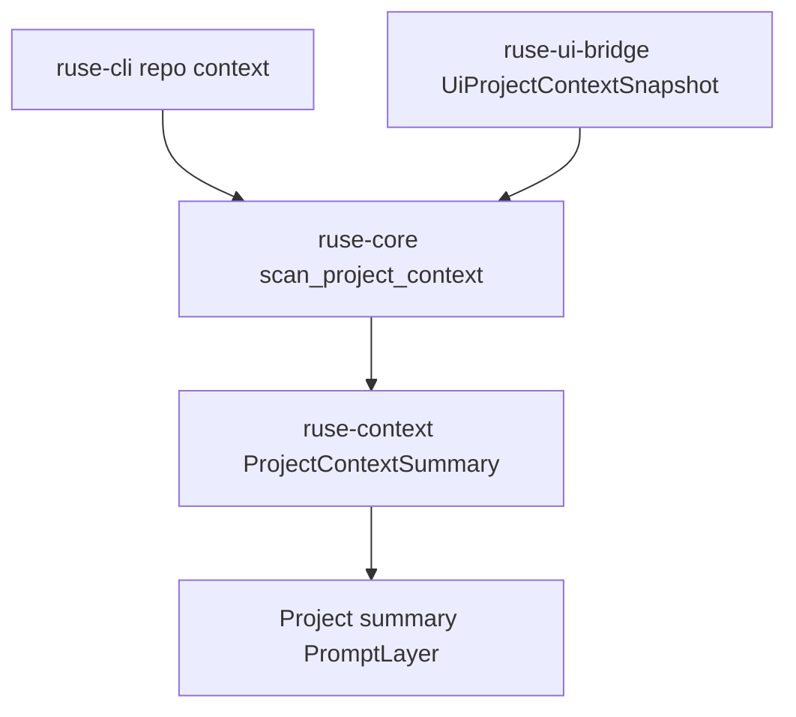

# M58-01 Repo Map and File Tree Summaries Spec

## Purpose

Create the first project-context contract: a bounded, deterministic, redacted summary of repository files and directories that can be converted into prompt layers and surfaced through CLI/JSON and Desktop-safe bridge snapshots.

## Product Context

M58 needs a reliable project map before ranking relevant files or adding semantic search. Existing prompt layers can carry project content, but there is no shared contract for discovering repository structure, classifying files, excluding unsafe or noisy paths, or explaining scan limits to users.

## Scope

This spec delivers:

- typed file and directory summary contracts in `ruse-context`
- deterministic sorting, validation, serde shape, and prompt-layer conversion for project summaries
- bounded workspace scanning in `ruse-core` with safe workspace-relative paths
- implicit exclusions for noisy or unsafe directories such as `.git`, `target`, `node_modules`, and build artifacts
- metadata-only handling for binary, oversized, generated, ignored, or secret-like files
- CLI text/JSON command output for inspecting project context summaries
- UI bridge snapshot shape for Desktop/TUI consumers
- focused tests for stable shape, bounds, redaction, and ignored directories

Owned by other specs:

- task-aware relevant-file ranking belongs to M58-02
- embedding or hybrid search belongs to M58-03
- user-pinned context controls belong to M58-04
- context quality eval gates belong to M58-05
- full CLI/TUI workflow polish belongs to M59

## Architecture

`ruse-context` owns pure context summary contracts and conversion into `PromptLayer`. `ruse-core` owns filesystem traversal because it has the workspace root and runtime boundary. `ruse-cli` and `ruse-ui-bridge` render summaries produced by the shared crates.



## File Layout

```text
crates/
  ruse-context/
    src/
      lib.rs
      project.rs
      error.rs
    tests/
      project_context_summary.rs
  ruse-core/
    src/
      lib.rs
      project_context.rs
    tests/
      project_context_scan.rs
  ruse-cli/
    src/
      command.rs
    tests/
      project_context_commands.rs
  ruse-ui-bridge/
    src/
      frame.rs
    tests/
      project_context_snapshot.rs
```

## Public Contracts

Final implementation may adjust names, but it should preserve these capabilities:

```rust
pub struct ProjectContextLimits {
    pub max_files: u32,
    pub max_depth: u32,
    pub max_file_bytes: u64,
    pub max_total_bytes: u64,
}

pub struct ProjectContextSummary {
    pub workspace_root_display: String,
    pub files: Vec<ProjectFileSummary>,
    pub directories: Vec<ProjectDirectorySummary>,
    pub omitted: Vec<ProjectContextOmission>,
    pub diagnostics: Vec<ProjectContextDiagnostic>,
    pub limits: ProjectContextLimits,
}

pub struct ProjectFileSummary {
    pub path: String,
    pub kind: ProjectFileKind,
    pub language: Option<String>,
    pub size_bytes: u64,
    pub line_count: Option<u32>,
    pub token_estimate: u32,
    pub content_hash: Option<String>,
    pub visibility: ProjectContextVisibility,
}

pub enum ProjectFileKind {
    Source,
    Test,
    Config,
    Documentation,
    Generated,
    Binary,
    SecretLike,
    Unknown,
}

pub enum ProjectContextVisibility {
    MetadataOnly,
    SummaryOnly,
    Full,
}
```

The summary should convert to an optional `PromptLayer` with `PromptLayerKind::Project`, `PromptLayerSource::ProjectFile` or a project-context source equivalent, workspace sensitivity, summary-only visibility, and bounded content.

## State and Failure Handling

- Invalid workspace roots fail in `ruse-core` before scanning.
- Files outside the workspace root are rejected after canonicalization.
- Unreadable files and symlink cycles produce recoverable diagnostics.
- Scan limits produce omissions with deterministic reasons such as `max_files`, `max_depth`, `max_file_bytes`, `max_total_bytes`, `ignored_path`, or `binary_file`.
- Secret-like files are included as metadata only and must not expose content previews.
- Summaries sort paths lexicographically for stable JSON and tests.

## Security and Privacy

- Repository contents are untrusted input.
- The scanner must not execute repository code, shell commands, Git commands, package managers, or hooks.
- Public output uses workspace-relative paths and must not include absolute paths outside the workspace.
- Secret-like filenames or contents such as `.env`, private keys, access tokens, and `api_key` values must not appear as raw content in diagnostics, snapshots, or prompt summaries.
- Binary and oversized files are not read into prompt content.

## Testing Strategy

- `ruse-context` serialization tests for project file summaries, omissions, diagnostics, and prompt-layer conversion
- `ruse-core` scan tests using temp workspaces for nested files, ignored directories, binary files, oversized files, secret-like files, and scan limits
- CLI tests for text and JSON `repo context --workspace .`
- UI bridge tests for stable safe `UiProjectContextSnapshot` shape
- focused commands:

```bash
cargo test -p ruse-context project_context_summary
cargo test -p ruse-core project_context_scan
cargo test -p ruse-cli project_context_commands
cargo test -p ruse-ui-bridge project_context_snapshot
```

## Acceptance Criteria

- `ruse-context` exposes typed project context summary contracts and prompt-layer conversion.
- `ruse-core` can scan a workspace into a bounded, deterministic project summary without executing code.
- CLI text and JSON output expose safe project summary evidence.
- Bridge snapshots serialize a stable context summary shape for Desktop/TUI consumers.
- Ignored, binary, oversized, and secret-like files are handled safely and covered by tests.

## Completion Signal

M58-01 is complete when project context summaries, bounded scanning, prompt-layer conversion, CLI/JSON output, bridge snapshot evidence, focused tests, and docs/status updates are implemented and committed separately from later retrieval work.
