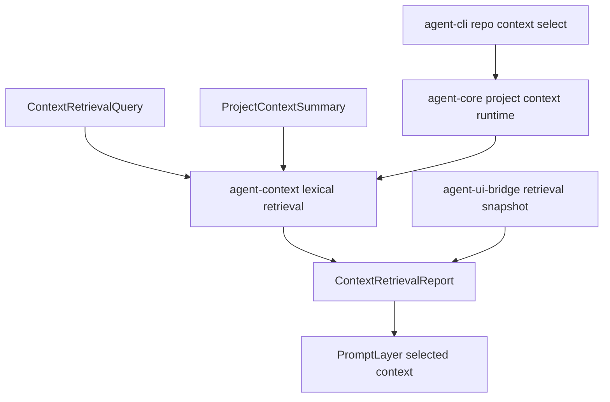

# M58-02 Relevant File Retrieval Spec

## Purpose

Select likely relevant project files for a coding task from the bounded project summaries introduced in M58-01, producing deterministic candidates, reasons, budget decisions, and prompt layers without requiring embeddings or provider credentials.

## Product Context

M58-01 can describe repository shape, but coding turns still need task-aware selection. M58-02 gives the runtime a lexical retrieval baseline so a request like "update the CLI project context command" can prioritize `agent-cli` command code, related tests, and bridge contracts before later semantic search work.

## Scope

This spec delivers:

- typed retrieval query, candidate, reason, omission, diagnostic, and report contracts
- deterministic lexical scoring from task text, file paths, names, directory names, language, kind, and existing summary metadata
- budget-aware selected/omitted candidate lists
- pinned path boosting as an input compatibility bridge for M58-04, without full pin UX
- prompt-layer conversion for selected relevant files as summary-only project context
- `agent-core` runtime helper that scans a workspace and runs retrieval in one call
- CLI/JSON and UI bridge summaries for retrieval evidence
- focused tests for stable scoring, sorting, redaction, and budget behavior

Owned by other specs:

- embedding-backed semantic or hybrid retrieval belongs to M58-03
- first-class pinned context controls and required pin semantics belong to M58-04
- quality traces and eval corpus integration belong to M58-05
- Desktop-specific interaction design belongs to M60

## Architecture

`agent-context` owns retrieval contracts, lexical scoring, budget selection, and prompt-layer conversion. `agent-core` owns workspace orchestration by composing M58-01 scanning with M58-02 retrieval. CLI/JSON and bridge surfaces render typed reports.



## File Layout

```text
crates/
  agent-context/
    src/
      retrieval.rs
      lib.rs
    tests/
      context_retrieval.rs
  agent-core/
    src/
      project_context.rs
    tests/
      project_context_retrieval.rs
  agent-cli/
    src/
      command.rs
    tests/
      project_context_retrieval_commands.rs
  agent-ui-bridge/
    src/
      frame.rs
    tests/
      project_context_retrieval_snapshot.rs
```

## Public Contracts

Final names may differ, but the durable shape should support:

```rust
pub struct ContextRetrievalQuery {
    pub task: String,
    pub max_candidates: u32,
    pub budget_tokens: u32,
    pub pinned_paths: Vec<String>,
}

pub struct ContextRetrievalReport {
    pub query: ContextRetrievalQuery,
    pub selected: Vec<ContextCandidate>,
    pub omitted: Vec<ContextCandidateOmission>,
    pub diagnostics: Vec<ContextRetrievalDiagnostic>,
    pub used_tokens: u32,
}

pub struct ContextCandidate {
    pub path: String,
    pub kind: ProjectFileKind,
    pub language: Option<String>,
    pub score: u32,
    pub token_estimate: u32,
    pub reasons: Vec<ContextSelectionReason>,
}

pub enum ContextSelectionReason {
    PinnedPath,
    PathTokenMatch,
    FileNameMatch,
    DirectoryMatch,
    LanguageMatch,
    KindMatch,
}
```

Scores are product diagnostics, not a public ranking guarantee. They must be deterministic for the same query and summary.

## State and Failure Handling

- Empty task text is invalid.
- Empty or duplicate pinned paths are invalid.
- Unknown pinned paths produce diagnostics and do not panic.
- Candidates sort by descending score and then ascending path.
- Candidates over budget are omitted with a stable reason such as `budget_exceeded`.
- A zero candidate result is valid with a warning diagnostic, not a runtime failure.

## Security and Privacy

- Retrieval works from M58-01 summaries and does not read additional file contents.
- Task text is untrusted and must be bounded in diagnostics.
- Public reports expose workspace-relative paths, scores, reasons, and metadata only.
- Secret-like files stay metadata-only and are not promoted to full prompt content by retrieval.

## Testing Strategy

- `agent-context` tests for scoring, stable ordering, pinned path boost, budget omission, serde shape, and prompt-layer conversion
- `agent-core` tests for scan-plus-retrieve orchestration on temp workspaces
- CLI tests for text and JSON retrieval output with safe task rendering
- UI bridge tests for retrieval snapshot stability and redaction
- focused commands:

```bash
cargo test -p agent-context --test context_retrieval
cargo test -p agent-core --test project_context_retrieval
cargo test -p agent-cli --test project_context_retrieval_commands
cargo test -p agent-ui-bridge --test project_context_retrieval_snapshot
```

## Acceptance Criteria

- Given a task and project summary, `agent-context` returns deterministic relevant-file candidates with reasons.
- Budget limits select fitting candidates and explain omissions.
- `agent-core` can scan and retrieve relevant files for a workspace in one typed call.
- CLI/JSON and bridge outputs expose safe retrieval evidence.
- M58-03 can add semantic signals without replacing the lexical contract.

## Completion Signal

M58-02 is complete when lexical relevant-file retrieval, budgeted selection, prompt-layer conversion, core orchestration, CLI/bridge evidence, focused tests, and docs/status updates are implemented and committed separately from semantic search.
