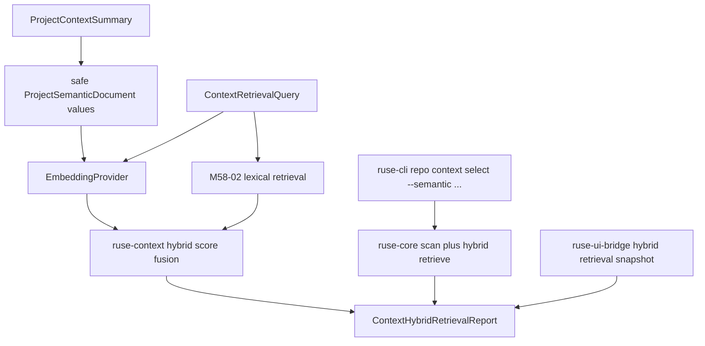

# M58-03 Semantic and Hybrid Search Spec

## Purpose

Add an optional semantic retrieval lane for project context selection, combining M58-02 lexical evidence with embedding-backed scores when an embedding provider is configured, while preserving deterministic lexical fallback and safe metadata-only public outputs.

## Product Context

M58-02 can rank likely relevant files from task text and project summary metadata. That baseline is deterministic and credential-free, but coding tasks often use synonyms or conceptual requests that do not match path tokens. M58-03 introduces semantic scoring so configured environments can improve candidate ranking without making embeddings mandatory for the local coding workflow.

## Scope

This spec delivers:

- typed semantic retrieval configuration, status, candidate score, diagnostic, and hybrid report contracts
- safe project semantic documents derived from M58 project summaries and allowed file metadata
- integration with `ruse-memory` embedding provider contracts and deterministic fixture embeddings
- hybrid score fusion that combines lexical and semantic signals with explicit weights
- lexical fallback when semantic retrieval is disabled, unavailable, or fails recoverably
- core scan-plus-hybrid retrieval orchestration
- CLI/JSON and UI bridge evidence for hybrid retrieval status and candidate scores
- focused tests for semantic ranking, fallback, validation, redaction, and deterministic ordering

Owned by other specs:

- first-class pinned context controls and required pin semantics belong to M58-04
- context quality traces and eval corpus integration belong to M58-05
- durable background project vector indexes, cache invalidation, and incremental indexing are future product hardening
- real remote embedding provider onboarding, secrets, and account diagnostics belong to provider/config product work unless needed by this slice
- Desktop-specific interaction design belongs to M60

## Architecture

`ruse-context` owns semantic and hybrid project retrieval contracts, score fusion, safe semantic document construction, and prompt-layer conversion. It may reuse `ruse-memory` embedding contracts because `ruse-context` already depends on `ruse-memory` for prompt/memory integration. `ruse-core` owns workspace orchestration by composing M58-01 scanning with optional semantic retrieval. CLI/JSON and bridge surfaces render typed reports without duplicating retrieval logic.



Dependency rules:

- `ruse-context` owns scoring and typed contracts.
- `ruse-core` may pass an optional embedding provider/config into context retrieval, but must not duplicate score fusion.
- UI crates render typed reports only.
- Semantic retrieval must not make lexical retrieval depend on provider credentials, network, or async runtime availability.

## File Layout

```text
crates/
  ruse-context/
    src/
      semantic.rs
      retrieval.rs
      lib.rs
    tests/
      context_semantic_retrieval.rs
  ruse-core/
    src/
      project_context.rs
      lib.rs
    tests/
      project_context_semantic_retrieval.rs
  ruse-cli/
    src/
      command.rs
    tests/
      project_context_semantic_commands.rs
  ruse-ui-bridge/
    src/
      frame.rs
      lib.rs
    tests/
      project_context_semantic_snapshot.rs
```

Exact module names may change during implementation, but semantic retrieval logic must remain in shared runtime crates.

## Public Contracts

Final names may differ, but the durable shape should support:

```rust
pub struct ContextSemanticRetrievalConfig {
    pub mode: ContextSemanticRetrievalMode,
    pub lexical_weight: f32,
    pub semantic_weight: f32,
    pub minimum_score: f32,
    pub fallback_policy: ContextSemanticFallbackPolicy,
}

pub enum ContextSemanticRetrievalMode {
    Disabled,
    Provider {
        provider_id: String,
        model_id: String,
        dimensions: usize,
    },
}

pub enum ContextSemanticFallbackPolicy {
    LexicalOnly,
    FailClosed,
}

pub struct ProjectSemanticDocument {
    pub path: String,
    pub text_hash: String,
    pub token_estimate: u32,
    pub visibility: ProjectContextVisibility,
}

pub struct ContextHybridCandidate {
    pub candidate: ContextCandidate,
    pub lexical_score: f32,
    pub semantic_score: Option<f32>,
    pub combined_score: f32,
}

pub struct ContextHybridRetrievalReport {
    pub query: ContextRetrievalQuery,
    pub semantic: ContextSemanticRetrievalSummary,
    pub selected: Vec<ContextHybridCandidate>,
    pub omitted: Vec<ContextHybridCandidateOmission>,
    pub diagnostics: Vec<ContextRetrievalDiagnostic>,
    pub used_tokens: u32,
}
```

Candidate ordering must be deterministic: combined score descending, semantic score descending, lexical score descending, then path ascending. Existing M58-02 lexical report contracts must remain usable without semantic fields.

## State and Failure Handling

- Semantic retrieval is optional. Disabled mode returns a lexical-only hybrid report with an explicit semantic status.
- Empty provider id, model id, invalid dimensions, non-finite weights, negative minimum score, and zero total scoring weight are invalid.
- Embedding provider errors produce warning diagnostics and lexical fallback when fallback policy is `LexicalOnly`.
- Embedding provider errors are terminal only when fallback policy is `FailClosed`.
- Dimension mismatch or non-finite vectors are treated as embedding failures.
- Files with `ProjectContextVisibility::MetadataOnly`, `ProjectFileKind::SecretLike`, or binary/generated visibility constraints must not send raw file content to embeddings; they may remain lexical-only candidates.
- Missing semantic scores never remove a valid lexical candidate by themselves.
- Hybrid budget behavior reuses M58-02 selected/omitted semantics and stable omission reasons.

## Security and Privacy

- Semantic input text is untrusted derived project data and must be bounded before embedding.
- Task text passed to an embedding provider must be bounded and secret-redacted.
- Public reports expose workspace-relative paths, scores, reasons, semantic status, provider/model identifiers, hashes, and metadata only.
- Public reports must not expose embedding vectors, raw semantic document text, raw file contents, or raw secret-like task text.
- Deterministic fixture embeddings must not call network, read secrets, or inspect files.
- External provider integration must be explicit; lexical retrieval remains the default credential-free path.

## Testing Strategy

- `ruse-context` tests for config validation, stable serde shape, semantic document safety, fixture embeddings, hybrid score ordering, fallback diagnostics, budget omissions, and prompt-layer conversion
- `ruse-core` tests for scan-plus-hybrid orchestration on temp workspaces, lexical fallback, provider failure handling, and secret-like metadata safety
- CLI tests for `repo context select` semantic flags, text output, JSON output, invalid config exits, and redaction
- UI bridge tests for hybrid snapshot stability, single-line frame encoding, omitted candidate summaries, semantic status, and redaction
- focused commands:

```bash
cargo test -p ruse-context --test context_semantic_retrieval
cargo test -p ruse-core --test project_context_semantic_retrieval
cargo test -p ruse-cli --test project_context_semantic_commands
cargo test -p ruse-ui-bridge --test project_context_semantic_snapshot
```

## Acceptance Criteria

- Lexical retrieval remains the default and remains deterministic without embeddings.
- When a deterministic embedding provider is configured, semantic scores can change candidate ranking through explicit hybrid weights.
- Semantic failures are surfaced as safe diagnostics and fall back to lexical retrieval unless configured to fail closed.
- CLI/JSON and bridge outputs expose safe hybrid retrieval evidence without raw vectors or secret-like text.
- M58-04 can add pinned context on top of hybrid reports without replacing the retrieval contracts.

## Completion Signal

M58-03 is complete when optional semantic/hybrid retrieval, deterministic fixture embedding support, lexical fallback, core orchestration, CLI/bridge evidence, focused tests, and docs/status updates are implemented and committed separately from pinned context and quality eval work.
