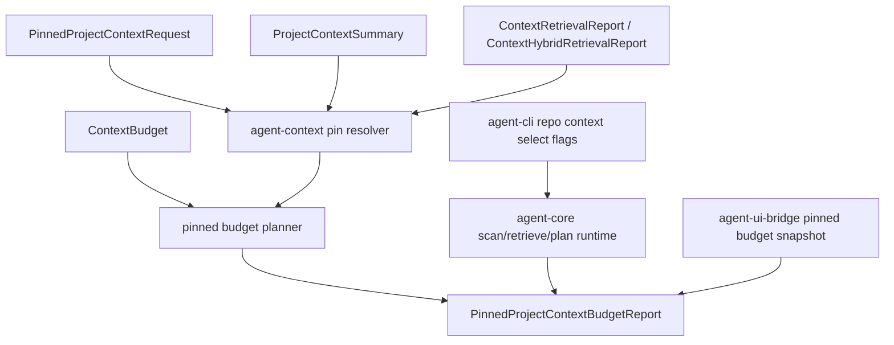

# M58-04 Pinned Context and Budget Planning Spec

## Purpose

Make pinned project context a first-class runtime contract so users can require or prefer specific workspace-relative files while the context planner fits pinned and retrieved context into an explicit prompt budget with deterministic diagnostics.

## Product Context

M58-01 summarizes repository shape, M58-02 retrieves relevant files lexically, and M58-03 adds optional semantic/hybrid ranking. Those slices can identify likely context, but users still need direct control when a task depends on a known file, design note, test, or constraint. M58-04 turns pinning from a retrieval score hint into budget-aware context assembly behavior that can prove whether required and optional pins were included, omitted, or rejected safely.

## Scope

This spec delivers:

- typed pinned project context request, item, priority, source, omission, diagnostic, and budget report contracts
- required versus optional pin behavior over workspace-relative project files
- deterministic pin resolution from M58 project summaries without reading raw file contents
- prompt-layer construction for pinned project context using metadata-safe summaries
- budget planning that includes required pins before optional pins and retrieval layers
- explicit failures when required pins are unknown or cannot fit the prompt budget
- optional-pin omissions with stable diagnostics instead of runtime failure
- core scan-plus-retrieve-plus-pinned-budget orchestration for lexical and hybrid reports
- CLI/JSON controls for required and optional pins plus prompt budget limits
- UI bridge snapshots for safe pinned context budget evidence
- focused tests for serialization, ordering, redaction, budget failures, CLI output, and bridge shape

Owned by other specs:

- lexical retrieval scoring belongs to M58-02
- semantic/hybrid retrieval and embedding provider behavior belongs to M58-03
- context quality traces and eval corpus integration belong to M58-05
- Desktop-specific pin management interaction design belongs to M60
- long-lived user/project memory pinning belongs to M64

## Architecture

`agent-context` owns pinned context contracts, pin resolution against project summaries, prompt-layer conversion, and budget planning. It should reuse the existing `ContextBudget`, `BudgetItem`, `BudgetClass`, and `plan_context_budget` primitives where possible, but it must expose pin-specific reports and diagnostics rather than leaking generic `(PromptLayer, String)` tuples to UI clients.

`agent-core` owns workspace orchestration by composing project scan, lexical or hybrid retrieval, and pinned budget planning. CLI, TUI, and Desktop bridge surfaces render typed reports only; they must not duplicate pin resolution, path matching, budget ordering, or failure rules.



Dependency rules:

- `agent-context` may depend on existing context project/retrieval/semantic contracts, but not on `agent-core`, CLI, TUI, or bridge crates.
- `agent-core` may re-export pinned context contracts and add orchestration input/report structs.
- UI crates may render reports and snapshots only.
- Pinned context must not grant filesystem, command, Git, network, MCP, plugin, browser, Desktop, secret, or memory permissions.

## File Layout

```text
crates/
  agent-context/
    src/
      pins.rs
      budget.rs
      retrieval.rs
      semantic.rs
      lib.rs
    tests/
      pinned_context_budget.rs
  agent-core/
    src/
      project_context.rs
      lib.rs
    tests/
      project_context_pinned_budget.rs
  agent-cli/
    src/
      command.rs
    tests/
      project_context_pinned_commands.rs
  agent-ui-bridge/
    src/
      frame.rs
      lib.rs
    tests/
      project_context_pinned_snapshot.rs
  agent-tui/
    src/
      trace_panel.rs
      transcript.rs
```

Exact module names may change during implementation, but runtime pin and budget logic must stay in shared runtime crates.

## Public Contracts

Final names may differ, but the durable shape should support:

```rust
pub struct PinnedProjectContextRequest {
    pub pins: Vec<PinnedProjectContextPin>,
    pub budget: ContextBudget,
    pub include_retrieval: bool,
}

pub struct PinnedProjectContextPin {
    pub path: String,
    pub priority: PinnedContextPriority,
    pub reason: String,
}

pub enum PinnedContextPriority {
    Required,
    Optional,
}

pub enum PinnedContextSource {
    ProjectFile,
    RetrievalCandidate,
    HybridRetrievalCandidate,
}

pub struct PinnedContextItem {
    pub path: String,
    pub kind: ProjectFileKind,
    pub language: Option<String>,
    pub visibility: ProjectContextVisibility,
    pub token_estimate: u32,
    pub priority: PinnedContextPriority,
    pub source: PinnedContextSource,
    pub reason: String,
}

pub enum PinnedContextOmissionReason {
    UnknownPath,
    BudgetExceeded,
    DuplicatePath,
}

pub struct PinnedContextOmission {
    pub path: String,
    pub priority: PinnedContextPriority,
    pub reason: PinnedContextOmissionReason,
    pub message: String,
}

pub struct PinnedProjectContextBudgetReport {
    pub request: PinnedProjectContextRequest,
    pub budget: ContextBudget,
    pub available_tokens: u32,
    pub used_tokens: u32,
    pub included: Vec<PinnedContextItem>,
    pub omitted: Vec<PinnedContextOmission>,
    pub retrieval_included: bool,
    pub retrieval_omitted_reason: Option<String>,
    pub diagnostics: Vec<ContextRetrievalDiagnostic>,
}
```

Ordering must be deterministic:

- required pins before optional pins
- within each priority, request order after path normalization
- retrieval prompt layer after pinned layers
- diagnostics sorted by code, path, and message like existing retrieval diagnostics

Path normalization must match M58-02 pinned path normalization: trim whitespace, convert backslashes to slashes, and remove leading `./`.

## State and Failure Handling

- Empty pin paths, empty pin reasons, duplicate paths within the same request, zero prompt budgets, or invalid reserved response budgets are invalid.
- Unknown required pins are terminal planning errors with safe diagnostics.
- Unknown optional pins are omitted with warning diagnostics.
- Required pins that exceed available prompt budget are terminal planning errors; required pinned context must never be silently dropped.
- Optional pins that exceed budget are omitted with `budget_exceeded`.
- Retrieval context is optional unless the caller marks it required in a future slice; in M58-04 it is omitted after pins if it does not fit.
- Secret-like, generated, binary, metadata-only, or oversized files may be pinned as metadata-only summaries, but raw contents are not read or exposed.
- A report with no included optional pins is valid if required pins and diagnostics are handled according to priority.
- Core orchestration should map context planning failures into `ProjectContextRetrievalError::Retrieval` with stable diagnostic codes.

## Security and Privacy

- Repository content and pin reasons are untrusted input.
- Public reports expose workspace-relative paths, metadata, reasons, priorities, token estimates, and bounded diagnostics only.
- Public reports and prompt layers must not expose raw file contents, `.env` values, private keys, credential files, token-like task text, embedding vectors, or raw semantic document text.
- Required pins do not bypass workspace root validation, scan limits, ignored path behavior, or metadata-only visibility.
- Pinning a path does not grant write/read/tool permissions beyond the existing context summary metadata path.
- CLI and bridge outputs must redact secret-like task text, pin reasons, diagnostics, and paths when applicable.

## Testing Strategy

- `agent-context` tests for pinned request validation, serde shape, path normalization, required versus optional behavior, duplicate handling, prompt-layer safety, budget ordering, required overflow errors, optional omissions, and redaction
- `agent-core` tests for scan-plus-retrieve-plus-pinned-budget orchestration on temp workspaces, unknown required pin failure, optional pin diagnostics, lexical and hybrid report compatibility, and secret-like metadata safety
- CLI tests for `repo context select` pinned budget flags, text output, JSON output, invalid pins, required pin budget failure, optional pin omission, and redaction
- UI bridge tests for stable pinned context snapshot shape, single-line frame encoding, included/omitted pin summaries, retrieval budget status, diagnostics, and redaction
- TUI reducer tests or existing TUI test updates if `UiJsonFrame` grows a new pinned snapshot variant
- focused commands:

```bash
cargo test -p agent-context --test pinned_context_budget
cargo test -p agent-core --test project_context_pinned_budget
cargo test -p agent-cli --test project_context_pinned_commands
cargo test -p agent-ui-bridge --test project_context_pinned_snapshot
cargo clippy -p agent-context -p agent-core -p agent-cli -p agent-ui-bridge -p agent-tui --all-targets -- -D warnings
```

## Acceptance Criteria

- Users can mark project context pins as required or optional through typed contracts.
- Required pins are included before retrieval context or fail with safe diagnostics.
- Optional pins improve context when they fit and produce stable omission evidence when they do not.
- Pinned context and retrieval context share an explicit prompt budget plan.
- `agent-core` can scan a workspace, run lexical or hybrid retrieval, and return one pinned budget report.
- CLI text/JSON and bridge outputs expose safe pinned budget evidence without raw secret leakage.
- Existing `--pin` retrieval boost behavior remains backward compatible.
- M58-05 can build context quality traces from the pinned budget report without replacing the M58-04 contracts.

## Completion Signal

M58-04 is complete when pinned context contracts, required/optional budget planning, prompt-layer conversion, core orchestration, CLI/bridge evidence, focused tests, and docs/status updates are implemented and committed separately from context quality eval work.
