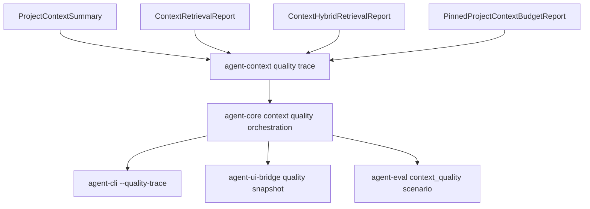

# M58-05 Context Quality Traces and Eval Spec

## Purpose

Add traceable context quality evidence for project context assembly so users and evals can see why selected, pinned, omitted, and budgeted context was considered sufficient for a coding task.

## Product Context

M58-01 through M58-04 added bounded repo summaries, lexical retrieval, optional semantic/hybrid retrieval, and pinned context budget planning. Those slices expose individual selection reports, but the product still needs one quality-oriented view that answers: what signals were used, what was included, what was omitted, whether required pins survived budgeting, and whether a deterministic eval can catch context regressions.

## Scope

This spec delivers:

- typed context quality trace contracts derived from existing project summary, retrieval, hybrid retrieval, and pinned budget reports
- deterministic quality scoring and diagnostic summaries for selected, omitted, pinned, and budgeted context
- prompt-safe trace summaries suitable for CLI/JSON, UI bridge, and eval artifacts
- optional CLI/JSON output for context quality traces without changing default `repo context select` output
- UI bridge snapshot contracts for context quality evidence
- deterministic eval fixture coverage for context selection quality
- default eval suite integration if the fixture is stable and credential-free

Owned by other specs:

- project tree scanning belongs to M58-01
- lexical retrieval scoring belongs to M58-02
- semantic/hybrid scoring belongs to M58-03
- required/optional pin budget behavior belongs to M58-04
- broader daily-driver terminal UX belongs to M59
- Desktop-specific trace visualizations belong to M60

## Architecture

`agent-context` owns quality trace contracts and deterministic quality derivation from existing context reports. It must not scan the filesystem or run providers. `agent-core` owns workspace orchestration helpers that produce quality traces next to lexical, hybrid, or pinned reports. `agent-cli`, `agent-ui-bridge`, and `agent-tui` render typed summaries only. `agent-eval` owns deterministic scenario execution and artifact reporting.



Dependency rules:

- `agent-context` may depend on existing context project, retrieval, semantic, and pin contracts only.
- `agent-core` may compose scan/retrieve/plan helpers and re-export quality contracts.
- `agent-eval` may call `agent-core` with deterministic fixtures, but must not shell out to CLI for core assertions.
- UI crates must not reimplement quality scoring or budget diagnostics.

## File Layout

```text
crates/
  agent-context/
    src/
      quality.rs
      lib.rs
    tests/
      context_quality_traces.rs
  agent-core/
    src/
      project_context.rs
      lib.rs
    tests/
      project_context_quality_traces.rs
  agent-cli/
    src/
      command.rs
    tests/
      project_context_quality_commands.rs
  agent-ui-bridge/
    src/
      frame.rs
      lib.rs
    tests/
      project_context_quality_snapshot.rs
  agent-tui/
    src/
      trace_panel.rs
      transcript.rs
  agent-eval/
    src/
      manifest.rs
      runner.rs
    tests/
      context_quality.rs
docs/
  eval/
    scenarios/
      m58-context-quality.eval.json
    fixtures/
      m58-context-quality-workspace/
    goldens/
      default-m58-context-quality.golden.json
```

Exact module names may change during implementation, but quality derivation must stay in shared runtime/eval crates, not presentation crates.

## Public Contracts

Final names may differ, but the durable shape should support:

```rust
pub struct ContextQualityTrace {
    pub task: String,
    pub workspace_root_display: String,
    pub retrieval_kind: ContextQualityRetrievalKind,
    pub selected_count: u32,
    pub omitted_count: u32,
    pub pinned_included_count: u32,
    pub pinned_omitted_count: u32,
    pub used_tokens: u32,
    pub available_tokens: u32,
    pub budget_pressure: ContextQualityBudgetPressure,
    pub signals: Vec<ContextQualitySignal>,
    pub diagnostics: Vec<ContextQualityDiagnostic>,
}

pub enum ContextQualityRetrievalKind {
    Lexical,
    Hybrid,
    PinnedLexical,
    PinnedHybrid,
}

pub enum ContextQualityBudgetPressure {
    Low,
    Medium,
    High,
    Exhausted,
}

pub struct ContextQualitySignal {
    pub path: Option<String>,
    pub kind: ContextQualitySignalKind,
    pub weight: u32,
    pub message: String,
}

pub enum ContextQualitySignalKind {
    SelectedCandidate,
    OmittedCandidate,
    IncludedRequiredPin,
    IncludedOptionalPin,
    OmittedOptionalPin,
    RetrievalLayerIncluded,
    RetrievalLayerOmitted,
    SemanticCompleted,
    SemanticFallback,
}

pub struct ContextQualityDiagnostic {
    pub severity: ContextQualityDiagnosticSeverity,
    pub code: String,
    pub message: String,
    pub path: Option<String>,
}
```

Eval manifest extensions should remain typed and serde-friendly:

```rust
pub enum EvalScenarioKind {
    ContextQuality,
}

pub struct EvalContextQualityExpectations {
    pub task: String,
    pub required_selected_paths: Vec<String>,
    pub required_pinned_paths: Vec<String>,
    pub max_diagnostics: u32,
    pub require_retrieval_included: bool,
}
```

The implementation may place context-quality expectations inside `EvalExpectations` or a scenario-specific field, but unknown fields must continue to be rejected.

## State and Failure Handling

- Quality traces are derived evidence, not a new source of context truth.
- Empty tasks, invalid workspaces, invalid retrieval settings, or invalid pin budgets fail through existing M58 retrieval errors before quality traces are built.
- Missing expected eval paths fail the context-quality eval with bounded diagnostics.
- Optional omissions may lower quality but must not fail runtime traces unless eval expectations require them.
- Required pin failures remain terminal retrieval errors from M58-04.
- Budget pressure is deterministic from used tokens and available tokens.
- Semantic provider failure inherits M58-03 lexical fallback or fail-closed behavior, then quality traces report the fallback status.
- Quality traces must be stable for the same workspace fixture and task.

## Security and Privacy

- Repository content, task text, pin reasons, diagnostics, and eval manifests are untrusted input.
- Quality traces expose workspace-relative paths, counts, bounded messages, scores, and diagnostics only.
- Quality traces must not expose raw file contents, `.env` values, private keys, token-like text, embedding vectors, raw semantic documents, absolute workspace paths, or provider secrets.
- Eval artifacts must contain redacted summaries and stable metadata, not raw command logs or raw file bodies.
- A quality trace never grants filesystem, command, Git, network, MCP, plugin, browser, Desktop, secret, memory, or scheduler permissions.

## Testing Strategy

- `agent-context` tests for stable serde shape, budget-pressure classification, lexical trace derivation, hybrid trace derivation, pinned trace derivation, signal ordering, and redaction
- `agent-core` tests for lexical, hybrid, pinned lexical, and pinned hybrid orchestration returning quality traces from temp workspaces
- CLI tests for `repo context select --quality-trace` text and JSON output with lexical, hybrid, and pinned modes
- UI bridge tests for stable quality snapshot JSON, single-line frame encoding, bounded signals/diagnostics, and redaction
- TUI reducer tests or existing snapshot updates for the new quality frame
- `agent-eval` tests for manifest validation, context-quality scenario pass/fail behavior, golden comparison, and artifact redaction
- focused commands:

```bash
cargo test -p agent-context --test context_quality_traces
cargo test -p agent-core --test project_context_quality_traces
cargo test -p agent-cli --test project_context_quality_commands
cargo test -p agent-ui-bridge --test project_context_quality_snapshot
cargo test -p agent-eval --test context_quality
cargo xtask eval
cargo clippy -p agent-context -p agent-core -p agent-cli -p agent-ui-bridge -p agent-tui -p agent-eval --all-targets -- -D warnings
```

## Acceptance Criteria

- Context quality traces can be built for lexical, hybrid, pinned lexical, and pinned hybrid context reports.
- Quality traces include selected, omitted, pinned, budget, semantic, and diagnostic evidence without raw secret leakage.
- CLI text/JSON can emit context quality evidence on request without changing default context selection output.
- UI bridge snapshots expose stable, bounded quality summaries.
- A deterministic M58 context-quality eval scenario runs without provider credentials.
- The default eval suite includes M58 context-quality coverage if the scenario remains stable.
- Existing M58 retrieval, semantic, pinned, CLI, and bridge tests continue to pass.

## Completion Signal

M58-05 is complete when quality trace contracts, core orchestration, CLI/bridge evidence, deterministic eval coverage, default-suite integration, focused tests, docs/status updates, and final M58 verification are implemented and committed.
