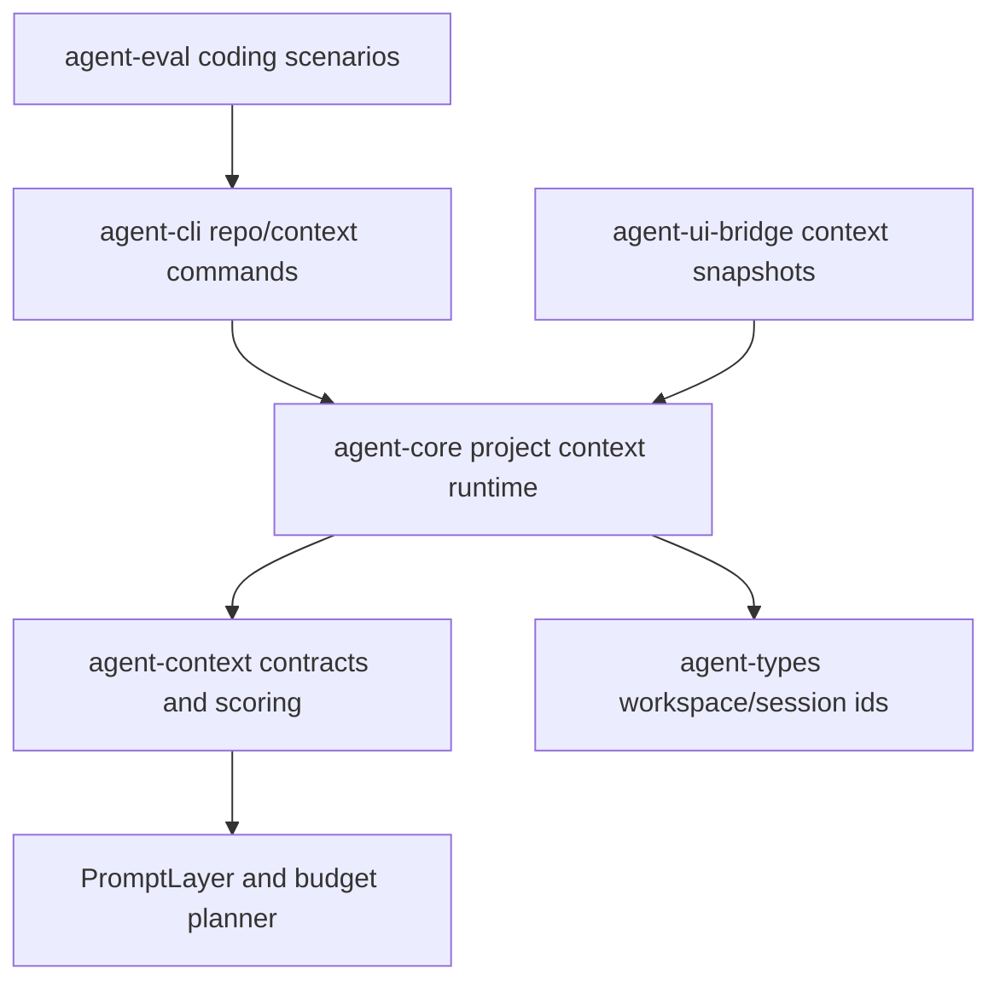

# M58 Project Context Intelligence Spec

## Purpose

Build repo-aware context assembly so coding turns can start with useful project structure, relevant files, pinned user context, and traceable budget decisions instead of relying only on static prompt layers and memory.

## Product Context

M56 proved the deterministic coding-agent golden path and M57 removed provider choice as a blocker. The next product gap is context quality: users expect the agent to understand repository shape, identify likely relevant files, respect pinned context, and explain what was included or omitted before editing code.

## Scope

This spec delivers:

- bounded project file tree and repo map summaries
- relevant-file retrieval using lexical and workspace metadata signals
- semantic or hybrid retrieval when embeddings are configured, with deterministic fixtures
- pinned context contracts and budget planning that integrate with existing prompt layers
- context assembly traces, diagnostics, and eval coverage for coding tasks
- CLI/JSON and UI bridge summaries for context evidence where product workflows need visibility

Owned by other specs:

- model provider capability selection belongs to M57
- terminal daily-driver interaction polish belongs to M59
- Desktop-specific context management UX belongs to M60
- long-term memory review and personalization belongs to M64
- subagent/team context handoff belongs to M63 unless a shared context contract is needed here

## Architecture

`agent-context` owns typed context contracts, prompt-layer conversion, scoring reports, budget decisions, and redacted context snapshots. `agent-core` owns workspace-bound scanning and runtime orchestration because it has the workspace root, policy context, and turn lifecycle. CLI, TUI, and Desktop consume context summaries through `agent-cli` and `agent-ui-bridge`; they must not duplicate project indexing, scoring, or budget logic.



## File Layout

```text
crates/
  agent-context/
    src/
      project.rs
      retrieval.rs
      pins.rs
      quality.rs
    tests/
      project_context_summary.rs
      context_retrieval.rs
      pinned_context_budget.rs
      context_quality_traces.rs
  agent-core/
    src/
      project_context.rs
      context.rs
    tests/
      project_context_scan.rs
      context_assembly_runtime.rs
  agent-cli/
    src/
      command.rs
    tests/
      project_context_commands.rs
  agent-ui-bridge/
    src/
      frame.rs
    tests/
      project_context_snapshot.rs
  agent-eval/
    tests/
      context_quality.rs
docs/
  eval/
    scenarios/
      m58-context-quality.eval.json
```

Exact module names may change by slice, but context logic must remain in shared crates.

## Public Contracts

M58 should extend existing prompt and budget contracts with serde-friendly context contracts. Final names may differ by slice, but the durable shape should support:

```rust
pub struct ProjectContextSummary {
    pub workspace_root_display: String,
    pub files: Vec<ProjectFileSummary>,
    pub directories: Vec<ProjectDirectorySummary>,
    pub diagnostics: Vec<ProjectContextDiagnostic>,
    pub limits: ProjectContextLimits,
}

pub struct ProjectFileSummary {
    pub path: String,
    pub kind: ProjectFileKind,
    pub language: Option<String>,
    pub size_bytes: u64,
    pub line_count: Option<u32>,
    pub token_estimate: u32,
    pub content_hash: Option<String>,
    pub visibility: ProjectContextVisibility,
}

pub struct ContextRetrievalQuery {
    pub task: String,
    pub max_candidates: u32,
    pub budget_tokens: u32,
    pub pinned_paths: Vec<String>,
}

pub struct ContextCandidate {
    pub path: String,
    pub score: u32,
    pub reasons: Vec<ContextSelectionReason>,
    pub token_estimate: u32,
}

pub struct PinnedContextItem {
    pub id: String,
    pub source: PinnedContextSource,
    pub token_estimate: u32,
    pub reason: String,
}

pub struct ContextQualityTrace {
    pub selected_count: u32,
    pub omitted_count: u32,
    pub used_tokens: u32,
    pub diagnostics: Vec<ProjectContextDiagnostic>,
}
```

Context summaries that cross UI, event, or eval boundaries must be serializable, deterministic, bounded, and redacted.

## State and Failure Handling

- Workspace scans are bounded by file count, depth, byte size, and ignored directories.
- Missing or unreadable files produce recoverable diagnostics unless required pinned context cannot be read.
- Binary, oversized, generated, ignored, or secret-like files are summarized as metadata only.
- Retrieval and budget decisions are deterministic for the same workspace snapshot and query.
- Semantic retrieval is optional; when embeddings are unavailable, lexical retrieval remains the supported fallback.
- Context assembly must never silently drop required pinned context; it must either include it or return a diagnostic/error that names the path safely.

## Security and Privacy

- Repository content is untrusted input and must not grant tool, command, Git, network, MCP, plugin, browser, Desktop, or secret permissions.
- Secret values, `.env` content, private keys, credential files, and token-like text must not appear in public diagnostics, UI snapshots, eval artifacts, or prompt summaries.
- Paths in public output should be workspace-relative and normalized.
- Context summaries may include metadata and bounded previews only when visibility permits it.
- File reads should stay within the selected workspace root and respect configured/implicit ignore rules.

## Testing Strategy

- `agent-context` tests for stable serialization, sorting, prompt-layer conversion, scoring reasons, pinned context budget behavior, and redaction
- `agent-core` tests for bounded workspace scans, ignored directories, unreadable/oversized/binary files, and safe diagnostics
- CLI/JSON tests for parseable context summaries and redaction
- UI bridge snapshot tests for stable safe context frames
- eval coverage proving a coding scenario receives relevant context evidence
- focused checks per slice plus final workspace fmt/clippy/test and `cargo xtask eval`

## Acceptance Criteria

- A coding turn can receive project file tree summaries and selected relevant files as typed prompt layers.
- Users can pin context and see whether it was included or why it could not fit.
- Context retrieval works deterministically without provider credentials.
- CLI/JSON and bridge surfaces expose safe context evidence without raw secret leakage.
- Eval coverage proves context quality behavior on at least one deterministic repository fixture.

## Completion Signal

M58 is complete when repo map summaries, relevant-file retrieval, optional semantic/hybrid retrieval, pinned context budget planning, context quality traces, CLI/bridge visibility, and eval coverage are implemented, verified, documented, and committed.
