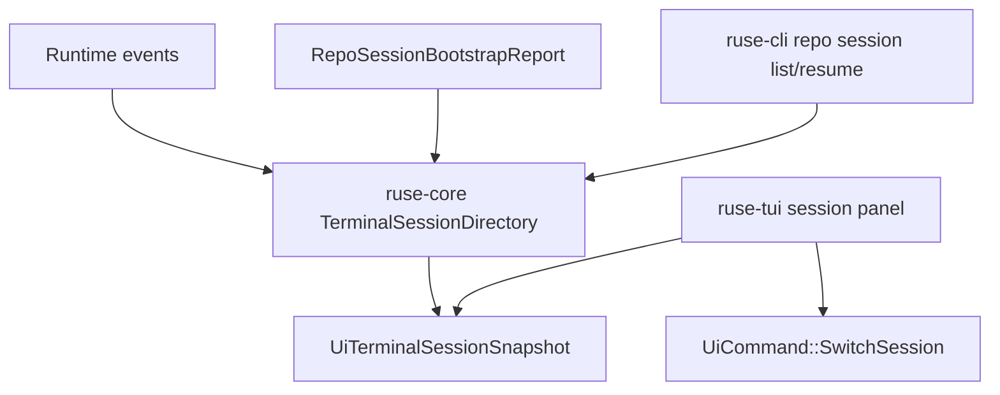

# M59-01 Session Restore and Switch Spec

## Purpose

Add a terminal session directory so users can see recent coding sessions, restore the current workspace/conversation context, and switch TUI focus without starting over. This is the first M59 daily-driver slice because session continuity is the entry point for every other terminal workflow.

## Product Context

M56 repo session bootstrap creates workspace and conversation ids, while M20 introduced TUI state and M58 added useful project context evidence. Users still cannot treat terminal sessions as durable work items: there is no typed list of recent sessions, no safe restore summary, and no shared switch command for CLI/TUI clients.

## Scope

This spec delivers:

- typed terminal session summary contracts derived from runtime session/conversation events and repo session reports
- deterministic session directory reports with sorting, counts, status, and diagnostics
- restore validation for workspace/conversation ids before a UI or CLI targets the session
- CLI text and JSON commands for listing and resuming sessions
- UI bridge snapshot and command support for session directory and switch requests
- TUI session panel state that can reduce snapshots and emit switch effects
- slash command entry point for opening the session panel

Owned by later M59 specs:

- complete slash command catalog belongs to M59-02
- approval queue grouping belongs to M59-03
- diff/command panel navigation and cancellation controls belong to M59-04
- task status recipes and batch docs belong to M59-05

## Architecture

`ruse-core` owns session directory construction and restore validation. It may consume in-memory or durable event-store data through typed inputs. `ruse-storage` owns event access and must not know about terminal rendering. `ruse-ui-bridge` exposes UI-safe session snapshots and switch commands. `ruse-cli` renders text/JSON and maps command-line inputs to core helpers. `ruse-tui` stores only panel state derived from bridge snapshots.



## File Layout

```text
crates/
  ruse-core/
    src/
      terminal_session.rs
      lib.rs
    tests/
      terminal_session_directory.rs
  ruse-ui-bridge/
    src/
      command.rs
      frame.rs
      lib.rs
    tests/
      terminal_session_snapshot.rs
  ruse-cli/
    src/
      command.rs
    tests/
      terminal_session_commands.rs
  ruse-tui/
    src/
      app.rs
      slash.rs
      session_panel.rs
      lib.rs
    tests/
      session_panel.rs
      slash_commands.rs
```

Exact files may be adjusted to fit existing modules, but runtime/session derivation must not be implemented in CLI or TUI renderers.

## Public Contracts

Final names may differ, but the durable shape should support:

```rust
pub struct TerminalSessionDirectoryInput {
    pub records: Vec<TerminalSessionRecord>,
}

pub struct TerminalSessionRecord {
    pub workspace_id: WorkspaceId,
    pub conversation_id: ConversationId,
    pub workspace_root_display: String,
    pub title: String,
    pub client_kind: ClientKind,
    pub client_version: String,
    pub provider_id: String,
    pub model_id: String,
    pub git_state: RepoGitState,
    pub last_event_at: Timestamp,
    pub pending_approval_count: u32,
    pub running_command_count: u32,
    pub task_count: u32,
}

pub struct TerminalSessionSummary {
    pub workspace_id: WorkspaceId,
    pub conversation_id: ConversationId,
    pub workspace_root_display: String,
    pub title: String,
    pub status: TerminalSessionStatus,
    pub last_event_at: Timestamp,
    pub pending_approval_count: u32,
    pub running_command_count: u32,
    pub task_count: u32,
}

pub struct TerminalSessionDirectoryReport {
    pub sessions: Vec<TerminalSessionSummary>,
    pub diagnostics: Vec<TerminalSessionDiagnostic>,
}

pub enum TerminalSessionStatus {
    Idle,
    WaitingApproval,
    RunningCommand,
    HasTasks,
    Failed,
}
```

UI bridge support should include:

```rust
pub struct UiTerminalSessionSnapshot {
    pub sessions: Vec<UiTerminalSessionSummary>,
    pub diagnostics: Vec<UiTerminalSessionDiagnostic>,
}

pub enum UiCommand {
    SwitchSession {
        workspace_id: WorkspaceId,
        conversation_id: ConversationId,
    },
}
```

CLI shape should support:

```text
ruse-cli repo session list [--workspace <path>]
ruse-cli repo session resume --conversation-id <id>
ruse-cli --json repo session list
ruse-cli --json repo session resume --conversation-id <id>
```

If implementation discovers that `repo session` should be renamed to avoid ambiguity, the final command may differ, but it must remain documented, script-safe, and tested.

## State and Failure Handling

- Empty session directories return a successful empty report with no diagnostics.
- Duplicate workspace/conversation records collapse deterministically to the latest record.
- Sessions sort by latest event descending, then workspace display, then conversation id.
- Missing workspace metadata produces a recoverable diagnostic and a redacted placeholder display.
- Invalid restore ids fail with exit code `2` in CLI and a typed error frame in JSON.
- Switch commands validate workspace and conversation ids before changing UI focus.
- Stale sessions are not deleted by this slice; they are marked with diagnostics for later cleanup UX.

## Security and Privacy

- Session summaries must use bounded, redacted workspace display text, titles, diagnostics, provider ids, and model ids.
- Raw prompts, hidden prompt layers, command output, diff contents, secrets, environment values, and raw absolute paths must not appear in public session snapshots.
- Switching sessions does not grant new permissions or bypass approval leases.
- CLI/JSON output must not leak paths from invalid ids or stale records.

## Testing Strategy

- `ruse-core` tests for directory construction, deterministic sorting, status derivation, duplicate collapse, restore validation, and redaction
- `ruse-ui-bridge` tests for stable snapshot JSON, command validation, and bounded diagnostics
- `ruse-cli` tests for text and JSON list/resume commands, invalid id exit behavior, and redaction
- `ruse-tui` tests for session panel snapshot reduction, focus movement, switch effect emission, and slash command opening
- regression tests for existing `repo session` bootstrap behavior

## Acceptance Criteria

- CLI text and JSON can list recent terminal sessions without leaking raw secrets.
- CLI resume validates a conversation id and returns a stable session summary or typed error.
- TUI session panel can display sessions, move focus, and emit a typed switch command.
- Existing repo session bootstrap behavior remains unchanged.
- Focused tests pass for core, bridge, CLI, and TUI session behavior.

## Completion Signal

M59-01 is complete when typed session directory contracts, CLI/JSON list/resume commands, bridge snapshots/commands, TUI session panel state, focused tests, docs/status updates, and a focused verification run are implemented and committed.
