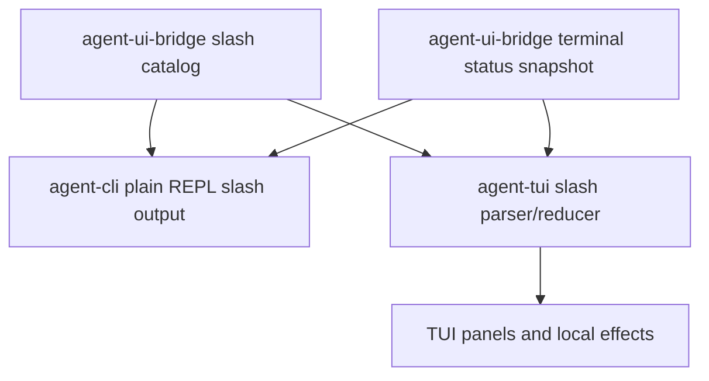

# M59-02 Slash Command Catalog and Status Hub Spec

## Purpose

Make common terminal actions discoverable and consistent across plain REPL and TUI by introducing a typed slash command catalog plus a small status hub snapshot. This slice turns `/help` and `/status` from hard-coded strings into shared UI contracts while keeping command side effects in the owning runtime or UI reducer.

## Product Context

M59-01 added terminal session list/resume/switch contracts. Users can now return to work, but the terminal surfaces still expose different slash command sets and status behavior. M59-02 gives daily-driver users a predictable command catalog, aliases, and status output before later slices add approval, diff, command, and task actions.

## Scope

This spec delivers:

- typed slash command descriptors with names, aliases, categories, availability, and effects
- a deterministic slash command catalog snapshot shared by CLI/plain REPL and TUI tests
- a bounded terminal status snapshot for provider/model/workspace/mode/connection/session counts
- CLI/plain REPL `/help`, `/status`, `/sessions`, `/trace`, `/tasks`, `/clear`, `/quit`, and `/exit` behavior backed by the catalog
- TUI slash parsing and help/status routing backed by the same descriptor semantics
- focused tests for catalog ordering, alias parsing, unknown command errors, status rendering, and redaction

Owned by later specs:

- approval queue commands and batch decisions belong to M59-03
- diff and command/test navigation commands belong to M59-04
- task recipe commands and documented batch scripts belong to M59-05
- user-configurable slash command extensions belong to a later extensibility milestone

## Architecture

`agent-ui-bridge` owns UI-safe catalog and status snapshot contracts. `agent-cli` renders catalog/status text for plain REPL and any CLI slash dispatch. `agent-tui` maps parsed slash commands to reducer effects and panels. Runtime execution, approval decisions, task mutation, and durable session state remain outside the slash parser.



## File Layout

```text
crates/
  agent-ui-bridge/
    src/
      slash.rs
      frame.rs
      lib.rs
    tests/
      slash_catalog.rs
  agent-cli/
    src/
      command.rs
      repl.rs
    tests/
      slash_commands.rs
      plain_repl.rs
  agent-tui/
    src/
      slash.rs
      app.rs
      status_panel.rs
      lib.rs
    tests/
      slash_commands.rs
      status_panel.rs
```

Exact files may change to fit local modules, but command catalog contracts must stay shared and typed.

## Public Contracts

Final names may differ, but the durable/UI-facing shape should support:

```rust
pub struct UiSlashCommandDescriptor {
    pub name: String,
    pub aliases: Vec<String>,
    pub category: UiSlashCommandCategory,
    pub summary: String,
    pub effect: UiSlashCommandEffect,
    pub available_in: Vec<UiSlashCommandSurface>,
}

pub struct UiSlashCommandCatalogSnapshot {
    pub commands: Vec<UiSlashCommandDescriptor>,
}

pub struct UiTerminalStatusSnapshot {
    pub provider: String,
    pub model: String,
    pub workspace: String,
    pub mode: String,
    pub connection: String,
    pub focused_panel: String,
    pub session_count: u32,
    pub diagnostic_count: u32,
}
```

Expected command names:

- `/help`
- `/status`
- `/sessions`
- `/trace`
- `/tasks`
- `/clear`
- `/quit`
- `/exit` as an alias of `/quit` where the surface exits

## State and Failure Handling

- Catalog output is deterministic, sorted by category then command name.
- Unknown slash commands return a typed parse error and do not submit prompts or cause side effects.
- Aliases resolve to the same command effect as their canonical command.
- Status snapshots are successful even when optional runtime details are unavailable; missing values render as bounded placeholders.
- Plain REPL exit commands terminate cleanly with status code `0`.
- TUI slash commands route to local panel effects only; later side-effectful runtime commands must add explicit validation.

## Security and Privacy

- Descriptor summaries and status fields are bounded and redacted before rendering.
- Slash parsing must not expose raw prompt text beyond the command token needed for an error.
- Status output must not include raw absolute paths, environment values, provider credentials, hidden prompt layers, or command output.
- Unknown command handling must not echo unbounded user input.

## Testing Strategy

- `agent-ui-bridge` tests for catalog ordering, JSON shape, alias coverage, status snapshot redaction, and single-line frame encoding
- `agent-cli` tests for `/help`, `/status`, aliases, unknown commands, plain REPL slash handling, and redacted output
- `agent-tui` tests for catalog-backed parsing, `/help`, `/status`, `/sessions`, `/trace`, `/tasks`, `/clear`, `/quit`, and status panel rendering
- regression tests for existing plain REPL prompt submission and exit behavior

## Acceptance Criteria

- Plain REPL and TUI parse the same canonical slash command set and aliases.
- `/help` renders a catalog-derived command list instead of a hard-coded string.
- `/status` renders a bounded status summary in CLI/plain REPL and opens or updates status state in TUI.
- Unknown slash commands are safe, deterministic, and do not submit prompts.
- Existing session, trace, task, clear, and quit behavior remains intact.

## Completion Signal

M59-02 is complete when shared slash catalog/status contracts, CLI/plain REPL rendering, TUI parsing/status state, focused tests, docs/status updates, standard Rust checks, and a focused implementation commit are complete.
