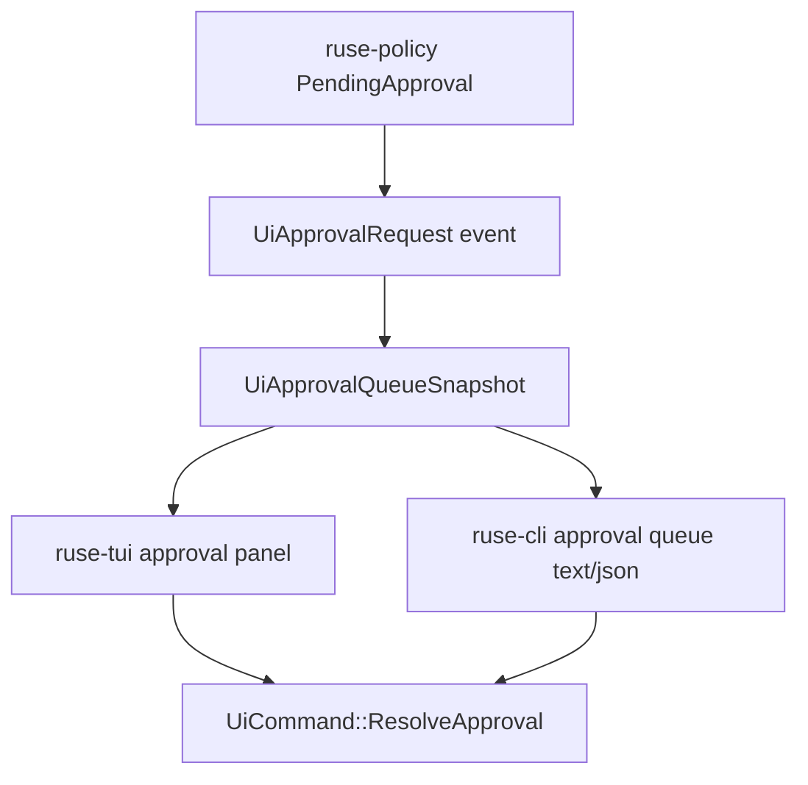

# M59-03 Approval Queue and Permission Review Spec

## Purpose

Make approval review usable as a daily-driver terminal workflow. Users should be able to inspect pending permission requests as a queue, understand the safe preview and lease scope, move focus, allow or deny explicitly, and see typed JSON/TUI state without bypassing policy or approval leases.

## Product Context

M56 introduced approval events and batch approval prompts, while M59-01 and M59-02 made terminal sessions and slash/status commands coherent. The remaining terminal gap is actionable permission review: pending approvals exist as events and TUI state, but there is no typed queue snapshot, no CLI/JSON inspection surface, no grouping/count summary, and limited TUI review metadata for repeated daily use.

## Scope

This spec delivers:

- typed approval queue snapshots derived from UI-safe approval requests/events
- queue summaries grouped by resource kind/action/status with deterministic ordering
- bounded, redacted preview, reason, resource, lease, expiry, and diagnostic fields
- CLI text and JSON approval queue inspection using deterministic fixtures
- TUI approval panel improvements for queue count, grouping metadata, focus movement, allow, deny, abort, expired/resolved removal, and empty state
- bridge JSON frame support for approval queue snapshots
- focused tests for safe rendering, invalid ids, lease duration display, redaction, and action effects

Owned by later specs:

- diff preview navigation and command/test streaming controls belong to M59-04
- stable daily-driver JSON/batch recipes and task status polish belong to M59-05
- durable recovery of approvals after process restart belongs to M62 unless required by this slice tests
- Desktop approval popup UX belongs to M60

## Architecture

`ruse-ui-bridge` owns UI-safe approval queue snapshot contracts because approval requests already cross the UI bridge as normalized events. `ruse-cli` renders text/JSON inspection and uses existing approval command parsing for explicit decisions. `ruse-tui` owns panel focus/rendering and emits existing `UiCommand::ResolveApproval` commands. `ruse-policy` and `ruse-core` remain the source of permission decisions, pending approval records, leases, and approval resolution semantics.



Dependency rules:

- `ruse-ui-bridge` may summarize `UiApprovalRequest` values into queue snapshots.
- `ruse-cli` may render snapshots and convert explicit user input into existing `UiCommand::ResolveApproval`.
- `ruse-tui` may reduce snapshots/events into panel state and emit bridge commands.
- No presentation crate may evaluate policy, mint leases, or mutate approval state directly.

## File Layout

```text
crates/
  ruse-ui-bridge/
    src/
      approval_queue.rs
      frame.rs
      lib.rs
    tests/
      approval_queue_snapshot.rs
  ruse-cli/
    src/
      approval.rs
      command.rs
    tests/
      approval_queue_commands.rs
      approval_prompt.rs
  ruse-tui/
    src/
      approval_panel.rs
      app.rs
      render.rs
    tests/
      approval_panel.rs
```

Exact files may be adjusted to fit local module boundaries, but queue derivation must stay shared and typed.

## Public Contracts

Final names may differ, but the UI-facing shape should support:

```rust
pub struct UiApprovalQueueSnapshot {
    pub pending: Vec<UiApprovalQueueItem>,
    pub groups: Vec<UiApprovalQueueGroup>,
    pub pending_count: u32,
    pub expired_count: u32,
    pub diagnostic_count: u32,
    pub diagnostics: Vec<UiApprovalQueueDiagnostic>,
}

pub struct UiApprovalQueueItem {
    pub request_id: String,
    pub status: String,
    pub action: String,
    pub resource_kind: String,
    pub resource: String,
    pub reason: String,
    pub preview: UiApprovalPreviewSummary,
    pub max_duration_seconds: Option<u64>,
    pub expires_at: Option<Timestamp>,
}

pub struct UiApprovalQueueGroup {
    pub resource_kind: String,
    pub action: String,
    pub status: String,
    pub count: u32,
}
```

Existing command contract remains:

```rust
UiCommand::ResolveApproval {
    request_id: ApprovalRequestId,
    decision: UiApprovalDecision,
    reason: String,
    lease_duration_seconds: Option<u64>,
}
```

CLI shape should support:

```text
ruse-cli approval queue [--fixture empty|sample|expired]
ruse-cli --json approval queue [--fixture empty|sample|expired]
```

## State and Failure Handling

- Empty queues return success with zero counts and no diagnostics.
- Duplicate request ids collapse to the latest request deterministically.
- Resolved, cancelled, expired, or consumed events remove items from pending queue state.
- Expired items are counted and omitted from actionable pending lists unless represented through a diagnostic fixture.
- Invalid approval request ids fail before emitting `ResolveApproval`.
- Deny requires a non-empty reason.
- Allow may include a bounded lease duration no greater than the request maximum when a maximum is present.
- Queue ordering is deterministic: status, resource kind, action, resource, request id.

## Security and Privacy

- Queue snapshots must bound and redact request ids only for malformed public diagnostics, action, resource kind, resource, reason, preview summary/resource, and diagnostic messages.
- Raw command output, diff content, hidden prompt layers, environment values, and secrets must not appear in queue snapshots.
- Approval queue inspection is read-only.
- Allow/deny commands must use existing typed bridge command validation and must not bypass policy, sandboxing, audit, or approval lease checks.

## Testing Strategy

- `ruse-ui-bridge` tests for snapshot derivation, grouping, duplicate collapse, redaction, expiration metadata, and JSON frame shape
- `ruse-cli` tests for text/JSON queue inspection, empty/sample/expired fixtures, stable exit codes, redaction, and existing approval prompt command conversion
- `ruse-tui` tests for snapshot reduction, event reduction, focus movement, allow/deny/abort effects, empty queue rendering, resolved/expired removal, and grouped render text
- regression tests for existing approval prompt and approval bridge behavior

## Acceptance Criteria

- CLI text and JSON can inspect pending approvals without leaking raw secrets.
- TUI approval panel displays queue count, focus, safe preview, lease duration, and redaction state.
- TUI allow/deny still emit typed `UiCommand::ResolveApproval` commands using validated ids.
- Resolved/expired/cancelled approvals leave actionable pending state.
- Existing approval prompt and approval bridge tests continue to pass.

## Completion Signal

M59-03 is complete when typed approval queue snapshots, CLI/JSON queue inspection, TUI approval queue improvements, focused tests, docs/status updates, standard Rust checks, and a focused implementation commit are complete.
