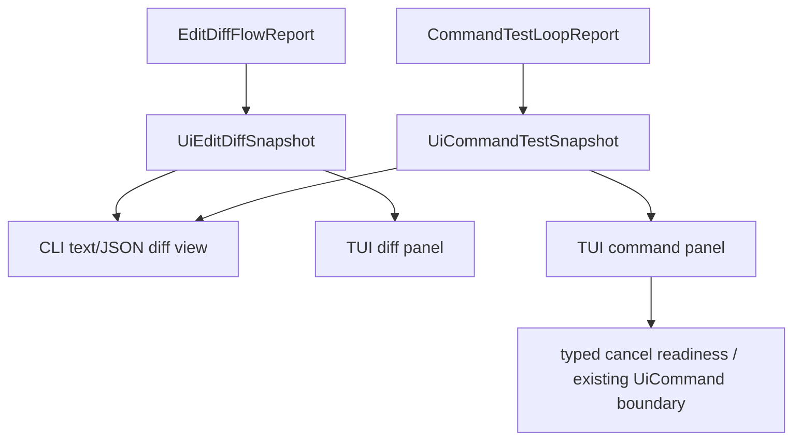

# M59-04 Diff Viewer and Command Streaming Controls Spec

## Purpose

Make diff review and command/test monitoring usable in the daily terminal coding loop. Users should be able to inspect bounded edit diffs, see command/test state and output evidence, understand whether cancellation is available, and navigate repeated output without depending on hidden commands or raw runtime logs.

## Product Context

M56 added deterministic edit/diff and command/test reports. M59-01 through M59-03 made terminal sessions, slash/status commands, and approval review daily-driver capable. The remaining coding-loop gap is review ergonomics: diffs and command output already cross the bridge as snapshots, but the CLI/TUI presentation is shallow and does not expose enough structured state for repeated inspection, focused navigation, streaming-like chunks, or cancellation readiness.

## Scope

This spec delivers:

- typed UI-safe diff review metadata derived from existing edit/diff reports
- typed UI-safe command/test output chunks and status metadata derived from existing command/test reports
- CLI text and JSON inspection improvements for diff and command/test snapshots
- TUI diff panel navigation over changed files and bounded preview lines
- TUI command panel status rendering for waiting, running, completed, failed, timed out, and cancellation-ready states
- visible cancellation readiness without implementing a new destructive cancel path in presentation crates
- focused tests for bounded output, redaction, navigation, status rendering, and JSON frame stability

Owned by later specs:

- task status and JSON/batch recipe documentation belongs to M59-05
- full turn/task cancellation UX, retry after failed commands, and crash recovery belong to M62 unless required by existing contracts
- Desktop visual diff review belongs to M60
- plan/todo integration for command verification steps belongs to M61

## Architecture

`ruse-core` remains the source of edit/diff and command/test reports. `ruse-ui-bridge` owns UI-safe snapshot contracts and any derived chunks or summary metadata. `ruse-cli` renders text and JSON views from those contracts. `ruse-tui` owns panel state, focus, navigation, and rendering. Presentation crates must not execute commands, evaluate policy, mutate files, or cancel runtime work except through existing typed commands.



Dependency rules:

- `ruse-core` may classify command/test status, failure class, cancellation state, and diff evidence.
- `ruse-ui-bridge` may bound, redact, chunk, count, and summarize reports for UI use.
- `ruse-cli` and `ruse-tui` may render bridge snapshots and emit existing typed UI commands only.
- No UI crate may infer policy, run shell commands directly, apply diffs directly, or synthesize secret-bearing output.

## File Layout

```text
crates/
  ruse-ui-bridge/
    src/
      frame.rs
    tests/
      edit_diff_snapshot.rs
      command_test_snapshot.rs
  ruse-cli/
    src/
      command.rs
    tests/
      edit_diff_flow.rs
      command_test_loop.rs
  ruse-tui/
    src/
      app.rs
      diff_panel.rs
      command_panel.rs
      render.rs
    tests/
      diff_panel.rs
      command_panel.rs
```

Exact implementation files may differ if the existing modules are split, but ownership must remain aligned with shared bridge contracts.

## Public Contracts

Existing snapshots remain the base contracts:

```rust
pub struct UiEditDiffSnapshot {
    pub path: String,
    pub applied: bool,
    pub diff_state: String,
    pub changed_files: Vec<String>,
    pub changed_file_count: u32,
    pub diff_line_count: u32,
    pub added_line_count: u32,
    pub removed_line_count: u32,
    pub resource: String,
    pub summary: String,
    pub content_hash: Option<String>,
    pub diff_preview: String,
    pub truncated: bool,
    pub redacted: bool,
    pub diagnostic_count: u32,
}

pub struct UiCommandTestSnapshot {
    pub command: String,
    pub cwd: String,
    pub classify_as_test: bool,
    pub status: String,
    pub classification: String,
    pub exit_code: Option<i32>,
    pub stdout: String,
    pub stderr: String,
    pub stdout_byte_count: u64,
    pub stderr_byte_count: u64,
    pub timed_out: bool,
    pub cancellable: bool,
    pub cancellation_reason: String,
    pub observation: String,
    pub truncated: bool,
    pub redacted: bool,
    pub diagnostic_count: u32,
}
```

M59-04 may add derived UI fields such as file summaries, preview chunks, active chunk index, output stream labels, or line counts if they are typed, serde-friendly, deterministic, bounded, and redacted.

CLI behavior should remain compatible with:

```text
ruse-cli repo edit ...
ruse-cli --json repo edit ...
ruse-cli repo command ...
ruse-cli --json repo command ...
```

TUI behavior should reduce `UiJsonFrame::EditDiffSnapshot` and `UiJsonFrame::CommandTestSnapshot` into panel state.

## State and Failure Handling

- Empty diffs render an explicit no-change state.
- Applied and preview-only diffs remain distinguishable.
- Large diffs and command outputs are bounded and marked truncated.
- Secret-like diff or command text is redacted before rendering.
- Command status supports waiting, running, succeeded, failed, timed out, and cancelled-like terminal states when represented by current reports.
- Cancellation readiness is displayed from bridge snapshot fields; unavailable cancellation includes a reason.
- Navigation on empty diff/output state is a no-op with deterministic state.
- Invalid workspaces, paths, commands, or cwd values continue to fail through existing CLI/runtime validation with stable exit codes.

## Security and Privacy

- Diffs and command output are untrusted and must be bounded and redacted before crossing UI/JSON boundaries.
- UI surfaces must not expose raw environment values, hidden prompt layers, provider credentials, or unbounded stdout/stderr.
- CLI/TUI cancellation controls must not bypass policy, sandboxing, audit, runtime cancellation tokens, or task ownership checks.
- File paths and command displays are public UI text and must be sanitized consistently with existing bridge helpers.

## Testing Strategy

- `ruse-ui-bridge` tests for diff/command snapshot JSON shape, chunk/count metadata if added, redaction, truncation, and single-line frame encoding
- `ruse-cli` tests for text/JSON diff and command views, stable status/cancellation labels, redaction, and existing exit-code behavior
- `ruse-tui` tests for diff panel snapshot reduction, file/line navigation, empty-state rendering, command panel status rendering, cancellation readiness, output truncation, and redaction
- focused gates for the touched crates plus the standard workspace fmt/clippy/test commands before implementation commit

## Acceptance Criteria

- CLI and JSON diff/command views expose bounded, redacted, stable evidence for daily coding-loop review.
- TUI diff panel can be rebuilt from bridge snapshots and supports deterministic navigation over available preview evidence.
- TUI command panel displays command status, classification, exit/timed-out state, output evidence, and cancellation readiness.
- No presentation crate executes commands, applies diffs, or evaluates policy directly.
- Existing M56 edit/diff and command/test runtime tests continue to pass.

## Completion Signal

M59-04 is complete when diff and command/test bridge snapshots, CLI rendering, TUI panels, focused tests, docs/status updates, standard Rust checks, and a focused implementation commit are complete.
