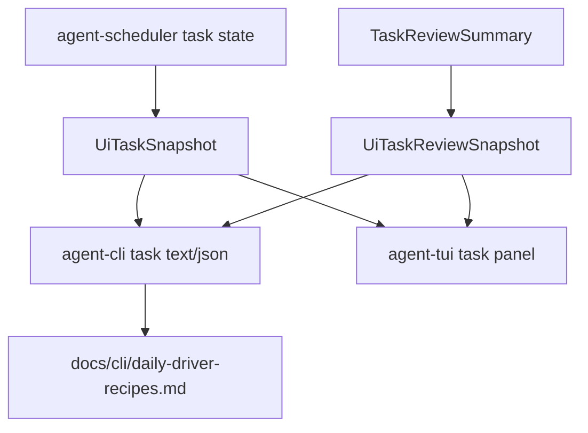

# M59-05 Task Status and JSON/Batch Recipes Spec

## Purpose

Finish M59 by making task status and scripted terminal workflows usable as daily-driver surfaces. Users should be able to inspect queued, running, waiting-approval, completed, failed, paused, and cancelled task state from CLI/JSON and TUI, and follow documented credential-free recipes that exercise the terminal coding loop without relying on hidden command combinations.

## Product Context

M59-01 through M59-04 completed session restore/switch, slash/status discovery, approval queue review, diff review, and command/test panels. Task status and stable recipes are the remaining M59 acceptance items. Existing task commands and TUI task notifications work, but they need clearer status summaries, deterministic JSON/batch examples, and a documented smoke path that ties the daily-driver terminal workflows together.

## Scope

This spec delivers:

- task status panel polish for queued, running, waiting-approval, paused, succeeded, failed, cancelled, and review states
- CLI text and JSON task output improvements using existing typed task snapshots and review summaries
- deterministic daily-driver recipe documentation under `docs/cli/`
- CLI recipe/smoke tests that parse or execute credential-free commands using fixture data
- status updates and final M59 verification, including `cargo xtask eval`

Owned by later specs:

- interactive plan/todo/task authoring semantics belong to M61
- crash recovery, replay/fork UX, failed-command retry, and task recovery productization belong to M62
- Desktop task monitor/log UI belongs to M60
- background notification delivery beyond local terminal state belongs to M61/M62 depending on runtime needs

## Architecture

`agent-scheduler` owns task state transitions and durable task semantics. `agent-core` may produce task review summaries and background task evidence. `agent-ui-bridge` owns UI-safe task snapshots and review snapshots. `agent-cli` renders task commands and documents stable recipes. `agent-tui` owns task panel state and rendering. Recipe tests must use deterministic fixtures or local temporary workspaces, not live providers or network access.



Dependency rules:

- Scheduler/core crates own task state and review semantics.
- UI bridge may bound, redact, sort, count, and summarize task data.
- CLI/TUI may render task snapshots, reviews, and notifications but must not mutate scheduler state except through existing typed task commands.
- Recipes must be reproducible in a local checkout without provider credentials.

## File Layout

```text
crates/
  agent-ui-bridge/
    src/
      frame.rs
    tests/
      task_command_bridge.rs
      task_review.rs
  agent-cli/
    src/
      command.rs
    tests/
      task_commands.rs
      daily_driver_recipes.rs
  agent-tui/
    src/
      task_panel.rs
      render.rs
    tests/
      task_panel.rs
docs/
  cli/
    daily-driver-recipes.md
```

Exact files may be adjusted to fit existing modules, but task semantics must remain in scheduler/core and UI state/rendering must consume typed bridge contracts.

## Public Contracts

Existing task-facing contracts remain the base:

```rust
pub struct UiTaskSnapshot {
    pub tasks: Vec<UiTaskSummary>,
    pub errors: Vec<UiTaskCommandError>,
}

pub struct UiTaskSummary {
    pub task_id: TaskId,
    pub state: TaskState,
    pub prompt_summary: String,
    pub priority: String,
    pub schedule: UiTaskScheduleSummary,
    pub approval_id: Option<ApprovalRequestId>,
}

pub struct UiTaskReviewSnapshot {
    pub reviews: Vec<UiTaskReviewSummary>,
    pub diagnostics: Vec<UiTaskReviewDiagnostic>,
}
```

CLI task commands should remain compatible with:

```text
agent-cli task create --prompt <text>
agent-cli task list
agent-cli task inspect <task-id>
agent-cli task pause <task-id> --reason <text>
agent-cli task resume <task-id> --reason <text>
agent-cli task cancel <task-id> --reason <text>
agent-cli --json task ...
```

Recipe docs should include stable command blocks for session/status, approval queue fixture inspection, repo edit preview, repo command/test, task lifecycle, and default eval.

## State and Failure Handling

- Empty task lists render an explicit empty state with success status.
- Missing task ids return stable validation/runtime errors and JSON error snapshots.
- Task summaries preserve state, priority, schedule, prompt summary, and approval id when present.
- Task reviews preserve final state, artifact count, trace/checkpoint ids, diagnostics, and redacted artifact summaries.
- TUI task panel remains bounded and can rebuild from task snapshots, review snapshots, and task notification events.
- Recipe commands must avoid destructive writes unless they create and use a temporary workspace or explicitly run preview mode.

## Security and Privacy

- Prompt summaries, task reasons, artifact summaries, diagnostics, and recipe output must be bounded and redacted.
- Recipe docs must not instruct users to paste provider secrets or depend on ambient secret values.
- Task pause/resume/cancel actions must keep using scheduler command validation and must not bypass task ownership, leases, or audit paths.
- JSON recipes must remain parseable NDJSON where applicable and must not expose raw command output beyond existing bounded snapshots.

## Testing Strategy

- `agent-ui-bridge` tests for task snapshot/review JSON shape, redaction, error snapshots, and stable ordering if changed
- `agent-cli` tests for task lifecycle text/JSON output, missing-task errors, redaction, and documented recipe command parsing/execution
- `agent-tui` tests for task panel snapshot reduction, review rendering, notification bounds, approval id display, empty state, and state grouping/counts if added
- docs/recipe tests that verify every documented command is either parseable or covered by a deterministic fixture path
- final M59 gates: `cargo fmt --all -- --check`, `cargo clippy --workspace --all-targets -- -D warnings`, `cargo test --workspace`, and `cargo xtask eval`

## Acceptance Criteria

- CLI and JSON task surfaces expose bounded, redacted, stable task status and review evidence.
- TUI task panel displays task status, reviews, notifications, approval waits, and empty state clearly from bridge frames.
- `docs/cli/daily-driver-recipes.md` documents credential-free terminal workflows for the completed M59 daily-driver surfaces.
- Recipe tests prove documented commands remain parseable or executable through deterministic local fixtures.
- M59 final verification gates pass, including `cargo xtask eval`.

## Completion Signal

M59-05 and M59 are complete when task status polish, daily-driver recipe docs/tests, final M59 status updates, standard Rust checks, `cargo xtask eval`, and focused commits are complete.
