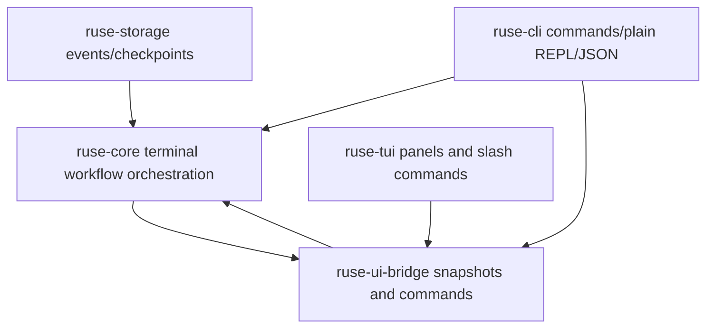

# M59 CLI/TUI Daily Driver Spec

## Purpose

Turn terminal use from a collection of working commands into a daily-driver developer workflow. M59 should make CLI, plain REPL, JSON, and TUI surfaces coherent for returning to work, issuing common slash commands, reviewing approvals and diffs, monitoring commands and tasks, and scripting stable recipes.

## Product Context

M56 proved the local coding-agent golden path, M57 made provider choice product-ready, and M58 added project context intelligence. The remaining terminal product gap is workflow ergonomics: a developer should be able to start `agent`, restore or switch sessions, inspect current status, approve or deny queued actions, review diffs, watch command/test execution, and use JSON/batch modes without hidden behavior or presentation-specific runtime logic.

## Scope

This spec delivers:

- terminal session directory, restore, and switch workflows across CLI and TUI
- slash command catalog and status hub for common terminal actions
- approval queue improvements with safe previews, focus movement, batch review, and explicit decisions
- diff viewer and command/test panel improvements for repeated coding-loop use
- command streaming and cancellation readiness surfaced consistently in CLI/JSON/TUI
- task status panel improvements for queued, running, waiting-approval, completed, and failed work
- stable JSON and batch recipes for the daily-driver workflows
- redacted terminal docs and examples that can be used as smoke scripts

Owned by other specs:

- Desktop-specific daily-driver screens belong to M60
- plan/todo/task authoring semantics beyond terminal presentation belong to M61
- crash recovery, replay/fork UX, and failed-command retry productization belong to M62
- worktree/subagent team flows belong to M63
- memory review and personalization belong to M64
- packaging and installer polish belong to M65
- extension/MCP management polish belongs to M66 unless needed by a terminal daily-driver path

## Architecture

Runtime truth stays in shared crates. `ruse-core` owns session and workflow orchestration; `ruse-storage` owns durable event/checkpoint access; `ruse-ui-bridge` owns UI-safe commands and snapshots; `ruse-cli` owns argument parsing, text/JSON rendering, batch recipes, and plain REPL dispatch; `ruse-tui` owns Ratatui state and rendering. TUI and CLI must consume typed bridge/core contracts rather than rebuilding runtime state from ad hoc strings.



Dependency rules:

- `ruse-core` may compose storage, scheduler, policy, command/test, repo session, and final-review contracts.
- `ruse-ui-bridge` may summarize core/runtime reports into UI-safe snapshots and command envelopes.
- `ruse-cli` and `ruse-tui` must not own durable session state, command policy, approval semantics, or task execution.
- Daily-driver behavior must remain available in deterministic fixture or fake-provider paths without live provider credentials.

## File Layout

```text
crates/
  ruse-core/
    src/
      terminal_session.rs
      repo_session.rs
    tests/
      terminal_session_directory.rs
  ruse-storage/
    src/
      event_store.rs
      sqlite.rs
      memory.rs
    tests/
      event_store.rs
  ruse-ui-bridge/
    src/
      command.rs
      frame.rs
    tests/
      terminal_session_snapshot.rs
  ruse-cli/
    src/
      command.rs
      repl.rs
    tests/
      terminal_session_commands.rs
      daily_driver_recipes.rs
  ruse-tui/
    src/
      slash.rs
      app.rs
      session_panel.rs
      approval_panel.rs
      diff_panel.rs
      command_panel.rs
      task_panel.rs
    tests/
      session_panel.rs
      slash_commands.rs
      approval_panel.rs
      command_panel.rs
docs/
  cli/
    daily-driver-recipes.md
```

Exact module names may change during implementation, but ownership must stay aligned with crate boundaries.

## Public Contracts

Final names may differ by slice, but M59 should support typed contracts like:

```rust
pub struct TerminalSessionSummary {
    pub workspace_id: WorkspaceId,
    pub conversation_id: ConversationId,
    pub workspace_root_display: String,
    pub title: String,
    pub client_kind: ClientKind,
    pub provider_id: String,
    pub model_id: String,
    pub git_state: RepoGitState,
    pub status: TerminalSessionStatus,
    pub last_event_at: Timestamp,
    pub pending_approval_count: u32,
    pub running_command_count: u32,
    pub task_count: u32,
}

pub enum TerminalSessionStatus {
    Active,
    Idle,
    WaitingApproval,
    RunningCommand,
    Failed,
    Archived,
}

pub struct TerminalSessionDirectoryReport {
    pub sessions: Vec<TerminalSessionSummary>,
    pub diagnostics: Vec<TerminalWorkflowDiagnostic>,
}

pub enum UiCommand {
    SwitchSession {
        workspace_id: WorkspaceId,
        conversation_id: ConversationId,
    },
}
```

Slash commands should be discoverable through a typed catalog rather than hard-coded help text only:

```rust
pub struct SlashCommandDescriptor {
    pub name: String,
    pub aliases: Vec<String>,
    pub category: SlashCommandCategory,
    pub effect: SlashCommandEffect,
}
```

All JSON and bridge-facing contracts must be serde-friendly, deterministic, bounded, and redacted.

## State and Failure Handling

- Missing, deleted, or unreadable workspaces produce recoverable diagnostics in session lists and terminal panels.
- Invalid workspace, conversation, task, approval, or turn ids fail before side effects.
- Session switch changes the UI target only after the target session is validated.
- Approval and cancellation actions are disabled when the relevant request, command, task, or turn has expired or resolved.
- Command/test cancellation readiness is visible before cancellation is implemented as a destructive side effect.
- JSON/batch commands keep stable exit codes: validation/user input errors exit `2`, runtime failures exit non-zero with typed error frames, and successful no-op lists exit `0`.
- TUI panel state is derived from snapshots/events and can be rebuilt after reconnect.

## Security and Privacy

- Terminal surfaces must not expose secret values, hidden prompt layers, raw provider credentials, raw environment values, or unbounded command output.
- Session lists show safe workspace display names and ids, not arbitrary raw paths from untrusted events.
- Approval previews, diffs, command output, task summaries, and diagnostics are bounded and redacted before crossing UI or JSON boundaries.
- TUI keybindings for side effects require focused explicit actions; slash commands must not bypass policy, sandbox, approval, or audit paths.
- Batch recipes must avoid commands that rely on ambient secrets or network access.

## Testing Strategy

- `ruse-core` tests for terminal session directory derivation, status classification, sorting, stale workspace diagnostics, and redaction
- `ruse-ui-bridge` tests for session, approval queue, command, diff, and task snapshot JSON shape
- `ruse-cli` tests for text/JSON session commands, daily-driver recipes, stable exit codes, and redaction
- `ruse-tui` state tests for slash command catalog, session panel, approval queue focus/actions, diff navigation, command panel status, and task panel rendering
- eval or smoke coverage that runs a credential-free terminal daily-driver path over the default fixture set
- final gates: `cargo fmt --all -- --check`, `cargo clippy --workspace --all-targets -- -D warnings`, `cargo test --workspace`, and `cargo xtask eval`

## Acceptance Criteria

- A developer can list, restore, and switch recent terminal sessions from CLI/JSON and TUI state.
- Common slash commands are discoverable, tested, and consistent between TUI and plain terminal surfaces where applicable.
- Approval queue, diff, command/test, and task panels expose actionable, bounded, redacted evidence.
- JSON and batch recipes cover the daily-driver workflows without relying on undocumented command combinations.
- Terminal behavior remains backed by shared runtime and bridge contracts, not duplicated presentation logic.
- Existing M56-M58 default eval coverage continues to pass.

## Completion Signal

M59 is complete when session restore/switch, slash command catalog, approval queue, diff and command panels, task status, JSON/batch recipes, docs, focused tests, workspace gates, and `cargo xtask eval` are implemented, verified, documented, and committed.
