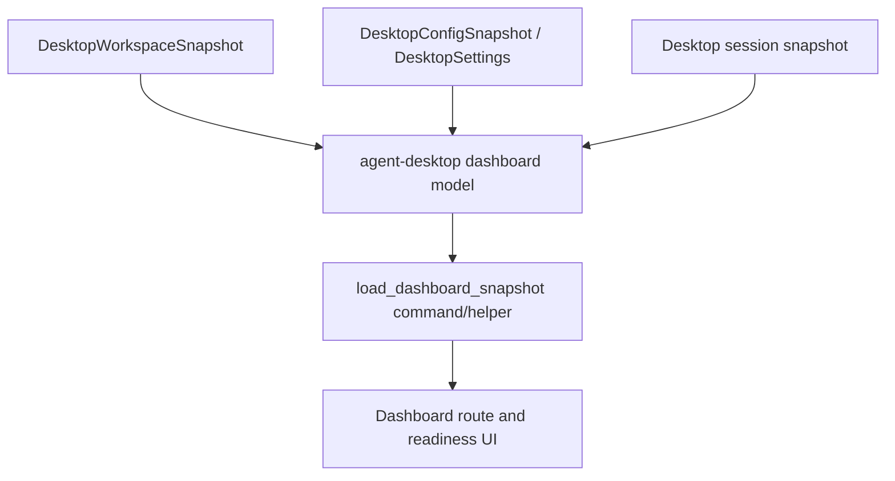

# M60-01 Workspace Dashboard and Session Readiness Spec

## Purpose

Define the Desktop workspace dashboard and session readiness slice for M60. This slice gives Desktop a first-screen product surface that summarizes runtime state, workspace/session identity, provider readiness, task state counts, pending approvals, and safe diagnostics before deeper conversation, approval, diff, and task workflows are implemented.

## Product Context

M21 delivered a runnable Desktop MVP, and M60 elevates it into a daily-driver interface. The current app opens directly into conversation and shows runtime details in a side panel. M60-01 adds a dashboard/readiness layer so users can understand whether the Desktop session is connected, which workspace/runtime context is active, and what requires attention.

This slice supports the M60 Desktop Daily Driver milestone and prepares later M60 slices for composer/transcript, approval/diff, provider/task/log, and Desktop smoke flows.

## Scope

This spec delivers:

- typed Desktop dashboard snapshot derived from existing workspace/session/provider/task inputs
- session readiness state for not-started, connecting, connected, disconnected, and blocked Desktop bridge states
- safe workspace display metadata, including workspace id and optional display root
- task counts grouped by active, waiting approval, failed, and terminal states
- pending approval count supplied through a UI-safe input boundary
- provider/model readiness summary derived from settings/config snapshots
- bounded dashboard diagnostics with severity, code, message, and truncation flag
- Dashboard route/navigation state in Desktop contracts and React shell
- Tauri helper for building an empty or current dashboard snapshot from the active bridge session
- focused Rust, Tauri, and frontend tests for serialization, sorting/counts, redaction, and disconnected/error states

Owned by later M60 slices:

- frame-driven transcript updates and turn submission belong to M60-02
- approval decision controls and visual diff review belong to M60-03
- full provider settings editing, task monitor details, logs, and trace polish belong to M60-04
- Desktop golden-path smoke docs and final gate wiring belong to M60-05

## Architecture

`agent-desktop` owns the dashboard view model and pure aggregation helpers. `agent-ui-bridge` remains the owner of shared UI command/frame contracts. Tauri commands call the Desktop view-model helpers and current bridge session state. React renders the dashboard and route state from typed API responses and local UI state only.



Dependency rules:

- dashboard counts are pure view-model aggregation, not scheduler/runtime ownership
- Tauri may adapt active bridge/session state into the dashboard model but must not own runtime policy or task semantics
- React must not infer task lifecycle or provider capability from raw strings beyond typed enum/display fields
- diagnostics are bounded and redacted before crossing the Tauri boundary

## File Layout

```text
crates/
  agent-desktop/
    src/
      dashboard.rs
      lib.rs
      session.rs
      snapshot.rs
      settings.rs
    tests/
      desktop_dashboard.rs
apps/
  desktop/
    src/
      App.tsx
      app.css
      api.ts
      types.ts
      components/
        WorkspaceDashboard.tsx
      __tests__/
        workspace-dashboard.test.tsx
    src-tauri/
      src/
        commands.rs
        dashboard.rs
        lib.rs
        state.rs
        tests/
          dashboard.rs
docs/
  milestones/
    README.md
  plans/
    M60-desktop-daily-driver.plan.md
```

Exact filenames can change if implementation finds a better local fit, but the public model should stay in `agent-desktop` and the UI command surface should stay typed.

## Public Contracts

M60-01 should add or equivalent typed contracts like:

```rust
pub struct DesktopDashboardSnapshot {
    pub workspace_id: WorkspaceId,
    pub workspace_root_display: Option<String>,
    pub session: DesktopSessionReadiness,
    pub provider: DesktopProviderReadiness,
    pub task_counts: DesktopTaskCounts,
    pub pending_approval_count: u32,
    pub diagnostics: Vec<DesktopDashboardDiagnostic>,
}

pub struct DesktopSessionReadiness {
    pub state: DesktopSessionReadinessState,
    pub session_id: Option<SessionId>,
    pub conversation_id: Option<ConversationId>,
    pub pending_frame_count: u32,
}

#[serde(rename_all = "snake_case")]
pub enum DesktopSessionReadinessState {
    NotStarted,
    Connecting,
    Connected,
    Disconnected,
    Blocked,
}

pub struct DesktopTaskCounts {
    pub total: u32,
    pub active: u32,
    pub waiting_approval: u32,
    pub failed: u32,
    pub terminal: u32,
}

pub struct DesktopProviderReadiness {
    pub provider_id: String,
    pub model_id: String,
    pub enabled: bool,
    pub diagnostic_count: u32,
}

pub struct DesktopDashboardDiagnostic {
    pub severity: DesktopDashboardSeverity,
    pub code: String,
    pub message: String,
    pub truncated: bool,
}
```

All contracts must derive or map cleanly to `Serialize` and `Deserialize`. Workspace display values, diagnostic text, provider ids, and model ids must be normalized, bounded, and secret-redacted.

## State and Failure Handling

- If no session is started, the dashboard returns `not_started` readiness with no session/conversation ids and disabled primary actions.
- Connecting, disconnected, and blocked states are represented explicitly and render recoverable diagnostics.
- Empty workspaces are valid and show zero counts.
- Task counts are computed from typed `TaskState` values and never from display text.
- Missing provider config produces disabled readiness plus diagnostics rather than a panic.
- Invalid, empty, or secret-like diagnostic fields are rejected, redacted, or bounded before serialization.
- Repeated dashboard loads are read-only and idempotent.

## Security and Privacy

- The dashboard does not expose raw prompts, hidden prompt layers, tool input JSON, command output, raw diffs, environment variables, or secret values.
- Workspace paths are optional display labels and do not broaden filesystem policy.
- Provider readiness exposes provider/model ids and diagnostics only, never credentials.
- Diagnostics are bounded and redacted before crossing into TypeScript.
- Dashboard actions only navigate or request typed bridge operations; they do not bypass policy, approval, sandbox, or audit.

## Testing Strategy

- `agent-desktop` tests for dashboard serialization, task count grouping, provider readiness, disconnected/not-started states, diagnostic bounding, and redaction
- Tauri tests for dashboard helper output from a new, connected, and disconnected bridge session
- Vitest component tests for dashboard route rendering, action disabled states, counts, diagnostics, and safe provider display
- regression assertions that serialized dashboard JSON excludes raw prompt, tool input, command output, and secret-like values

Focused commands:

```bash
cargo test -p agent-desktop --test desktop_dashboard
cargo test --manifest-path apps/desktop/src-tauri/Cargo.toml dashboard
npm --prefix apps/desktop test -- workspace-dashboard
```

## Acceptance Criteria

- Desktop exposes a dashboard route that can be the first user-visible workspace surface.
- Dashboard state is derived from typed Desktop/session/workspace/provider inputs.
- Runtime readiness, provider readiness, task counts, pending approvals, and diagnostics are visible and bounded.
- Empty, disconnected, and invalid-input states are handled with typed recoverable diagnostics.
- No raw secrets, prompt text, tool input, command output, or unbounded paths are serialized to the dashboard.
- Focused Rust, Tauri, and frontend tests pass.

## Completion Signal

M60-01 is complete when the dashboard/readiness contracts, Tauri helper, React route, styles, focused tests, M60 plan status, milestone index updates, and exact-path commit are finished.
