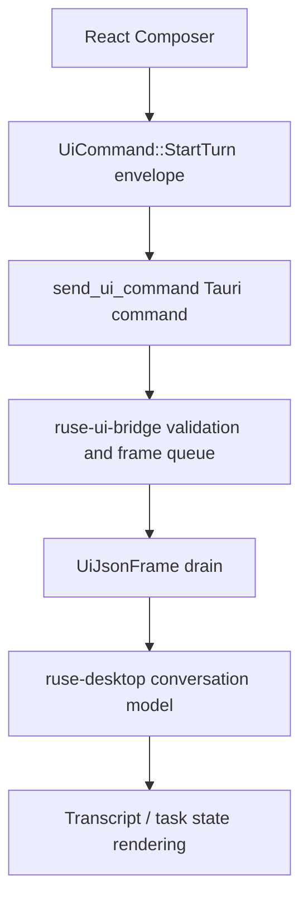

# M60-02 Conversation, Composer, and Transcript Flow Spec

## Purpose

Define the Desktop conversation slice for M60. This slice connects the composer to typed bridge turn submission, drains bounded UI frames into a transcript, surfaces command acknowledgements, and shows recoverable bridge errors without moving runtime behavior into the React app or Tauri presentation layer.

## Product Context

M60-01 made Desktop open on a typed dashboard/readiness surface. M60-02 adds the first interactive daily-driver loop: a user can open the conversation route, submit a prompt for the active workspace conversation, see the submitted prompt and bridge acknowledgement, and watch typed frames become transcript, progress, diagnostic, and task updates.

This slice supports the M60 Desktop Daily Driver acceptance path and prepares later M60 slices for approval popups, visual diff review, provider/task/log polish, and the Desktop golden-path smoke fixture.

## Scope

This spec delivers:

- typed Desktop conversation panel contracts for transcript entries, active submission state, command acknowledgements, frame drain diagnostics, and bridge errors
- bounded/redacted prompt preview for submitted user turns
- validation that Desktop turn submission uses `UiCommand::StartTurn` with workspace id, conversation id, client info, and a non-empty prompt
- bridge frame draining from Tauri into React state with bounded max count and recoverable error rendering
- transcript updates for user messages, model deltas, final responses, diagnostics, progress, done frames, and error frames
- task notification updates that keep the conversation and task side panel consistent
- focused Rust, Tauri, and frontend tests covering accepted submissions, rejected prompts, frame reduction, acknowledgements, and recoverable errors

Owned by later M60 slices:

- approval popup controls, lease display, and visual diff review belong to M60-03
- full provider settings editing, task monitor details, logs, and trace polish belong to M60-04
- Desktop golden-path smoke docs and final gate wiring belong to M60-05
- plan/todo/task authoring semantics beyond Desktop presentation belong to M61
- crash recovery, replay/fork, and retry productization belong to M62

## Architecture

`ruse-ui-bridge` owns the shared command and frame contracts. `ruse-desktop` owns Desktop-safe conversation view models and pure update helpers. Tauri owns the narrow command boundary, command acknowledgements, and bounded frame queue. React owns presentation and local UI reduction from typed frames and Desktop view models only.



Dependency rules:

- start-turn validation stays in `ruse-ui-bridge`; Tauri calls that validation before acknowledging
- transcript view models and bounded/redacted labels live in `ruse-desktop`
- React does not parse CLI output, invoke providers, execute tools, or infer runtime state from free-form logs
- Desktop submit and frame drain failures become typed recoverable errors and do not create side effects after validation fails

## File Layout

```text
crates/
  ruse-desktop/
    src/
      conversation.rs
      lib.rs
    tests/
      desktop_conversation.rs
  ruse-ui-bridge/
    src/
      command.rs
      frame.rs
    tests/
      desktop_daily_driver.rs
apps/
  desktop/
    src/
      App.tsx
      bridge.ts
      types.ts
      state/
        conversation.ts
      components/
        Composer.tsx
        TranscriptView.tsx
      __tests__/
        conversation-task-ui.test.tsx
    src-tauri/
      src/
        bridge.rs
        commands.rs
        tests/
          bridge_session.rs
docs/
  milestones/
    README.md
  plans/
    M60-desktop-daily-driver.plan.md
```

Exact filenames can change if implementation finds a better local fit, but the public conversation model should stay in `ruse-desktop`, and command/frame contracts should stay in `ruse-ui-bridge`.

## Public Contracts

M60-02 should add or equivalent typed Desktop contracts like:

```rust
pub struct DesktopConversationPanel {
    pub workspace_id: WorkspaceId,
    pub active_conversation_id: Option<ConversationId>,
    pub conversations: Vec<DesktopConversationItem>,
    pub transcript: Vec<DesktopTranscriptEntry>,
    pub current_submission: Option<DesktopTurnSubmission>,
    pub diagnostics: Vec<DesktopConversationDiagnostic>,
}

pub struct DesktopTranscriptEntry {
    pub id: String,
    pub conversation_id: Option<ConversationId>,
    pub role: DesktopTranscriptRole,
    pub content: String,
    pub source_event_id: Option<String>,
    pub truncated: bool,
}

#[serde(rename_all = "snake_case")]
pub enum DesktopTranscriptRole {
    User,
    Assistant,
    Diagnostic,
    Progress,
    System,
}

pub struct DesktopTurnSubmission {
    pub command_id: CorrelationId,
    pub conversation_id: ConversationId,
    pub prompt_preview: String,
    pub status: DesktopTurnSubmissionStatus,
    pub ack: Option<DesktopTurnCommandAck>,
    pub error: Option<DesktopBridgeErrorNotice>,
}

#[serde(rename_all = "snake_case")]
pub enum DesktopTurnSubmissionStatus {
    Draft,
    Submitting,
    Accepted,
    Rejected,
    DrainingFrames,
    Completed,
}

pub struct DesktopTurnCommandAck {
    pub command_id: CorrelationId,
    pub accepted: bool,
    pub pending_frame_count: u32,
}

pub struct DesktopBridgeErrorNotice {
    pub code: String,
    pub message: String,
    pub recoverable: bool,
    pub truncated: bool,
}
```

All contracts must derive or map cleanly to `Serialize` and `Deserialize`. Prompt previews, transcript text, diagnostics, and bridge errors must be bounded and redacted before serialization.

## State and Failure Handling

- Empty or whitespace-only prompts are rejected before a command acknowledgement.
- Submitting while the bridge is disconnected, blocked, or missing an active conversation returns a recoverable error and keeps the composer usable once state recovers.
- Accepted submissions record command id, pending frame count, and prompt preview without exposing hidden prompt layers.
- Frame drains are bounded by caller-provided max count and surface dropped-frame diagnostics as recoverable transcript diagnostics.
- `Done` frames mark the current submission complete; `Error` frames mark it rejected or diagnostic depending on recoverability.
- Unknown frames are ignored for transcript purposes but must not corrupt existing conversation/task state.
- Repeated frame drains are idempotent when no frames are pending.

## Security and Privacy

- Desktop does not expose hidden prompt text, tool input JSON, raw command output, raw diffs, environment variables, or secret values in transcript state.
- User prompt previews are bounded and secret-redacted before crossing a Desktop view-model boundary.
- Bridge errors and diagnostics are bounded and redacted before display.
- Composer submission does not bypass policy, sandbox, approval, audit, or runtime tool paths.
- Tauri commands remain narrow: start session, send typed UI command, and drain typed UI frames.

## Testing Strategy

- `ruse-desktop` tests for transcript entry construction, prompt preview bounding/redaction, submission status transitions, done/error frame handling, and JSON serialization
- `ruse-ui-bridge` tests for `StartTurn` serialization/validation and Desktop-safe frame JSON for transcript-relevant events, done, and recoverable errors
- Tauri tests for accepted start-turn acknowledgements, rejected invalid prompts, disconnected errors, bounded frame draining, and redacted recoverable diagnostics
- Vitest state/component tests for composer submission, acknowledgement display, frame drain reduction, transcript updates, task notification updates, recoverable error rendering, and disabled disconnected submit

Focused commands:

```bash
cargo test -p ruse-desktop --test desktop_conversation
cargo test -p ruse-ui-bridge desktop_daily_driver
cargo test --manifest-path apps/desktop/src-tauri/Cargo.toml bridge_session
npm --prefix apps/desktop test -- conversation-task-ui
```

## Acceptance Criteria

- Desktop can submit a prompt from the conversation route through a typed `StartTurn` bridge command.
- Accepted submissions show prompt preview, command acknowledgement, and pending frame count.
- Drained frames update transcript and task state without parsing CLI text.
- Recoverable bridge errors are visible, bounded, redacted, and do not crash the shell.
- Focused Rust, Tauri, and frontend tests pass.

## Completion Signal

M60-02 is complete when conversation view models, typed command submission, frame draining, acknowledgement/error UI, focused tests, M60 plan status, milestone index updates, and exact-path implementation commit are finished.
