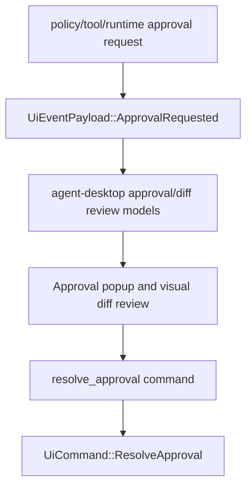

# M60-03 Approval Popup and Visual Diff Review Spec

## Purpose

Define the Desktop approval popup and visual diff review slice for M60. This slice turns the existing approval queue and text preview into explicit, typed review surfaces for allow/deny decisions, lease and expiry state, policy rationale, safe file summaries, and bounded redacted diff hunks.

## Product Context

M60-01 added workspace/session readiness, and M60-02 connected the conversation composer to typed bridge commands and frame-driven transcript updates. M60-03 closes the next daily-driver loop: when the runtime asks for permission or presents a diff, Desktop users must see exactly what is being requested and make an explicit, typed decision without bypassing policy, sandbox, audit, or bridge contracts.

This slice supports the M60 Desktop Daily Driver acceptance path and prepares M60-05 for a deterministic Desktop smoke flow with conversation, approvals, diffs, and trace evidence.

## Scope

This spec delivers:

- Desktop approval review contracts with request id, status, action, resource, policy rationale, preview summary, lease duration, expiry, and disabled decision state
- explicit allow and deny decision controls with required denial reason and command acknowledgement feedback
- bounded/redacted approval preview text and resource labels
- visual diff review contracts with file summaries, line counts, hunk previews, status, selected file state, and command/test evidence labels
- disabled decision states for expired, resolved, or terminal approvals and diffs
- React approval popup/detail and diff review rendering from typed state rather than raw text blobs
- focused Rust, Tauri, and frontend tests for status transitions, redaction, expiry/terminal disabled states, decision commands, and visual diff rendering

Owned by later M60 slices:

- provider settings, task monitor details, logs, and trace polish belong to M60-04
- full Desktop golden-path smoke fixture and final gate wiring belong to M60-05
- plan/todo/task authoring semantics beyond Desktop presentation belong to M61
- recovery, retry, and replay productization belong to M62

## Architecture

`agent-policy` and `agent-ui-bridge` remain the owners of permission request and decision semantics. `agent-desktop` owns Desktop-safe review view models and pure state transitions. Tauri exposes narrow typed approval command boundaries and does not decide policy. React renders approval popups and diff reviews from typed contracts and dispatches explicit bridge commands.



Dependency rules:

- Desktop decisions must go through `UiCommand::ResolveApproval` and the existing bridge validation path.
- Desktop approval/diff models may summarize and bound state but must not grant permission directly.
- React must not infer policy state from display text; it should consume typed status and disabled fields.
- Diff previews must stay relative to the workspace and bounded before serialization.

## File Layout

```text
crates/
  agent-desktop/
    src/
      permission.rs
      diff.rs
      lib.rs
    tests/
      permissions_diffs.rs
  agent-ui-bridge/
    src/
      event.rs
      frame.rs
    tests/
      approval_bridge.rs
apps/
  desktop/
    src/
      App.tsx
      types.ts
      state/
        approvals.ts
      components/
        ApprovalDetail.tsx
        ApprovalQueue.tsx
        DiffPreview.tsx
      __tests__/
        approval-diff-ui.test.tsx
    src-tauri/
      src/
        approval_commands.rs
        tests/
          approval_commands.rs
docs/
  milestones/
    README.md
  plans/
    M60-desktop-daily-driver.plan.md
```

Exact filenames can change if implementation finds a better local fit, but policy/bridge semantics must stay out of React and Tauri presentation code.

## Public Contracts

M60-03 should add or equivalent typed contracts like:

```rust
pub struct DesktopApprovalReview {
    pub request_id: ApprovalRequestId,
    pub status: DesktopApprovalReviewStatus,
    pub action_label: String,
    pub resource_kind: String,
    pub resource_label: String,
    pub policy_rationale: String,
    pub preview: DesktopApprovalPreview,
    pub lease_duration_seconds: Option<u64>,
    pub expires_at: Option<Timestamp>,
    pub decision_enabled: bool,
    pub disabled_reason: Option<String>,
}

#[serde(rename_all = "snake_case")]
pub enum DesktopApprovalReviewStatus {
    Pending,
    Allowed,
    Denied,
    Expired,
    Resolved,
}

pub struct DesktopApprovalPreview {
    pub kind: String,
    pub summary: String,
    pub content_hash: Option<String>,
    pub truncated: bool,
    pub redacted: bool,
}

pub struct DesktopDiffReview {
    pub review_id: String,
    pub status: DesktopDiffReviewStatus,
    pub files: Vec<DesktopDiffFileReview>,
    pub selected_path: Option<String>,
    pub decision_enabled: bool,
    pub disabled_reason: Option<String>,
}

pub struct DesktopDiffFileReview {
    pub path: String,
    pub added_lines: u32,
    pub removed_lines: u32,
    pub summary: String,
    pub hunks: Vec<DesktopDiffHunkPreview>,
}

pub struct DesktopDiffHunkPreview {
    pub old_start: u32,
    pub new_start: u32,
    pub lines: Vec<DesktopDiffLinePreview>,
    pub truncated: bool,
}
```

All contracts must derive or map cleanly to `Serialize` and `Deserialize`. Resource labels, rationales, preview text, paths, and hunk lines must be bounded and redacted before serialization.

## State and Failure Handling

- Pending approvals are actionable; allowed, denied, expired, resolved, or missing approvals disable decisions with a typed reason.
- Allow decisions may include a lease duration only when policy/bridge contracts support it.
- Deny decisions require a non-empty reason before a command envelope is produced.
- Duplicate approval requests update the existing review by request id rather than creating duplicate controls.
- Resolved approval frames remove or disable the pending review and preserve last decision status.
- Diff reviews reject empty file sets, absolute paths, parent traversal, empty summaries, and unbounded hunk text.
- Terminal diff reviews cannot transition back to pending or receive additional decisions.
- Unknown approval/diff frames are ignored without corrupting current UI state.

## Security and Privacy

- Approval previews and diff hunks are bounded and redacted before Desktop serialization.
- Desktop never exposes raw tool input JSON, raw command output, environment variables, hidden prompts, or secrets.
- Workspace paths remain relative display labels and do not broaden filesystem policy.
- User approval in Desktop does not bypass policy, sandbox, audit, or permission lease rules.
- Tauri approval commands validate request ids and denial reasons before submitting bridge commands.

## Testing Strategy

- `agent-desktop` tests for approval review status, expiry/terminal disabled states, lease display, preview bounding/redaction, diff path validation, hunk bounding, and diff status transitions
- `agent-ui-bridge` tests for approval request/resolved frame shape and safe preview serialization
- Tauri tests for allow/deny command envelopes, empty reason rejection, invalid request id redaction, and connected-session acknowledgement
- Vitest tests for approval queue selection, popup/detail disabled terminal states, denial reason validation, command acknowledgement display, visual diff file/hunk rendering, and redaction/truncation badges

Focused commands:

```bash
cargo test -p agent-desktop --test permissions_diffs
cargo test -p agent-ui-bridge approval_bridge
cargo test --manifest-path apps/desktop/src-tauri/Cargo.toml approval_commands
npm --prefix apps/desktop test -- approval-diff-ui
```

## Acceptance Criteria

- Desktop shows approval requests as explicit review surfaces with action, resource, rationale, preview, lease/expiry state, and safe disabled states.
- Allow and deny decisions use typed bridge commands and return command acknowledgement/error state.
- Visual diff review shows file summaries and bounded redacted hunk previews without raw unbounded diff text.
- Expired/resolved/terminal approvals and diffs cannot be decided from the UI.
- Focused Rust, Tauri, and frontend tests pass.

## Completion Signal

M60-03 is complete when approval/diff review contracts, Tauri command validation, React popup/detail/diff rendering, focused tests, M60 plan status, milestone index updates, and exact-path implementation commit are finished.
