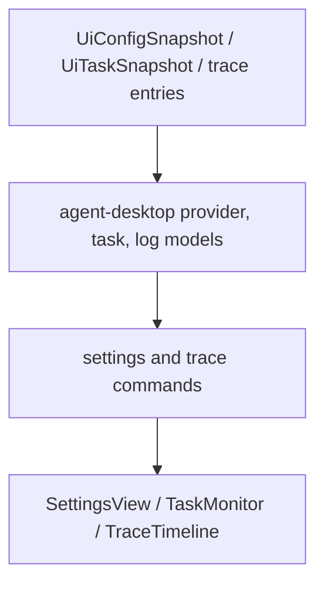

# M60-04 Provider Settings, Task Monitor, and Logs Spec

## Purpose

Define the Desktop provider settings, task monitor, and runtime log surfaces for M60. This slice makes provider/model diagnostics, settings validation, task state summaries, and bounded trace/log evidence visible through typed Desktop contracts without exposing secrets or duplicating runtime behavior in Tauri or React.

## Product Context

M60-01 added dashboard readiness, M60-02 connected conversation/composer/transcript flow, and M60-03 added explicit approval and visual diff review. M60-04 completes the remaining daily-driver inspection surfaces before the Desktop smoke slice: a developer should be able to inspect provider readiness, validate settings, monitor task status, and read bounded runtime evidence from Desktop.

This slice supports the M60 Desktop Daily Driver acceptance path and prepares M60-05 to exercise a complete UI-safe bridge simulation with dashboard, conversation, approvals, diffs, provider settings, task monitor, logs, and trace evidence.

## Scope

This spec delivers:

- Desktop provider/settings summary contracts with selected provider/model, provider capabilities, provider enabled state, diagnostics, and validation results
- settings validation diagnostics that remain read-only until a later persistence slice and never expose secrets
- task monitor contracts with total/active/waiting/failed/terminal counts, selected task detail, latest run summaries, artifact counts, and recoverable task errors
- runtime log entry contracts derived from trace/log evidence with sequence, severity, source, message, and truncation flag
- React provider/settings, task monitor, and trace/log rendering from typed state
- focused Rust, Tauri, and frontend tests for provider diagnostics, task monitor grouping, log bounding/redaction, settings validation, and rendering behavior

Owned by later M60 slices:

- credential-free Desktop golden-path smoke fixture, docs, and final gate wiring belong to M60-05
- plan/todo/task authoring semantics beyond Desktop presentation belong to M61
- recovery, retry, replay/fork, and crash productization belong to M62
- provider credential onboarding, installer/keychain, packaging, and updates belong to M65

## Architecture

`agent-ui-bridge` remains the owner of UI-safe config, task, and trace frame contracts. `agent-desktop` owns Desktop view models and pure aggregation/redaction helpers. Tauri settings and trace commands adapt existing state into typed Desktop contracts and do not persist settings in this slice. React renders settings, task monitor, and logs from typed snapshots and local reducers.



Dependency rules:

- Provider capability and diagnostic information must come from shared bridge/config contracts.
- Desktop settings validation is read-only and does not mutate config or secrets.
- Task monitor state is presentation aggregation over typed task states, not scheduler ownership.
- Runtime logs are bounded product diagnostics derived from typed trace/log evidence, not raw process stderr.

## File Layout

```text
crates/
  agent-desktop/
    src/
      settings.rs
      task.rs
      trace.rs
      lib.rs
    tests/
      settings.rs
      trace_timeline.rs
      conversation_tasks.rs
apps/
  desktop/
    src/
      App.tsx
      types.ts
      state/
        settings.ts
        tasks.ts
        trace.ts
      components/
        SettingsView.tsx
        TaskList.tsx
        TaskDetail.tsx
        TraceTimeline.tsx
      __tests__/
        trace-settings-ui.test.tsx
    src-tauri/
      src/
        settings_commands.rs
        trace_commands.rs
        tests/
          trace_settings_commands.rs
docs/
  milestones/
    README.md
  plans/
    M60-desktop-daily-driver.plan.md
```

Exact filenames can change if implementation finds a better local fit, but settings/task/log view models should stay in `agent-desktop`, and bridge/runtime ownership should stay outside React and Tauri presentation code.

## Public Contracts

M60-04 should add or equivalent typed contracts like:

```rust
pub struct DesktopProviderSettingsSummary {
    pub selected_provider: String,
    pub selected_model: String,
    pub providers: Vec<DesktopProviderSummary>,
    pub diagnostics: Vec<DesktopSettingsDiagnostic>,
    pub validation: DesktopSettingsValidationSummary,
}

pub struct DesktopProviderSummary {
    pub id: String,
    pub kind: String,
    pub default_model: String,
    pub enabled: bool,
    pub supports_tools: bool,
    pub supports_streaming: bool,
    pub context_window: Option<u32>,
    pub output_limit: Option<u32>,
}

pub struct DesktopTaskMonitor {
    pub counts: DesktopTaskMonitorCounts,
    pub tasks: Vec<DesktopTaskMonitorItem>,
    pub errors: Vec<DesktopTaskMonitorError>,
}

pub struct DesktopRuntimeLogEntry {
    pub sequence: u64,
    pub severity: DesktopRuntimeLogSeverity,
    pub source: String,
    pub message: String,
    pub truncated: bool,
}
```

All contracts must derive or map cleanly to `Serialize` and `Deserialize`. Provider diagnostics, validation messages, task summaries, artifact metadata, trace summaries, and log entries must be bounded and redacted before serialization.

## State and Failure Handling

- Missing provider config produces diagnostics and disabled/read-only display state rather than a panic.
- Invalid settings return typed validation diagnostics without persisting or mutating settings.
- Empty task lists and logs are valid and render stable empty states.
- Task counts are computed from typed `TaskState` values.
- Task errors remain recoverable diagnostics unless a source contract marks them fatal.
- Runtime logs are sorted by sequence, reject duplicate sequence numbers where trace semantics require uniqueness, and bound/truncate messages.
- Unknown trace/log kinds default to info severity unless their kind signals warning/error/failure.

## Security and Privacy

- Desktop must not read, store, render, or log raw API keys, secret values, environment variables, provider credential refs, hidden prompts, tool input JSON, raw command output, or unbounded stderr.
- Provider settings expose ids, models, capability metadata, and diagnostics only.
- Settings validation diagnostics are redacted before crossing Tauri or TypeScript boundaries.
- Task summaries, task errors, trace summaries, and runtime logs are bounded and redacted.
- Task monitor controls are view-only in this slice and do not bypass scheduler, policy, sandbox, or audit paths.

## Testing Strategy

- `agent-desktop` tests for provider/settings summary shape, settings validation diagnostics, task monitor counts, selected task detail, task error redaction, runtime log severity mapping, log sorting, truncation, and secret redaction
- Tauri tests for config snapshot redaction, settings validation diagnostics, trace/log loading, duplicate trace errors, and invalid id redaction
- Vitest tests for provider/settings diagnostics rendering, task monitor counts/detail rendering, runtime log rendering, empty states, and no secret exposure
- focused build/type checks for the Desktop frontend

Focused commands:

```bash
cargo test -p agent-desktop --test settings
cargo test -p agent-desktop --test trace_timeline
cargo test -p agent-desktop --test conversation_tasks
cargo test --manifest-path apps/desktop/src-tauri/Cargo.toml trace_settings_commands
npm --prefix apps/desktop test -- trace-settings-ui
```

## Acceptance Criteria

- Desktop shows provider/model settings and provider diagnostics without secrets.
- Settings validation returns bounded typed diagnostics and does not mutate persisted state.
- Task monitor shows typed task counts, selected task details, latest run summaries, artifacts, and recoverable errors.
- Runtime logs/trace evidence render as bounded redacted entries with stable severity/source labels.
- Focused Rust, Tauri, frontend, and build checks pass.

## Completion Signal

M60-04 is complete when provider/settings summaries, task monitor state, bounded runtime logs, Tauri command coverage, React rendering, focused tests, M60 plan status, milestone index updates, and exact-path implementation commit are finished.
