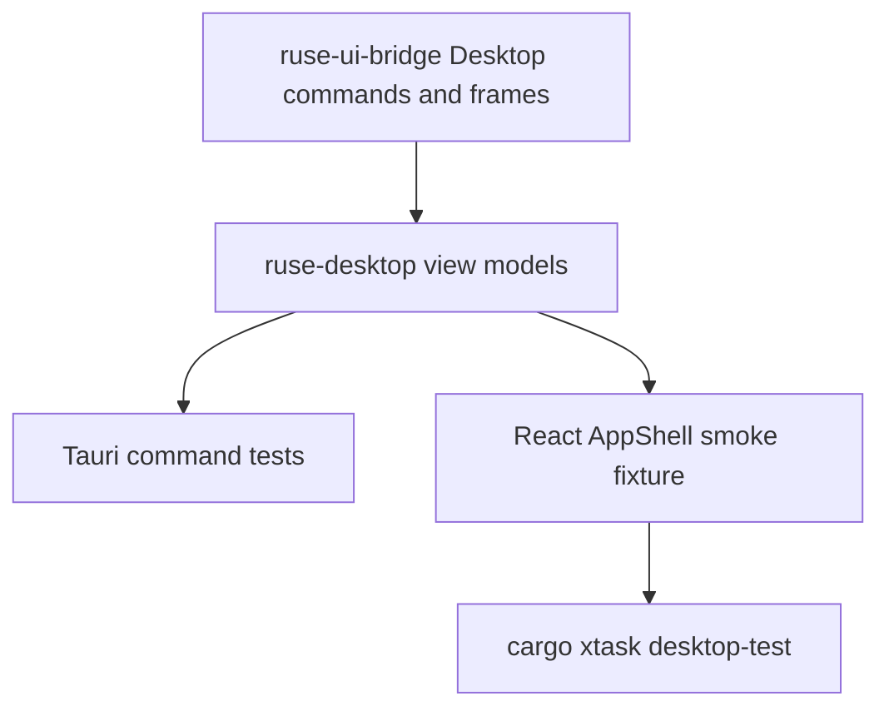

# M60-05 Desktop Golden Path Smoke and Closeout Spec

## Purpose

Define the Desktop golden-path smoke slice for M60. This slice proves that the Desktop app can present an M56-shaped local coding workflow through credential-free, UI-safe fixtures that cover workspace readiness, conversation, approvals, diff review, provider/settings diagnostics, task monitor, logs, and trace evidence.

## Product Context

M60-01 through M60-04 built the Desktop daily-driver surfaces over shared Rust contracts. M60-05 closes the milestone by making those surfaces verifiable together rather than only as isolated component tests. The smoke path should show the same product story as M56: open a workspace, submit a prompt, observe progress, review a permission and diff, see task completion, inspect provider readiness, and verify trace/log evidence.

This slice is deliberately credential-free. It uses deterministic fake-provider and bridge-shaped fixtures rather than live provider calls, network access, or real side effects.

## Scope

This spec delivers:

- a deterministic Desktop daily-driver smoke fixture with stable ids, timestamps, task states, approvals, diff hunks, provider diagnostics, trace items, and runtime logs
- `ruse-desktop` contract coverage that serializes the complete Desktop daily-driver state and verifies bounded redaction
- `ruse-ui-bridge` coverage for Desktop start-turn commands, approval resolution commands, M56-shaped frame sequencing, and one-line JSON frame encoding
- a frontend smoke test that navigates dashboard, conversation, tasks, approvals, trace, and settings while asserting the golden-path evidence is visible
- `cargo xtask desktop-test` as the Desktop product gate for Rust Desktop contracts, bridge contracts, Tauri command boundaries, frontend tests, and frontend build
- `docs/desktop/daily-driver-smoke.md` documenting the smoke path, evidence, and commands
- M60 milestone, roadmap, and plan closeout status updates

Out of scope:

- live provider Desktop runs and credential onboarding, which belong to M65 beta/release hardening
- plan/todo/task authoring semantics, which belong to M61
- crash recovery, replay/fork UX, and retry productization, which belong to M62
- packaging, installer, update, and keychain polish, which belong to M65

## Architecture

The smoke fixture must compose existing typed contracts. Runtime behavior stays in shared crates; Desktop and frontend code adapt and render typed snapshots.



Dependency rules:

- no Desktop-specific runtime logic may be added in Tauri or React
- frontend fixtures must use the same TypeScript contracts as command responses
- Rust fixtures must serialize through serde-friendly public contracts
- fixture evidence must be bounded and redacted before crossing UI boundaries
- `xtask` may orchestrate Desktop checks but must not parse app state or test output

## File Layout

```text
crates/
  ruse-desktop/
    tests/
      desktop_daily_driver.rs
  ruse-ui-bridge/
    tests/
      desktop_daily_driver.rs
apps/
  desktop/
    src/
      __tests__/
        desktop-smoke.test.tsx
xtask/
  src/lib.rs
  tests/xtask_plan.rs
docs/
  desktop/
    daily-driver-smoke.md
  milestones/
    README.md
  plans/
    M60-desktop-daily-driver.plan.md
```

## Fixture Shape

The Desktop smoke fixture should use stable values equivalent to:

- workspace id `00000000-0000-0000-0000-000000000060`
- conversation id `00000000-0000-0000-0000-000000000061`
- task ids for running, waiting-approval, succeeded, and failed states
- provider `fake` with model `fake-scripted`, streaming enabled, tool calls enabled, and no credential fields
- conversation prompt preview such as `Update the CLI smoke fixture and run tests`
- transcript entries for user prompt, model progress, tool/test progress, final response, and done frame count
- approval request for a bounded shell or file-edit action with lease metadata and redacted preview text
- visual diff review for a small source/doc change with bounded hunks
- trace/log entries for context, edit preview, command/test, permission, final response, and runtime warning/error evidence

Secrets, raw environment values, raw command output, hidden prompt text, unbounded stderr, and unredacted diff payloads must not appear in serialized smoke artifacts or rendered frontend assertions.

## Testing Strategy

Focused implementation checks:

```bash
cargo test -p ruse-desktop --test desktop_daily_driver
cargo test -p ruse-ui-bridge --test desktop_daily_driver
cargo test --manifest-path apps/desktop/src-tauri/Cargo.toml
npm --prefix apps/desktop test -- desktop-smoke
npm --prefix apps/desktop run build
cargo test -p xtask --test xtask_plan
cargo xtask desktop-test
```

Final M60 checks:

```bash
cargo fmt --all -- --check
cargo clippy --workspace --all-targets -- -D warnings
cargo test --workspace
npm --prefix apps/desktop test
npm --prefix apps/desktop run build
cargo xtask eval
```

## Acceptance Criteria

- Desktop smoke coverage proves a credential-free M56-shaped workflow through typed bridge/Desktop/frontend contracts.
- Dashboard, conversation, composer/submission state, transcript, approvals, visual diff, provider settings, task monitor, logs, and trace evidence are all covered in one Desktop smoke path.
- `cargo xtask desktop-test` runs the Desktop product gate rather than only one crate test.
- The smoke fixture is deterministic, bounded, redacted, and does not require network access or provider credentials.
- M60 closeout docs, milestone status, roadmap status, and final verification evidence are updated.

## Completion Signal

M60-05 and M60 are complete when the Desktop golden-path smoke fixture, `xtask desktop-test` gate, daily-driver smoke docs, final M60 status updates, final workspace/frontend/eval gates, and exact-path closeout commit are finished.
