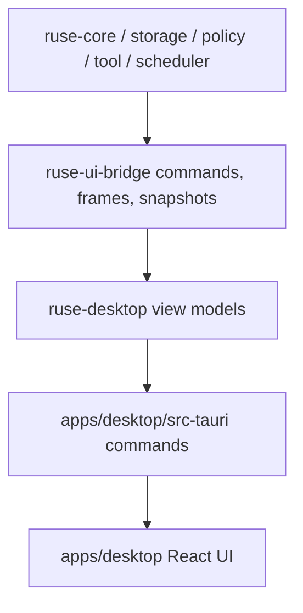

# M60 Desktop Daily Driver Spec

## Purpose

Turn the existing Desktop MVP into a daily-driver product surface over the shared runtime. M60 should let a developer open a workspace, monitor runtime/session state, converse with the agent, review approvals and diffs, inspect provider/settings diagnostics, and track task/log evidence without Desktop-specific runtime logic.

## Product Context

M56 proved the deterministic local coding-agent golden path, M57 made provider selection diagnosable, M58 added project context intelligence, and M59 made CLI/TUI daily use coherent. M60 brings the same product path to Desktop: a visual interface that consumes shared runtime bridge contracts and can prove an M56-equivalent workflow through a credential-free bridge simulation or fixture.

M21 delivered the runnable Tauri MVP. M60 builds on that foundation with product-level daily-driver ergonomics, stronger shared state contracts, richer tests, and a Desktop smoke gate.

## Scope

This spec delivers:

- workspace dashboard with runtime state, workspace/session identity, provider status, task counts, pending approvals, and recent trace/log summaries
- conversation view with composer, active session state, submitted prompt evidence, streaming or frame-driven transcript updates, command acknowledgements, and recoverable bridge errors
- approval popup/review surface with explicit allow/deny decisions, lease display, request identity, policy rationale, and redacted preview text
- visual diff review with file-level summaries, hunks, approval state, command/test evidence links, and bounded redacted content
- provider/settings view with selected provider/model, capability diagnostics, validation results, and no secret exposure
- task monitor and logs view for queued, running, waiting-approval, succeeded, failed, cancelled, and expired work, including bounded runtime log entries
- Desktop-safe bridge simulation or fixture that exercises the M56 golden path shape through UI state without live provider credentials
- Desktop verification path covering Rust contracts, Tauri command boundaries, frontend components/state, and the Desktop smoke fixture

Owned by other specs:

- plan/todo/task authoring semantics beyond Desktop presentation belong to M61
- crash recovery, replay/fork, idempotent retry, and recovery productization belong to M62
- worktree/subagent team workflows belong to M63
- memory review and personalization belong to M64
- installer, updater, keychain, and packaging beta polish belong to M65
- plugin/MCP management polish beyond existing health snapshots belongs to M66 unless required by the M60 daily-driver path

## Architecture

Runtime truth stays in shared Rust crates. `ruse-core`, `ruse-storage`, `ruse-policy`, `ruse-tool`, `ruse-context`, and `ruse-scheduler` own runtime behavior. `ruse-ui-bridge` owns UI commands, frames, and UI-safe snapshots. `ruse-desktop` owns Desktop view-model contracts that remain typed, serializable, bounded, and redacted. `apps/desktop/src-tauri` owns the Tauri command allowlist and bridge session wiring. `apps/desktop/src` owns React presentation, UI state reducers, and component tests.



Dependency rules:

- Desktop commands must call shared bridge/runtime contracts rather than rebuilding runtime state in Tauri or TypeScript.
- React state must be derived from typed snapshots and bridge frames, not from parsed CLI text.
- Side effects remain behind runtime policy, sandbox, audit, and approval paths.
- Desktop fixtures must be deterministic, credential-free, and redacted.

## File Layout

```text
crates/
  ruse-desktop/
    src/
      conversation.rs
      diff.rs
      permission.rs
      session.rs
      settings.rs
      snapshot.rs
      task.rs
      trace.rs
    tests/
      desktop_daily_driver.rs
      permissions_diffs.rs
      settings.rs
      trace_timeline.rs
  ruse-ui-bridge/
    src/
      command.rs
      frame.rs
    tests/
      desktop_daily_driver.rs
apps/
  desktop/
    src/
      App.tsx
      api.ts
      bridge.ts
      types.ts
      components/
      state/
      __tests__/
    src-tauri/
      src/
        commands.rs
        bridge.rs
        approval_commands.rs
        settings_commands.rs
        trace_commands.rs
        workspace_snapshot.rs
        tests/
xtask/
  src/lib.rs
docs/
  desktop/
    daily-driver-smoke.md
```

Exact module names may change during slice implementation, but ownership must stay aligned with these boundaries.

## Public Contracts

Final names may differ by slice, but M60 should support typed contracts like:

```rust
pub struct DesktopDailyDriverSnapshot {
    pub workspace: DesktopWorkspaceDashboard,
    pub session: DesktopSessionSummary,
    pub conversation: DesktopConversationPanel,
    pub approvals: Vec<DesktopApprovalReview>,
    pub diffs: Vec<DesktopDiffReview>,
    pub provider: DesktopProviderSettingsSummary,
    pub tasks: DesktopTaskMonitor,
    pub logs: Vec<DesktopRuntimeLogEntry>,
}

pub struct DesktopWorkspaceDashboard {
    pub workspace_id: WorkspaceId,
    pub workspace_root_display: String,
    pub git_branch: Option<String>,
    pub runtime_state: DesktopSessionState,
    pub pending_approval_count: u32,
    pub running_task_count: u32,
    pub failed_task_count: u32,
}

pub struct DesktopApprovalReview {
    pub request_id: PermissionRequestId,
    pub status: DesktopApprovalStatus,
    pub action_label: String,
    pub resource_label: String,
    pub rationale: String,
    pub lease_expires_at: Option<Timestamp>,
}

pub struct DesktopRuntimeLogEntry {
    pub sequence: u64,
    pub timestamp: Timestamp,
    pub severity: DesktopLogSeverity,
    pub source: String,
    pub message: String,
    pub truncated: bool,
}
```

All bridge-facing and Tauri-facing contracts must derive or map cleanly to `Serialize` and `Deserialize`. Raw provider credentials, environment values, hidden prompt text, unbounded command output, and unredacted diffs must never cross into Desktop snapshots.

## State and Failure Handling

- Missing, unreadable, or deleted workspaces produce dashboard diagnostics and do not crash the shell.
- Starting an already-connected Desktop session returns the existing session snapshot idempotently.
- Bridge disconnects enter a reconnectable state; queued UI actions are disabled until a valid session exists.
- Invalid conversation, task, approval, diff, or trace ids fail before side effects and return typed recoverable errors.
- Approval and diff decisions are disabled after expiration or resolution.
- Frame drains are bounded and report dropped-frame diagnostics when capacity is exceeded.
- Provider/settings validation returns diagnostics without persisting invalid settings.
- Desktop smoke fixtures use stable ids, timestamps, event order, and no network or live provider dependencies.

## Security and Privacy

- Desktop must not read, store, render, or log raw API keys or secret values.
- Tauri command exposure stays allowlisted and narrow.
- Workspace paths are displayed through safe labels and do not grant broader file permissions.
- Approval previews, diffs, command output, logs, provider diagnostics, and trace summaries are bounded and redacted before reaching React.
- User approval in Desktop does not bypass policy, sandbox, audit, or lease rules.
- Runtime logs shown in Desktop are product diagnostics, not raw process stderr dumps.

## Testing Strategy

- `ruse-desktop` tests for dashboard snapshots, approval/diff review view models, provider/settings summaries, task monitor state, log bounding, and redaction
- `ruse-ui-bridge` tests for Desktop-safe command/frame contracts and M56-shaped fixture frames
- Tauri Rust tests for bridge session idempotency, command validation, approval resolution, settings validation, trace/log loading, and workspace snapshots
- Vitest component/state tests for dashboard navigation, composer/transcript updates, approval popup, visual diff review, provider/settings diagnostics, task monitor, and log rendering
- Desktop smoke fixture that runs a credential-free M56-equivalent UI flow or bridge simulation
- final gates: `cargo fmt --all -- --check`, `cargo clippy --workspace --all-targets -- -D warnings`, `cargo test --workspace`, `npm --prefix apps/desktop test`, `npm --prefix apps/desktop run build`, and `cargo xtask eval`

## Acceptance Criteria

- A developer can use Desktop to start or resume a workspace session, see runtime readiness, and understand pending work.
- Conversation, composer, transcript, approvals, diffs, provider settings, task monitor, and logs are visible and actionable through Desktop.
- Desktop state comes from shared bridge/runtime contracts and Desktop view models, not duplicated runtime logic in React or Tauri.
- Approval and diff decisions are explicit, typed, bounded, redacted, and policy-backed.
- Provider/settings diagnostics are useful without exposing secrets.
- A deterministic Desktop smoke path proves the M56 golden-path shape or UI-safe bridge simulation.
- Existing M56-M59 CLI/TUI/eval behavior continues to pass.

## Completion Signal

M60 is complete when the Desktop daily-driver slices, Desktop smoke fixture, frontend and Rust tests, workspace gates, eval gate, docs, and milestone status updates are implemented, verified, and committed.
