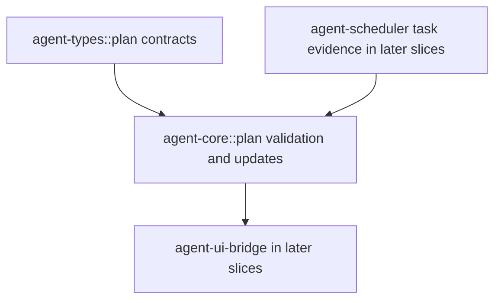

# M61-01 Shared Plan/Todo State Contracts Spec

## Purpose

Define the shared runtime contracts for plan and todo state before adding CLI, TUI, Desktop, or background UX. This slice creates the typed source of truth that later M61 slices can render and update.

## Product Context

M61 requires TodoWrite-compatible task state and plan tracking across interactive and background work. Existing task state lives in `agent-types` and `agent-scheduler`; task reviews and artifacts live in `agent-core`; UI snapshots live in `agent-ui-bridge`. M61-01 adds the missing plan/todo state model so later slices can connect it to existing task commands, notifications, and artifacts.

## Scope

This spec delivers:

- typed plan/todo ids, todo statuses, priority/source enums, evidence references, diagnostics, and progress summaries
- serde-friendly snapshot and update contracts suitable for durable events and UI bridge frames
- TodoWrite-compatible validation for pending, in-progress, completed, and cancelled todo states
- revision checking for stale update detection
- bounded/redacted text normalization for todo content, reasons, diagnostics, and evidence summaries
- unit tests for serde shape, validation, redaction, progress counts, and stale update failures

Owned by later specs:

- CLI/JSON commands belong to M61-02
- TUI/Desktop rendering belongs to M61-03
- background approval-wait/control evidence belongs to M61-04
- final smoke docs and closeout belong to M61-05

## Architecture

`agent-types` owns public serde contracts and event payload additions. `agent-core` owns validation helpers, update application, redaction, progress summarization, and evidence normalization. Later UI layers must consume these contracts through `agent-ui-bridge`.



Dependency rules:

- `agent-types` must not depend on runtime crates.
- `agent-core` may depend on `agent-types` and existing task/artifact contracts.
- `agent-core` must not depend on CLI, TUI, Desktop, Tauri, or TypeScript.
- Event payload additions must stay serializable and backward-compatible with existing event serde tests.

## File Layout

```text
crates/
  agent-types/
    src/
      lib.rs
      event.rs
      plan.rs
      ids.rs
      state.rs
  agent-core/
    src/
      lib.rs
      plan.rs
    tests/
      plan_todo_state.rs
```

Exact filenames can be adjusted if the implementation finds an existing better home, but public contracts must remain in shared crates.

## Public Contracts

This slice should introduce contracts like:

```rust
pub struct PlanTodoItemId(String);

pub struct PlanTodoSnapshot {
    pub conversation_id: ConversationId,
    pub turn_id: Option<TurnId>,
    pub task_id: Option<TaskId>,
    pub revision: u64,
    pub items: Vec<PlanTodoItem>,
    pub updated_at: Timestamp,
    pub diagnostics: Vec<PlanTodoDiagnostic>,
}

pub struct PlanTodoItem {
    pub item_id: PlanTodoItemId,
    pub content: String,
    pub status: TodoStatus,
    pub priority: TodoPriority,
    pub source: TodoSource,
    pub task_id: Option<TaskId>,
    pub evidence: Vec<PlanTodoEvidence>,
    pub updated_at: Timestamp,
}

pub enum TodoStatus {
    Pending,
    InProgress,
    Completed,
    Cancelled,
}

pub enum TodoPriority {
    Low,
    Normal,
    High,
}

pub enum TodoSource {
    Model,
    User,
    Runtime,
    BackgroundTask,
}

pub struct PlanTodoEvidence {
    pub kind: PlanTodoEvidenceKind,
    pub reference: String,
    pub summary: String,
}

pub struct PlanTodoProgress {
    pub total: u32,
    pub pending: u32,
    pub in_progress: u32,
    pub completed: u32,
    pub cancelled: u32,
}
```

Runtime helpers should support update application without presentation logic:

```rust
pub struct PlanTodoUpdate {
    pub expected_revision: u64,
    pub reason: String,
    pub operation: PlanTodoOperation,
    pub updated_at: Timestamp,
}

pub enum PlanTodoOperation {
    ReplaceAll { items: Vec<PlanTodoItem> },
    UpdateStatus { item_id: PlanTodoItemId, status: TodoStatus },
    AppendEvidence { item_id: PlanTodoItemId, evidence: PlanTodoEvidence },
}
```

If a smaller initial API satisfies tests, it may be used, but it must preserve the same product semantics.

## State and Failure Handling

- Snapshot revision starts at 0 or 1 and increments on every successful mutation.
- Updates with a mismatched `expected_revision` fail with a typed stale-update error.
- Empty todo lists are valid and summarize to zero counts.
- Empty todo content, evidence references, evidence summaries, reasons, and diagnostic messages are invalid.
- Text fields are trimmed, bounded, and redacted with the same secret-like token rules used by task text.
- The default TodoWrite-compatible invariant allows at most one `in_progress` todo per snapshot.
- Completed and cancelled todos can receive evidence, but status changes out of completed/cancelled require an explicit valid operation if the implementation supports reopening; otherwise they fail.
- Duplicate item ids in one snapshot fail validation.

## Security and Privacy

- Todo content and evidence may contain prompt text, file paths, command summaries, artifact names, or model output; all are bounded and redacted before leaving runtime contracts.
- No side effects occur in this slice.
- Evidence references must be identifiers, safe display paths, or trace/checkpoint/artifact ids, not raw command output.
- Diagnostics must not include raw secrets or unbounded model/tool output.

## Testing Strategy

- `agent-types` tests for serde snake_case status/priority/source/evidence shape and event payload serialization if added
- `agent-core` tests for snapshot validation, duplicate item rejection, empty text rejection, one-in-progress invariant, progress counts, stale revision failures, redaction, and evidence append behavior
- focused checks: `cargo test -p agent-types` and `cargo test -p agent-core --test plan_todo_state`
- focused clippy for touched crates before implementation commit

## Acceptance Criteria

- Shared plan/todo contracts exist in runtime crates and derive serde-compatible traits.
- Runtime validation enforces TodoWrite-compatible state, revisions, bounded text, redaction, and progress summaries.
- Invalid snapshots and stale updates fail before mutation.
- Tests cover serialization, validation, redaction, and progress behavior.
- No CLI, TUI, Desktop, or TypeScript runtime logic is introduced in this slice.

## Completion Signal

M61-01 is complete when the shared plan/todo contracts and validation helpers are implemented, focused tests and clippy pass, and the slice plan checklist is updated with verified commands.
