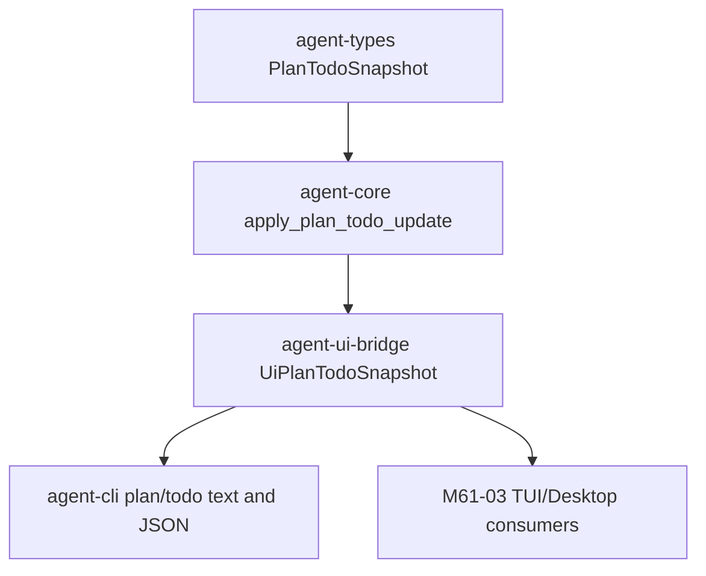

# M61-02 CLI and JSON Plan/Todo Commands Spec

## Purpose

Expose shared plan/todo state through stable CLI text commands and newline-delimited JSON frames so users, scripts, TUI, and Desktop bridge clients can inspect and update the same runtime plan without presentation-layer state machines.

## Product Context

M61-01 added TodoWrite-compatible plan/todo contracts, revision checks, validation, redaction, progress counts, and runtime event payloads. M61-02 turns those contracts into a product surface for the PRD interactive coding and background task journeys: users can ask what is planned, what is active, what is done, and can advance todo state with deterministic feedback.

This slice follows the M59 terminal daily-driver pattern: text output is concise for humans, JSON output is stable for automation, and both are generated from shared bridge snapshots.

## Scope

This spec delivers:

- `agent-cli plan show` for a bounded plan summary with progress and revision
- `agent-cli todo list` for todo item details from the same snapshot
- `agent-cli todo update --todo <id> --status <status> --revision <n> --reason <text>` for revision-aware status updates
- `agent-cli todo set --snapshot-json <json> --revision <n> --reason <text>` for replacing the shared snapshot from typed JSON
- a typed `UiCommand::PlanTodo` command envelope for bridge clients
- a `UiJsonFrame::PlanTodoSnapshot` frame with progress, normalized items, diagnostics, and command errors
- focused bridge and CLI tests covering text, JSON, redaction, sorting, revision failures, and terminal status failures

Owned by other specs:

- TUI and Desktop rendering belongs to M61-03.
- Background approval waits, pause/resume/cancel controls, and notifications belong to M61-04.
- Artifact/review evidence linking and final smoke docs belong to M61-05.
- Crash recovery and replay/fork UX belongs to M62.

## Architecture

`agent-types` remains the owner of durable plan/todo schemas. `agent-core` remains the owner of validation, normalization, progress, revision checks, and transition rules. `agent-ui-bridge` owns UI-safe command envelopes and snapshots. `agent-cli` parses command syntax, delegates updates to the shared core helper, and renders text or JSON from bridge snapshots.



Dependency rules:

- CLI parsing must not duplicate transition validation; it builds typed operations and calls `agent-core`.
- Bridge snapshots may normalize, sort, bound, redact, and summarize, but they must not create new runtime truth.
- JSON output uses `UiJsonFrame` instead of ad hoc CLI-only schemas.
- The fixture runtime used by tests is in-memory and deterministic; durable persistence remains future runtime integration work.

## File Layout

```text
crates/
  agent-ui-bridge/
    src/
      command.rs
      frame.rs
      lib.rs
    tests/
      plan_todo_bridge.rs
  agent-cli/
    src/
      command.rs
    tests/
      plan_todo_commands.rs
docs/
  specs/
    M61-02-cli-json-plan-todo.spec.md
  plans/
    M61-02-cli-json-plan-todo.plan.md
```

## Public Contracts

Bridge commands:

```rust
pub enum UiCommand {
    PlanTodo(UiPlanTodoCommand),
}

#[serde(tag = "type", content = "data", rename_all = "snake_case")]
pub enum UiPlanTodoCommand {
    Show { conversation_id: ConversationId },
    List { conversation_id: ConversationId },
    UpdateStatus {
        conversation_id: ConversationId,
        item_id: PlanTodoItemId,
        status: TodoStatus,
        expected_revision: u64,
        reason: String,
    },
    ReplaceSnapshot {
        snapshot: PlanTodoSnapshot,
        expected_revision: u64,
        reason: String,
    },
}
```

JSON frame:

```rust
pub enum UiJsonFrame {
    PlanTodoSnapshot(UiPlanTodoSnapshot),
}

pub struct UiPlanTodoSnapshot {
    pub snapshot: PlanTodoSnapshot,
    pub progress: PlanTodoProgress,
    pub errors: Vec<UiPlanTodoCommandError>,
}
```

CLI syntax:

```text
agent-cli plan show
agent-cli todo list
agent-cli todo update --todo <id> --status pending|in_progress|completed|cancelled --revision <n> --reason <text>
agent-cli todo set --snapshot-json <json> --revision <n> --reason <text>
agent-cli --json plan show
agent-cli --json todo list
```

`--snapshot-json` is used for the snapshot payload because `--json` is already the global CLI output-mode flag.

## State and Failure Handling

- Empty snapshots are successful and render explicit empty text/JSON states.
- Text output includes conversation id, optional task/turn ids, revision, progress, diagnostics, and sorted todo lines.
- JSON output emits exactly one `plan_todo_snapshot` frame for plan/todo commands.
- Stale revisions, missing todo ids, invalid status transitions, invalid JSON, and invalid snapshots return exit code `2`.
- JSON failures are represented as `PlanTodoSnapshot` frames with no items and redacted recoverable errors.
- Terminal todo states (`completed`, `cancelled`) cannot transition to another status; core validation enforces this.
- Replacement snapshots must match the expected revision before replacing items and incrementing the revision.
- Reasons, todo content, evidence, diagnostics, and errors are normalized, bounded, and redacted before display.

## Security and Privacy

- Plan/todo content may contain prompts, paths, command summaries, model text, or secret-like tokens; all display surfaces use existing redaction helpers and bounded text.
- Commands only mutate in-memory plan state in this slice. Future durable writes must still pass through runtime event, audit, storage, and policy boundaries.
- Bridge commands expose ids, status, revision, and bounded reasons; they do not expose provider credentials, raw tool inputs, unbounded command output, or secret environment values.
- Desktop/Tauri and future UI clients will submit typed bridge commands rather than direct filesystem or scheduler mutations.

## Testing Strategy

- `agent-ui-bridge/tests/plan_todo_bridge.rs` covers command serialization, command validation, snapshot sorting, progress, redaction, empty states, and JSON frame shape.
- `agent-cli/tests/plan_todo_commands.rs` covers parser shapes, text rendering, JSON rendering, update success, stale revision failure, terminal status failure, and snapshot replacement.
- Focused verification:

```bash
cargo clippy -p agent-ui-bridge -p agent-cli --all-targets -- -D warnings
cargo test -p agent-ui-bridge --test plan_todo_bridge
cargo test -p agent-cli --test plan_todo_commands
```

## Acceptance Criteria

- `plan show` and `todo list` render stable bounded text from a shared plan/todo snapshot.
- `--json plan show` and `--json todo list` emit stable `plan_todo_snapshot` frames.
- `todo update` and `todo set` are revision-aware and use `agent-core` validation.
- Bridge command and frame contracts are typed, serde-friendly, redacted, and covered by focused tests.
- Existing task command tests continue to pass.

## Completion Signal

M61-02 is complete when the spec/plan are committed, bridge and CLI command contracts are implemented, focused bridge/CLI tests pass, M61 status docs identify the slice as complete, and the next M61 slice remains the TUI/Desktop plan/task surface.
