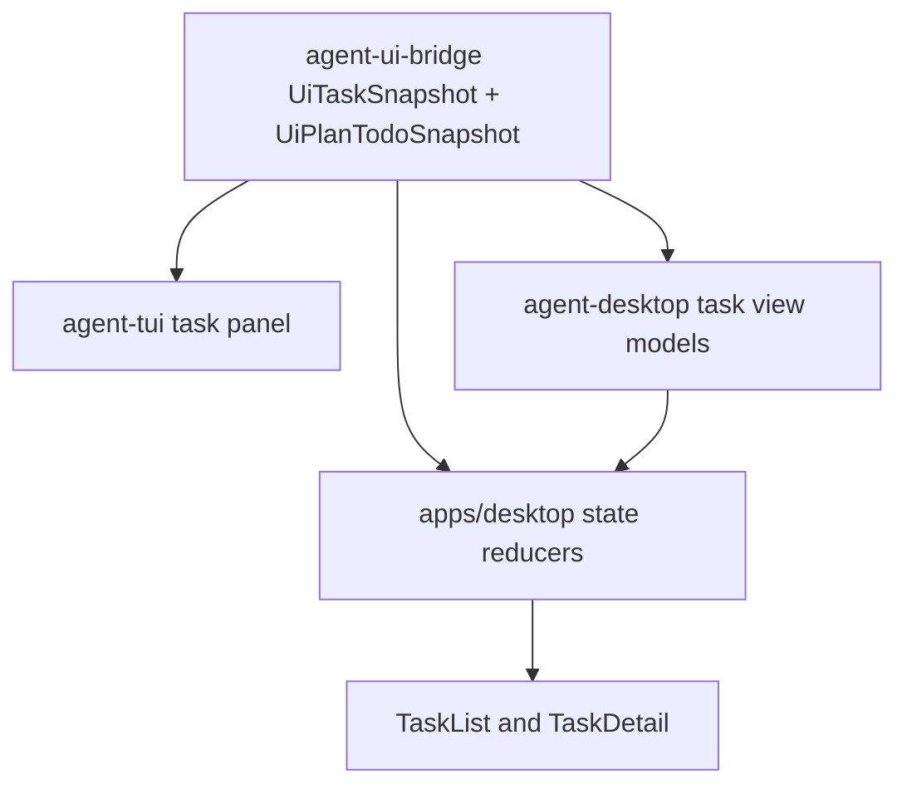

# M61-03 TUI and Desktop Plan/Task Surfaces Spec

## Purpose

Render shared plan/todo/task truth in TUI and Desktop surfaces so users can see plan progress, the active todo, waiting task state, latest task context, and artifact evidence without either presentation layer inventing runtime state.

## Product Context

M61-01 created typed plan/todo contracts and core validation. M61-02 exposed those contracts through CLI/JSON and bridge frames. M61-03 makes the same state visible in the interactive surfaces created by M59 and M60: the TUI task panel and Desktop task list/detail views.

This slice supports the PRD daily-driver and background task journeys by answering user-visible questions from shared snapshots: what is the current plan, which todo is active, which task is waiting, and what task evidence exists.

## Scope

This spec delivers:

- TUI task panel consumption of `UiJsonFrame::PlanTodoSnapshot`
- TUI rendering of plan revision, progress counts, active todo content, diagnostics, and task/review/notification context
- Desktop Rust task view-model fields for plan progress, active todo, waiting-approval state, latest notification, and artifact counts
- Desktop TypeScript task state reducers that merge plan/todo frames into task items by `task_id`
- Desktop React task list/detail rendering for plan progress, active todo, waiting state, latest notification, and artifacts
- focused Rust and frontend tests for rendering, frame reduction, redaction, and backward-compatible empty states

Owned by other specs:

- Background pause/resume/cancel command wiring, approval wait evidence enrichment, and notification delivery belong to M61-04.
- Artifact/review evidence linking into plan/todo evidence and final smoke docs belong to M61-05.
- Durable plan persistence, crash resume, and replay/fork UX belong to M62.

## Architecture

`agent-ui-bridge` remains the shared UI protocol owner. TUI and Desktop consume `UiTaskSnapshot`, `UiTaskReviewSnapshot`, `UiPlanTodoSnapshot`, and task notification events as UI-safe state. `agent-desktop` owns Rust Desktop view models. `apps/desktop` owns TypeScript state reduction and React rendering. No presentation layer validates plan transitions or mutates runtime state directly.



Dependency rules:

- Plan/todo progress shown in TUI/Desktop comes from `PlanTodoProgress` in bridge snapshots.
- Active todo summaries are derived from already-normalized bridge snapshots and remain bounded/redacted.
- Task state remains scheduler-owned; presentation layers may display waiting/active/terminal derived labels only.
- Desktop TypeScript may merge bridge frame data into local view state, but cannot perform runtime transitions.

## File Layout

```text
crates/
  agent-ui-bridge/
    src/frame.rs
    tests/task_command_bridge.rs
  agent-tui/
    src/task_panel.rs
    tests/task_panel.rs
  agent-desktop/
    src/task.rs
    tests/plan_todo_tasks.rs
apps/
  desktop/
    src/types.ts
    src/state/conversation.ts
    src/state/tasks.ts
    src/components/TaskList.tsx
    src/components/TaskDetail.tsx
    src/__tests__/conversation-task-ui.test.tsx
    src/__tests__/trace-settings-ui.test.tsx
    src/__tests__/desktop-smoke.test.tsx
docs/
  specs/M61-03-tui-desktop-plan-task-surfaces.spec.md
  plans/M61-03-tui-desktop-plan-task-surfaces.plan.md
```

## Public Contracts

Bridge task summaries may carry optional plan presentation fields:

```rust
pub struct UiTaskSummary {
    pub plan_progress: Option<PlanTodoProgress>,
    pub active_todo: Option<UiTaskActiveTodoSummary>,
    pub waiting_approval: bool,
    pub latest_notification: Option<String>,
    pub artifact_count: u32,
}

pub struct UiTaskActiveTodoSummary {
    pub item_id: PlanTodoItemId,
    pub content: String,
    pub priority: TodoPriority,
    pub evidence_count: u32,
}
```

Desktop view models mirror only UI-safe display fields:

```rust
pub struct DesktopTaskMonitorItem {
    pub plan_progress: Option<PlanTodoProgress>,
    pub active_todo: Option<DesktopTaskActiveTodo>,
    pub waiting_approval: bool,
    pub latest_notification: Option<String>,
    pub artifact_count: u32,
}
```

TypeScript task state uses compatible optional fields so older fixtures remain valid:

```ts
interface DesktopTaskItem {
  plan_progress?: PlanTodoProgress | null;
  active_todo?: DesktopTaskActiveTodo | null;
  waiting_approval?: boolean;
  latest_notification?: string | null;
  artifact_count?: number;
}
```

## State and Failure Handling

- Existing task fixtures without plan fields continue to deserialize and render.
- Empty task and plan snapshots render explicit empty states.
- A plan snapshot with no `task_id` updates the TUI plan section but does not attach to a Desktop task.
- A plan snapshot with `task_id` attaches progress and the active todo to the matching Desktop task; if no task exists, the frame is retained only as plan context and does not fabricate a task.
- Multiple in-progress todos are already rejected by core normalization before the bridge snapshot reaches UI consumers.
- Missing active todo renders as `none` while progress remains visible.
- Long or secret-like task and todo text is bounded/redacted before Desktop view-model exposure and TypeScript rendering.

## Security and Privacy

- TUI/Desktop render only bridge-provided bounded/redacted summaries.
- Presentation layers do not expose raw provider prompts, raw tool input/output, secrets, environment values, or unbounded artifact content.
- Approval ids, task ids, artifact counts, and checkpoint/trace ids may be visible when already present in UI-safe snapshots.
- Desktop TypeScript state updates are display-only and do not grant filesystem, command, scheduler, or policy authority.

## Testing Strategy

- `agent-tui/tests/task_panel.rs` covers plan/todo frame reduction, active todo rendering, empty states, task waiting state, notifications, and reviews.
- `agent-desktop/tests/plan_todo_tasks.rs` covers Rust Desktop task monitor/view-model conversion with plan progress, active todo, waiting approval, latest notification, artifact count, and redaction.
- `apps/desktop/src/__tests__/conversation-task-ui.test.tsx` covers TypeScript reduction of `plan_todo_snapshot` frames into selected tasks.
- `apps/desktop/src/__tests__/trace-settings-ui.test.tsx` covers React task list/detail rendering of plan progress and active todo.
- `apps/desktop/src/__tests__/desktop-smoke.test.tsx` keeps the broader Desktop smoke fixture rendering plan/task data without secret leakage.
- Focused verification:

```bash
cargo clippy -p agent-tui -p agent-desktop --all-targets -- -D warnings
cargo test -p agent-tui --test task_panel
cargo test -p agent-desktop --test plan_todo_tasks
npm --prefix apps/desktop test -- conversation-task-ui trace-settings-ui desktop-smoke
npm --prefix apps/desktop run build
```

## Acceptance Criteria

- TUI task panel renders plan progress and active todo from `UiPlanTodoSnapshot`.
- Desktop Rust view models expose plan progress, active todo, waiting state, latest notification, and artifact count as typed serde fields.
- Desktop TypeScript reducers merge plan/todo frames into task state without runtime mutation authority.
- React task list/detail views display plan progress, active todo, waiting state, latest notification, and artifact count from typed state.
- Existing task-only fixtures remain compatible, bounded, redacted, and covered by tests.

## Completion Signal

M61-03 is complete when the spec/plan are committed, TUI/Desktop plan/task rendering is implemented, focused Rust/frontend checks pass, M61 status docs identify the slice as complete, and M61-04 remains the next background wait/control slice.
