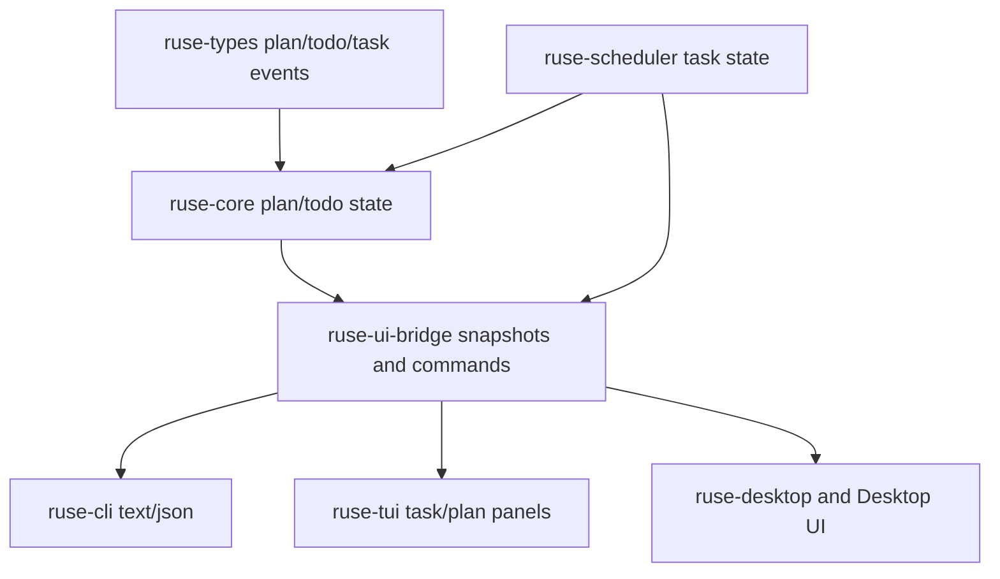

# M61 Plan, Todo, and Task UX Spec

## Purpose

Make plan, todo, and task state a first-class runtime product surface across interactive and background work. M61 should let users see what the agent intends to do, what is in progress, what is blocked on approval or background execution, and what evidence was produced, without each UI inventing its own state model.

## Product Context

M56 proved the local coding golden path, M59 made terminal daily-driver flows coherent, and M60 made Desktop consume shared runtime state. M61 closes the gap between interactive plans, TodoWrite-style progress, and existing background task state so CLI, TUI, and Desktop can all answer the same user questions: what is planned, what is active, what is waiting, what changed, and what evidence supports completion.

M08 and M24 already created scheduler, notification, approval-wait, pause/resume/cancel, and artifact foundations. M61 promotes those foundations into a shared product UX layer instead of creating a parallel task system.

## Scope

This spec delivers:

- TodoWrite-compatible todo item state with typed status, priority, owner/source, timestamps, and bounded/redacted content
- plan tracking snapshots that can be associated with conversations, turns, and background tasks
- task snapshot enrichment with plan progress, waiting approval evidence, latest notification, and artifact/review counts
- typed plan/todo commands and UI bridge frames for CLI/JSON, TUI, and Desktop consumers
- background approval-wait, pause/resume/cancel visibility through existing scheduler and policy paths
- notification summaries that connect task state changes to plan/todo progress
- deterministic tests and smoke coverage for interactive and background task UX

Owned by other specs:

- crash recovery, fork/replay UX, failed-command retry productization, and conflict recovery belong to M62
- worktree/subagent team task ownership and merge review belong to M63
- memory-backed recurring preferences or personalized todo suggestions belong to M64
- installer, packaging, and OS notification delivery beyond local product surfaces belong to M65
- plugin/MCP task integration polish belongs to M66 unless it blocks M61 acceptance

## Architecture

Runtime truth stays in shared crates. `ruse-types` owns durable serializable plan/todo identifiers, states, and event payloads. `ruse-core` owns plan/todo snapshot validation and turn/task progress updates. `ruse-scheduler` remains the owner of task queues, leases, approval waits, pause/resume/cancel, and notifications. `ruse-ui-bridge` owns UI-safe snapshots and commands. `ruse-cli`, `ruse-tui`, `ruse-desktop`, and `apps/desktop` render or submit typed commands without duplicating runtime logic.



Dependency rules:

- Plan/todo state transitions must be validated in runtime crates, not CLI, TUI, Desktop, Tauri, or TypeScript.
- Task pause/resume/cancel and approval waits continue to flow through scheduler, policy, sandbox, and audit paths.
- UI bridge snapshots may sort, bound, redact, and summarize runtime state, but must not create new runtime truth.
- Durable/public contracts must be serde-friendly and backward-compatible where defaults are needed.

## File Layout

```text
crates/
  ruse-types/
    src/
      plan.rs
      event.rs
      lib.rs
  ruse-core/
    src/
      plan.rs
      lib.rs
    tests/
      plan_todo_state.rs
  ruse-scheduler/
    src/
      command.rs
      notification.rs
    tests/
      task_plan_evidence.rs
  ruse-ui-bridge/
    src/
      command.rs
      frame.rs
      event.rs
    tests/
      plan_todo_bridge.rs
      task_command_bridge.rs
  ruse-cli/
    src/
      command.rs
    tests/
      plan_todo_commands.rs
  ruse-tui/
    src/
      task_panel.rs
    tests/
      task_panel.rs
  ruse-desktop/
    src/
      task.rs
      conversation.rs
    tests/
      plan_todo_tasks.rs
apps/
  desktop/
    src/
      types.ts
      components/
      state/
      __tests__/
docs/
  cli/
  desktop/
```

Exact files may change during slice implementation, but ownership boundaries must stay aligned with shared runtime contracts.

## Public Contracts

Final names may change by slice, but M61 should support typed contracts like:

```rust
pub struct PlanTodoSnapshot {
    pub conversation_id: ConversationId,
    pub turn_id: Option<TurnId>,
    pub task_id: Option<TaskId>,
    pub revision: u64,
    pub items: Vec<PlanTodoItem>,
    pub updated_at: Timestamp,
    pub diagnostics: Vec<PlanTodoDiagnostic>,
}

pub struct PlanTodoItem {
    pub item_id: PlanTodoItemId,
    pub content: String,
    pub status: TodoStatus,
    pub priority: TodoPriority,
    pub source: TodoSource,
    pub task_id: Option<TaskId>,
    pub evidence: Vec<PlanTodoEvidence>,
    pub updated_at: Timestamp,
}

#[serde(rename_all = "snake_case")]
pub enum TodoStatus {
    Pending,
    InProgress,
    Completed,
    Cancelled,
}

pub struct UiPlanTodoSnapshot {
    pub snapshot: PlanTodoSnapshot,
    pub progress: UiPlanTodoProgress,
}
```

Task-facing snapshots should be enriched without replacing existing contracts:

```rust
pub struct UiTaskSummary {
    pub task_id: TaskId,
    pub state: TaskState,
    pub prompt_summary: String,
    pub latest_run_summary: Option<String>,
    pub plan_progress: Option<UiPlanTodoProgress>,
    pub waiting_approval_id: Option<ApprovalRequestId>,
    pub latest_notification: Option<UiTaskNotificationSummary>,
    pub artifact_count: u32,
}
```

CLI and bridge command shapes should remain typed and stable:

```text
ruse-cli plan show
ruse-cli plan update --todo <id> --status in_progress --reason <text>
ruse-cli todo list
ruse-cli todo set --json <snapshot-json>
ruse-cli task inspect <task-id>
ruse-cli task pause|resume|cancel <task-id> --reason <text>
```

## State and Failure Handling

- Todo content, reasons, notifications, and artifact summaries are normalized, bounded, and redacted before storage or UI exposure.
- Todo snapshots carry a monotonically increasing revision so stale UI updates can fail safely.
- TodoWrite compatibility allows pending, in-progress, completed, and cancelled states; the default invariant is at most one in-progress item per conversation/task snapshot unless a future team workflow explicitly scopes parallel owners.
- Invalid todo status transitions return typed validation errors and do not mutate state.
- Background tasks in `waiting_approval`, `paused`, `cancelled`, `failed`, `succeeded`, and `expired` states remain scheduler-owned and are reflected into plan/todo evidence.
- Approval waits preserve approval ids and summaries without holding active execution leases.
- Missing artifact metadata produces diagnostics rather than hiding the task review.
- Empty plan/todo snapshots render as explicit empty states with success status.

## Security and Privacy

- Plan/todo text may contain user prompts, paths, command summaries, and model output; it must be bounded and redacted before durable storage or UI snapshots.
- Side effects requested while advancing a plan or task must still pass through policy, sandbox, tool execution, audit, and approval paths.
- Approval ids, task ids, trace ids, checkpoint ids, and artifact ids may be exposed, but raw tool inputs, provider credentials, secret environment values, and unbounded output must not be exposed.
- Desktop/Tauri and TypeScript state must not gain direct filesystem, process, or task mutation authority outside typed bridge commands.
- Notifications contain summaries and ids, not raw command output or secrets.

## Testing Strategy

- `ruse-types` and `ruse-core` unit tests for serde shape, todo transition validation, revision checks, redaction, progress counts, and evidence linking
- `ruse-scheduler` tests for task approval-wait, pause/resume/cancel, notification, and artifact evidence visible to plan/todo consumers
- `ruse-ui-bridge` snapshot tests for plan/todo frames, enriched task summaries, notification events, and stable JSON shape
- `ruse-cli` tests for text and JSON plan/todo commands plus existing task lifecycle commands
- `ruse-tui` tests for task panel rendering of plan progress, approval waits, notifications, reviews, and empty states
- `ruse-desktop` and Vitest tests for Desktop task/detail plan progress, waiting approval, artifacts, and notifications using typed fixtures
- final M61 gates: `cargo fmt --all -- --check`, `cargo clippy --workspace --all-targets -- -D warnings`, `cargo test --workspace`, `npm --prefix apps/desktop test`, `npm --prefix apps/desktop run build`, and `cargo xtask eval`

## Acceptance Criteria

- CLI/JSON can show and update shared plan/todo state with stable bounded output.
- TUI and Desktop can render the same plan/todo/task truth from bridge snapshots without presentation-layer runtime logic.
- Background tasks show waiting approval, pause/resume/cancel state, notifications, and artifact evidence in CLI/Desktop-visible surfaces.
- TodoWrite-compatible state is typed, serializable, validated, redacted, and covered by tests.
- Plan/todo progress is linked to task artifacts, task reviews, trace/checkpoint ids, and approval waits where available.
- Existing M56-M60 golden-path, provider, context, terminal, and Desktop behavior continues to pass.

## Completion Signal

M61 is complete when shared plan/todo contracts, CLI/JSON commands, TUI/Desktop rendering, background wait controls, artifact/notification evidence, deterministic smoke coverage, final verification gates, roadmap status updates, and focused commits are complete.
