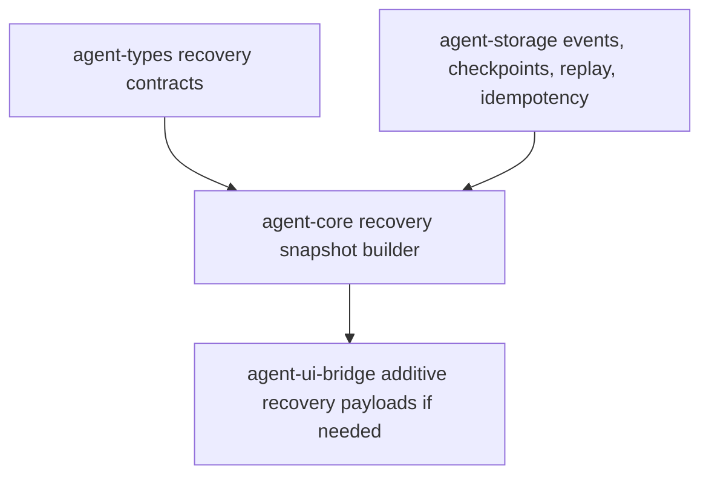

# M62-01 Recovery Snapshot and Resume Contracts Spec

## Purpose

Define the first product-level recovery contract for interrupted coding work. M62-01 turns the existing `RecoveryEngine`, checkpoint store, replay cursor, idempotency store, and approval-resume foundations into a typed recovery snapshot and resume dry-run report that can tell a caller what is ready, what will be replayed, what side effects are already recorded, and what blocks safe resume.

## Product Context

M62 Reliability and Recovery Productization is about user trust after interruption, crash, conflict, or retryable failure. Before CLI, TUI, or Desktop can show polished resume/replay UX, the runtime needs one stable, serde-friendly contract that represents recovery readiness without duplicating side effects. M62-01 provides that shared contract and leaves command/UI presentation to later M62 slices.

This slice builds directly on:

- M04 checkpoint/recovery/replay foundations
- M18 tool-loop idempotency foundations
- M19 approval resume recovery
- M26-M29 observability and replay evidence
- M56-M61 coding, terminal, Desktop, and task UX foundations

## Scope

This spec delivers:

- typed recovery snapshot contracts in shared runtime crates
- recovery readiness classification for clean, pending, approval-wait, corrupt-checkpoint, storage-error, and blocked states
- checkpoint and replay metadata suitable for CLI/JSON and bridge surfaces
- pending tool call summaries that exclude terminal tool events and recorded idempotent effects
- idempotent effect summaries that expose safe key/hash/tool metadata without raw tool input or raw output
- pending approval wait summaries where the existing event stream carries approval-request evidence
- typed recovery diagnostics for corrupt checkpoint state, storage failures, invalid idempotency keys, missing or stale replay data, and unknown blocking state
- resume dry-run behavior that reports planned recovery work without executing side effects
- focused tests for serde shape, readiness, diagnostics, pending tool filtering, idempotent effect visibility, approval waits, and corrupt checkpoint handling

Owned by later M62 specs:

- CLI/JSON `recovery status`, `recovery resume`, `replay inspect`, and `replay fork` commands belong to M62-02.
- Failed command/test retry planning and retry command UX belong to M62-03.
- Worktree conflict diagnostic surfacing belongs to M62-04.
- Crash/restart smoke coverage and user workflow docs belong to M62-05.
- Desktop visual redesign and multi-provider settings productization are intentionally out of scope and belong to the separate Desktop Productization workstream.

## Architecture

`agent-types` owns durable, serde-friendly recovery data contracts. `agent-core` owns snapshot construction, recovery readiness classification, dry-run planning, and mapping existing storage/core errors into typed diagnostics. `agent-storage` remains the owner of event, checkpoint, replay, and idempotency stores. `agent-ui-bridge` may receive additive frame/command contracts only if needed by tests in this slice; no CLI, TUI, Desktop, or TypeScript presentation logic is required for M62-01.



Dependency rules:

- Snapshot construction must live in `agent-core`, not in CLI, TUI, Desktop, Tauri, or React.
- Durable/public recovery contracts must be typed and `Serialize`/`Deserialize`.
- Recovery snapshots must consume existing storage traits instead of adding direct SQL or backend-specific logic to `agent-core`.
- Resume dry-run must not execute model, tool, command, policy mutation, checkpoint mutation, or audit side effects.

## File Layout

```text
crates/
  agent-types/
    src/
      recovery.rs
      lib.rs
  agent-core/
    src/
      recovery.rs
      lib.rs
    tests/
      recovery_snapshot.rs
  agent-storage/
    src/
      checkpoint.rs
      replay.rs
      idempotency.rs
docs/
  specs/
    M62-01-recovery-snapshot-resume.spec.md
  plans/
    M62-01-recovery-snapshot-resume.plan.md
```

Exact implementation files may change if existing modules already own a compatible contract, but the ownership boundary must remain the same.

## Public Contracts

Final field names may change during implementation, but the slice should provide contracts equivalent to:

```rust
pub struct RecoverySnapshot {
    pub conversation_id: ConversationId,
    pub turn_id: Option<TurnId>,
    pub checkpoint: Option<RecoveryCheckpointSummary>,
    pub replay: RecoveryReplaySummary,
    pub readiness: RecoveryReadiness,
    pub pending_tool_calls: Vec<RecoveredToolCall>,
    pub idempotent_effects: Vec<RecoveredToolEffect>,
    pub pending_approvals: Vec<RecoveredApprovalWait>,
    pub diagnostics: Vec<RecoveryDiagnostic>,
}

pub struct RecoveryCheckpointSummary {
    pub checkpoint_id: CheckpointId,
    pub event_seq: EventSeq,
    pub label: String,
    pub created_at: Timestamp,
}

pub struct RecoveryReplaySummary {
    pub replay_from: EventSeq,
    pub replayed_event_count: u32,
}

#[serde(rename_all = "snake_case")]
pub enum RecoveryReadiness {
    Ready,
    NeedsApproval,
    PendingToolCalls,
    CorruptCheckpoint,
    StorageError,
    Blocked,
}

pub struct RecoveredToolCall {
    pub call_id: String,
    pub tool_name: Option<String>,
    pub status: RecoveredToolCallStatus,
}

pub struct RecoveredToolEffect {
    pub idempotency_key: String,
    pub call_id: String,
    pub tool_name: String,
    pub input_hash: String,
    pub completed_at: Timestamp,
}

pub struct RecoveredApprovalWait {
    pub approval_id: String,
    pub call_id: Option<String>,
    pub summary: String,
}

pub struct RecoveryDiagnostic {
    pub severity: RecoveryDiagnosticSeverity,
    pub code: String,
    pub message: String,
    pub source: Option<String>,
    pub truncated: bool,
}

pub struct ResumeDryRunReport {
    pub snapshot: RecoverySnapshot,
    pub will_replay_event_count: u32,
    pub will_resume_pending_tool_count: u32,
    pub will_reuse_idempotent_effect_count: u32,
    pub blocked: bool,
}
```

The existing `RecoveryPlan` and `RecoveryOutcome` may remain for internal compatibility, but callers should be able to request the richer product snapshot without parsing raw events or checkpoint JSON.

## State and Failure Handling

- If a valid checkpoint exists, replay starts from the next event sequence after the checkpoint event sequence.
- If no checkpoint exists, replay starts from event sequence 1.
- If checkpoint state is corrupt, the snapshot reports `CorruptCheckpoint` readiness with a blocking diagnostic and does not silently fall back to sequence 1.
- Pending tool calls are derived from replayed `ToolCallProposed` events minus terminal `ToolExecutionCompleted`, `ToolExecutionFailed`, and `ToolObservationRecorded` events.
- Pending tool calls with a matching idempotency record are excluded from pending work and represented as idempotent effect summaries.
- If idempotency lookup fails, the snapshot includes a storage/error diagnostic and readiness becomes blocked or storage-error.
- Pending approval waits are reconstructed only from typed event evidence already available in the event stream; missing approval detail should produce a bounded diagnostic rather than invented state.
- Event, checkpoint, and idempotency storage errors become typed diagnostics with redacted messages.
- Empty replay tails are valid and should usually be `Ready` when no diagnostics or waits remain.

## Security and Privacy

- Recovery snapshots may expose ids, labels, tool names, safe hashes, event counts, and bounded summaries.
- Recovery snapshots must not expose raw tool input JSON, raw command output, raw provider prompts, raw checkpoint JSON, secret refs with values, environment values, or unbounded tool output.
- Diagnostic messages must be bounded and redacted before crossing crate/UI boundaries.
- Resume dry-run is read-only and must not mutate storage, re-execute tools, grant approvals, or record audit/checkpoint events.
- Existing policy, sandbox, audit, and idempotency boundaries must remain authoritative for any later real resume command.

## Testing Strategy

- `agent-types` tests or coverage through `agent-core` tests for serde shape and enum naming.
- `agent-core/tests/recovery_snapshot.rs` should cover:
  - no-checkpoint snapshot starts from sequence 1 and is ready
  - valid checkpoint snapshot starts from the next sequence and includes checkpoint metadata
  - corrupt checkpoint reports blocking diagnostic
  - pending tool calls exclude terminal events
  - idempotent records exclude pending tool calls and appear in effect summaries
  - pending approval evidence produces `NeedsApproval` readiness
  - dry-run reports counts without side effects
- Existing recovery/idempotency/storage tests must continue to pass.

## Acceptance Criteria

- M62-01 slice spec and plan are committed before code changes.
- Runtime exposes a typed recovery snapshot and resume dry-run report with stable serde JSON.
- Snapshot construction reuses existing checkpoint, replay, and idempotency stores.
- Pending tool calls do not include terminal or idempotently completed side effects.
- Corrupt checkpoint and storage/idempotency failures are typed diagnostics, not panics or silent fallbacks.
- Dry-run resume is read-only and reports planned replay/resume/reuse counts.
- Focused verification passes:
  - `cargo fmt --all -- --check`
  - `cargo clippy -p agent-types -p agent-core -p agent-storage -p agent-ui-bridge --all-targets -- -D warnings`
  - `cargo test -p agent-types`
  - `cargo test -p agent-core --test recovery_snapshot`
  - `cargo test -p agent-core --test approval_resume_recovery`
  - `cargo test -p agent-core --test comprehensive_turn_idempotency`
  - `cargo test -p agent-storage --test checkpoint_store`
  - `cargo test -p agent-storage --test replay_integration`

## Completion Signal

M62-01 is complete when the slice docs, typed contracts, snapshot builder, dry-run report, focused tests, verification commands, milestone status updates, and exact-staged implementation commit are complete.
