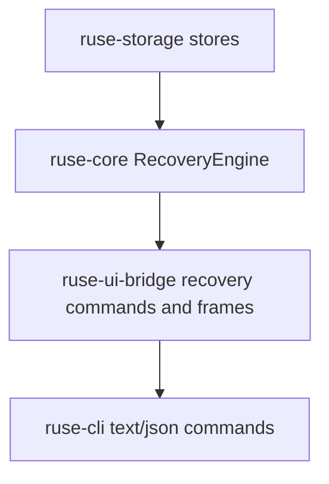

# M62-02 CLI/JSON Replay, Resume, and Fork Commands Spec

## Purpose

Expose M62 recovery snapshots through stable CLI/JSON and UI bridge commands so users and automation can inspect resume readiness, dry-run checkpoint resume, inspect replay evidence, and create explicit fork requests without duplicating recovery logic in presentation layers.

## Product Context

M62-01 added typed recovery snapshots and resume dry-run reports in shared runtime crates. M62-02 makes those contracts visible through terminal and bridge surfaces, closing the first product loop for interrupted work: a developer can ask what is recoverable, see what would replay or remain pending, and request a fork or resume plan from typed state.

This slice supports the M62 acceptance criteria for checkpoint resume UX and replay/fork commands. It deliberately stays below Desktop visual productization and above raw storage internals.

## Scope

This spec delivers:

- typed UI bridge command envelopes for recovery status, recovery resume dry-run, replay inspect, and replay fork planning
- typed UI bridge frames for recovery snapshots, resume dry-run reports, replay inspection reports, and replay fork reports
- CLI text and JSON commands for recovery status, recovery resume dry-run, replay inspect, and replay fork planning
- deterministic fixture-backed command behavior using existing in-memory stores and M62-01 recovery contracts
- stable, bounded, redacted output that exposes ids, readiness, replay counts, pending calls, idempotent effects, pending approvals, and diagnostics without raw tool input/output
- focused tests for bridge JSON shape and CLI text/JSON rendering

Owned by later M62 specs:

- real resume execution after approval/tool policy belongs to later recovery implementation, not this dry-run command slice
- failed command/test retry UX belongs to M62-03
- worktree conflict diagnostics belong to M62-04
- crash/restart smoke and user workflow docs belong to M62-05
- Desktop visual redesign and provider/model settings productization belong to the separate Desktop Productization workstream

## Architecture

`ruse-core` remains the source of recovery truth through `RecoveryEngine::snapshot` and `RecoveryEngine::resume_dry_run`. `ruse-ui-bridge` owns typed command/frame contracts and UI-safe reports. `ruse-cli` parses command arguments, invokes shared recovery fixture/runtime helpers for deterministic local output, and renders text or JSON. `ruse-storage` remains behind traits and test fixtures.



Dependency rules:

- CLI must not parse raw event JSON to infer recovery state.
- UI bridge may wrap and summarize recovery contracts but must not reclassify readiness differently from `ruse-core`.
- Fork commands in this slice are explicit typed plans/reports, not hidden storage mutations unless a durable fork store already exists and is safely wired.
- All public command outputs must be serde-friendly, bounded, redacted, and stable.

## File Layout

```text
crates/
  ruse-ui-bridge/
    src/
      command.rs
      frame.rs
    tests/
      recovery_bridge.rs
  ruse-cli/
    src/
      command.rs
    tests/
      recovery_commands.rs
docs/
  specs/
    M62-02-cli-json-replay-resume-fork.spec.md
  plans/
    M62-02-cli-json-replay-resume-fork.plan.md
```

Exact file placement may change to match existing local helpers, but recovery behavior must remain sourced from runtime contracts rather than presentation-layer parsing.

## Public Contracts

The slice should add or expose command contracts equivalent to:

```rust
#[serde(tag = "type", rename_all = "snake_case")]
pub enum UiCommand {
    RecoveryStatus {
        conversation_id: ConversationId,
        turn_id: Option<TurnId>,
    },
    RecoveryResumeDryRun {
        conversation_id: ConversationId,
        turn_id: Option<TurnId>,
        checkpoint_id: Option<CheckpointId>,
    },
    ReplayInspect {
        conversation_id: ConversationId,
        from_checkpoint_id: Option<CheckpointId>,
    },
    ReplayFork {
        conversation_id: ConversationId,
        source_turn_id: Option<TurnId>,
        checkpoint_id: Option<CheckpointId>,
        fork_label: String,
    },
}
```

Frames/reports should carry typed payloads equivalent to:

```rust
pub struct UiRecoverySnapshotFrame {
    pub snapshot: RecoverySnapshot,
}

pub struct UiResumeDryRunFrame {
    pub report: ResumeDryRunReport,
}

pub struct UiReplayInspectReport {
    pub conversation_id: ConversationId,
    pub replay_from: EventSeq,
    pub replayed_event_count: u32,
    pub checkpoint_id: Option<CheckpointId>,
    pub diagnostics: Vec<RecoveryDiagnostic>,
}

pub struct UiReplayForkReport {
    pub conversation_id: ConversationId,
    pub source_turn_id: Option<TurnId>,
    pub checkpoint_id: Option<CheckpointId>,
    pub fork_label: String,
    pub replay_from: EventSeq,
    pub dry_run: bool,
    pub diagnostics: Vec<RecoveryDiagnostic>,
}
```

CLI command shapes:

```text
ruse-cli recovery status --conversation <id> [--turn <id>]
ruse-cli recovery resume --conversation <id> [--turn <id>] [--checkpoint <id>] --dry-run
ruse-cli replay inspect --conversation <id> [--from-checkpoint <id>]
ruse-cli replay fork --conversation <id> [--turn <id>] [--checkpoint <id>] --label <name> --dry-run
```

If live persisted session lookup is not yet available for arbitrary ids, commands may provide deterministic fixture modes in this slice, but the public JSON/text shape must match the real command shape and the limitation must be explicit in diagnostics.

## State and Failure Handling

- Missing required ids fail before side effects with stable CLI errors or JSON error frames.
- Invalid UUID/id values fail as typed parse errors.
- `recovery resume` in M62-02 defaults to dry-run; real side-effecting resume is rejected with a diagnostic until a later slice wires execution.
- Replay inspect reports the same replay start and event count as the recovery snapshot.
- Replay fork reports a planned fork label and source metadata without mutating storage unless a durable fork backend exists.
- Checkpoint arguments are validated for shape, but checkpoint lookup remains driven by the recovery snapshot unless later storage APIs support direct checkpoint selection.
- Diagnostics are bounded and redacted.

## Security and Privacy

- CLI/JSON and bridge outputs must not include raw tool input JSON, raw command output, raw checkpoint JSON, raw provider prompts, secret values, or environment values.
- Resume and fork commands in this slice are read-only dry-runs.
- Any future real resume/fork side effect must still pass through policy, sandbox, audit, checkpoint, and storage boundaries.
- JSON output must remain machine-parseable and not include terminal-only decoration.

## Testing Strategy

- `ruse-ui-bridge/tests/recovery_bridge.rs` for command serde shape, frame serde shape, and redaction-safe payloads
- `ruse-cli/tests/recovery_commands.rs` for text and JSON output for recovery status, resume dry-run, replay inspect, and replay fork dry-run
- CLI tests should include invalid ids, missing required args, and no-secret leakage checks
- Focused checks:
  - `cargo clippy -p ruse-ui-bridge -p ruse-cli --all-targets -- -D warnings`
  - `cargo test -p ruse-ui-bridge --test recovery_bridge`
  - `cargo test -p ruse-cli --test recovery_commands`

## Acceptance Criteria

- CLI/JSON can render recovery status from typed M62-01 snapshots.
- CLI/JSON can render resume dry-run reports with replay/pending/idempotent counts.
- CLI/JSON can render replay inspect and replay fork dry-run reports with stable bounded output.
- UI bridge commands and frames serialize with stable snake_case command types.
- Outputs are redacted and do not expose raw tool input/output or secret-like values.
- No Desktop UI or provider/model settings files are changed by this slice.

## Completion Signal

M62-02 is complete when slice docs, bridge command/frame contracts, CLI text/JSON commands, focused tests, verification commands, milestone status updates, and exact-staged commits are complete.
