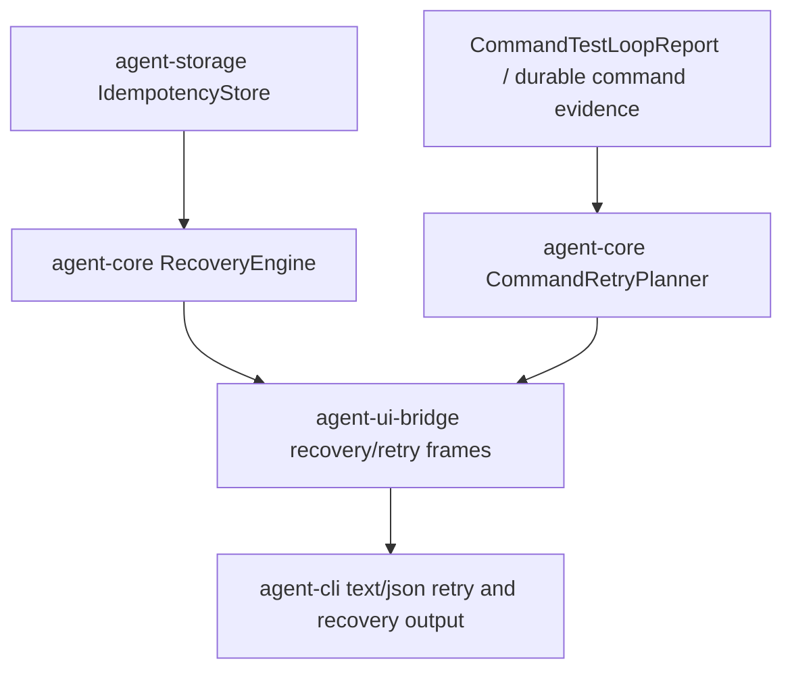

# M62-03 Idempotent Recovery and Failed Command Retry UX Spec

## Purpose

Make recovery explain what happened to side effects and make failed command/test retries explicit, evidence-linked, and safe. M62-03 turns the M62-01 recovery snapshot and M62-02 CLI/JSON surfaces into a more actionable recovery loop: users can see which tool effects will be reused or skipped, why pending calls remain pending, and what retry plan is available for a failed command/test run.

## Product Context

M62-01 exposed typed recovery snapshots and resume dry-run reports. M62-02 exposed those reports through CLI/JSON and UI bridge commands. The remaining trust gap is the moment after a failed command or interrupted tool loop: users need to understand whether side effects would be duplicated, whether retry is allowed, and how a new attempt links back to the evidence that failed.

This slice focuses on runtime-owned planning and presentation-safe summaries. CLI, TUI, Desktop, and JSON may display or request retry actions, but retry classification and side-effect disposition must be computed in shared runtime crates.

## Scope

This slice delivers:

- typed idempotent recovery visibility for completed effects, reusable/skipped side effects, pending calls, and conflicts
- typed failed command/test retry planning from `CommandTestLoopReport` or equivalent durable command evidence
- retry readiness diagnostics for stale, missing, successful, denied, waiting-approval, timed-out, and failed targets
- attempt linkage between the original command/test evidence and a planned or executed retry attempt
- UI bridge frames/summary fields that are bounded, redacted, and safe for CLI/TUI/Desktop display
- CLI text/JSON retry planning command and recovery output that includes idempotent side-effect disposition
- focused tests for idempotency visibility, retry classification, retry plan JSON shape, redaction, and invalid/stale targets

Out of scope for this slice:

- provider transport retry policy changes
- Desktop-specific visual redesign
- worktree conflict diagnostics, which belong to M62-04
- crash/restart smoke and user workflow docs, which belong to M62-05
- bypassing command/test policy, sandbox, approval, audit, checkpoint, or trace paths for real retry execution

## Architecture

`agent-core` remains the source of retry and idempotency truth. `agent-storage` remains the owner of idempotency records and durable command evidence when available. `agent-ui-bridge` wraps runtime reports into UI-safe frames. `agent-cli` parses retry requests and renders typed reports without reclassifying failures.



Dependency rules:

- CLI must not infer retryability from exit codes or stderr text.
- UI bridge must not mutate command state or retry attempts.
- Real retry execution, if implemented in this slice, must call the existing command/test loop with a new attempt id and policy path.
- Idempotent tool recovery must expose only ids, tool names, hashes, timestamps, counts, statuses, and redacted summaries.

## File Layout

```text
crates/
  agent-types/
    src/
      recovery.rs
      command_retry.rs
      lib.rs
  agent-core/
    src/
      command_retry.rs
      idempotency.rs
      recovery.rs
      lib.rs
    tests/
      failed_command_retry.rs
      recovery_snapshot.rs
  agent-ui-bridge/
    src/
      command.rs
      frame.rs
      lib.rs
    tests/
      recovery_bridge.rs
  agent-cli/
    src/
      command.rs
      lib.rs
    tests/
      recovery_commands.rs
      command_retry.rs
```

Exact placement may change to match existing crate organization, but retry and idempotency classification must stay in shared runtime crates.

## Public Contracts

Names may be adjusted during implementation, but contracts should be equivalent to:

```rust
#[derive(Clone, Debug, Eq, PartialEq, Serialize, Deserialize)]
pub struct IdempotentRecoverySummary {
    pub reusable_effect_count: u32,
    pub pending_tool_count: u32,
    pub conflict_count: u32,
    pub effects: Vec<RecoveredToolEffectDisposition>,
    pub diagnostics: Vec<RecoveryDiagnostic>,
}

#[derive(Clone, Debug, Eq, PartialEq, Serialize, Deserialize)]
pub struct RecoveredToolEffectDisposition {
    pub call_id: String,
    pub tool_name: String,
    pub idempotency_key: String,
    pub input_hash: String,
    pub disposition: ToolEffectDisposition,
    pub completed_at: Timestamp,
}

#[derive(Copy, Clone, Debug, Eq, PartialEq, Serialize, Deserialize)]
#[serde(rename_all = "snake_case")]
pub enum ToolEffectDisposition {
    Reusable,
    SkippedDuplicate,
    PendingReplay,
    Conflict,
}

#[derive(Clone, Debug, Eq, PartialEq, Serialize, Deserialize)]
pub struct CommandRetryRequest {
    pub command_run_id: String,
    pub reason: String,
    pub dry_run: bool,
}

#[derive(Clone, Debug, Eq, PartialEq, Serialize, Deserialize)]
pub struct CommandRetryPlan {
    pub command_run_id: String,
    pub previous_attempt_id: String,
    pub next_attempt_id: String,
    pub readiness: CommandRetryReadiness,
    pub classification: CommandFailureClassification,
    pub command: CommandIntentSummary,
    pub exit_code: Option<i32>,
    pub reason: String,
    pub dry_run: bool,
    pub diagnostics: Vec<CommandRetryDiagnostic>,
}

#[derive(Copy, Clone, Debug, Eq, PartialEq, Serialize, Deserialize)]
#[serde(rename_all = "snake_case")]
pub enum CommandRetryReadiness {
    Retryable,
    AlreadySucceeded,
    WaitingApproval,
    PolicyBlocked,
    StaleTarget,
    MissingEvidence,
    InvalidTarget,
}
```

UI bridge command/frame equivalents:

```rust
#[serde(tag = "type", content = "data", rename_all = "snake_case")]
pub enum UiCommand {
    CommandRetryPlan {
        command_run_id: String,
        reason: String,
        dry_run: bool,
    },
}

#[serde(tag = "type", content = "data", rename_all = "snake_case")]
pub enum UiJsonFrame {
    CommandRetryPlan(UiCommandRetryPlan),
    IdempotentRecovery(UiIdempotentRecoverySummary),
}
```

CLI command shape:

```text
agent-cli command retry <command-run-id> --reason <text> --dry-run
```

If durable command evidence lookup is not available yet, the CLI may use deterministic fixture-backed retry evidence for M62-03 tests, but output must include a typed diagnostic explaining the fixture limitation.

## State and Failure Handling

- Successful command/test reports are not retryable and produce `already_succeeded`.
- Waiting approval or denied reports must not silently retry; they produce `waiting_approval` or `policy_blocked`.
- Timeout, command failure, test failure, and tool failure may be retryable when previous evidence includes enough command intent to rerun.
- Invalid input and missing/stale command evidence are blocking.
- Retry attempts must receive a new attempt id while preserving a link to the previous attempt id.
- Redacted stdout/stderr summaries may be referenced, but raw unbounded command output must not be embedded in retry plans.
- Idempotency conflicts must remain blocking until user/runtime state changes; reports expose the key and hashes, not raw inputs or outputs.
- Dry-run retry planning must never execute commands or mutate idempotency records.

## Security and Privacy

- No retry output may include raw command output, raw tool input/output, provider prompts, environment values, credentials, or secret-like substrings.
- Real retry execution must use the same sandbox, policy, approval, audit, event, checkpoint, and command/test paths as a first attempt.
- Retry reason text must be bounded and redacted.
- JSON output must remain machine-parseable and free of terminal decoration.

## Testing Strategy

- `agent-core/tests/failed_command_retry.rs`
  - retryable command failure produces a retryable plan
  - retryable test failure preserves `classify_as_test`
  - successful command is not retryable
  - waiting approval/denied command is blocked
  - missing/stale target is blocked
  - retry reason and command output are redacted
- `agent-core/tests/recovery_snapshot.rs`
  - idempotent effects expose reusable/skipped disposition without raw output
  - idempotency conflict produces blocking diagnostic
- `agent-ui-bridge/tests/recovery_bridge.rs`
  - retry command/frame serde shape
  - idempotent recovery frame shape
- `agent-cli/tests/command_retry.rs` or `agent-cli/tests/recovery_commands.rs`
  - parse retry dry-run command
  - render text retry plan
  - render JSON retry plan
  - reject missing reason and missing `--dry-run` for planning-only mode
  - verify no `must-not-appear`, `sk-`, `api_key`, or `token` leakage

Focused checks:

```bash
cargo fmt --all -- --check
cargo clippy -p agent-core -p agent-ui-bridge -p agent-cli --all-targets -- -D warnings
cargo test -p agent-core --test comprehensive_turn_idempotency
cargo test -p agent-core --test failed_command_retry
cargo test -p agent-ui-bridge --test recovery_bridge
cargo test -p agent-cli --test recovery_commands
```

## Acceptance Criteria

- Recovery output explains idempotent side-effect disposition with bounded redacted summaries.
- Failed command/test retry planning is typed, explicit, evidence-linked, and policy-aware.
- CLI/JSON can render retry plans without executing commands in dry-run mode.
- Retry plans reject successful, waiting-approval, denied, stale, missing, and invalid targets with typed diagnostics.
- All retry/idempotency public contracts are serializable and covered by focused tests.
- No Desktop UI or conflict diagnostic work is mixed into this slice.

## Completion Signal

M62-03 is complete when slice docs, runtime contracts, retry planner, idempotent recovery summaries, bridge frames, CLI text/JSON commands, focused tests, verification commands, milestone status updates, and exact-staged commits are complete.
