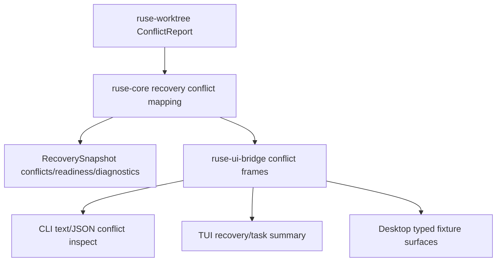

# M62-04 Conflict Diagnostics and Recovery Surfacing Spec

## Purpose

Surface worktree/file-change conflicts as typed, safe, actionable recovery diagnostics. M62-04 builds on the existing `ruse-worktree` conflict detector and threads conflict summaries through recovery snapshots and UI-safe surfaces so a developer can see why work is blocked, which paths overlap, and what the next safe action is.

## Product Context

M09-02 added pure conflict detection for changed-file sets. M62-01 through M62-03 now expose recovery state, replay/fork dry-runs, idempotent side-effect disposition, and command retry plans. The next reliability gap is conflict awareness: recovery should not look "ready" when the current work has overlapping edits that require user or reviewer action.

This slice is not a full merge workflow. M63 owns worktree/team product workflows. M62-04 only makes conflict state typed, redacted, recoverable, and visible through shared runtime/bridge surfaces.

## Scope

This slice delivers:

- typed conflict summary contracts suitable for recovery snapshots
- mapping from `ruse-worktree::ConflictReport` into recovery-safe conflict diagnostics
- recovery readiness interaction for active conflicts
- CLI/JSON conflict inspection using deterministic fixture-backed conflict reports when durable lookup is not yet available
- bridge frames for conflict diagnostics and recovery snapshots carrying conflict summaries
- TUI/Desktop-safe fixture updates so clients can render conflict counts and path summaries without raw file contents
- focused tests for conflict mapping, redaction, JSON shape, and CLI output

Out of scope:

- real Git merge execution
- conflict resolution editing UI
- subagent handoff, reviewer roles, and team-level workflows, which belong to M63
- Desktop visual redesign or provider/model settings work
- crash/restart smoke, which belongs to M62-05

## Architecture

`ruse-worktree` remains the source of pure conflict detection. `ruse-core` owns recovery-facing mapping and readiness logic. `ruse-ui-bridge` wraps recovery-safe conflict reports into frames. CLI/TUI/Desktop render typed summaries without embedding raw file contents or recomputing conflict classification.



Dependency rules:

- CLI, TUI, and Desktop must not classify conflicts from paths themselves.
- Recovery readiness must be computed in runtime crates.
- Conflict reports may contain paths, change kinds, hashes, source labels, counts, and suggested actions; they must not contain file contents or patch hunks.
- Desktop changes in this slice must be limited to typed recovery/conflict surfaces and smoke fixtures, not productization redesign.

## File Layout

```text
crates/
  ruse-types/
    src/
      recovery.rs
  ruse-core/
    src/
      recovery.rs
      conflict_recovery.rs
    tests/
      conflict_recovery.rs
  ruse-worktree/
    src/
      conflict.rs
    tests/
      conflict_detection.rs
  ruse-ui-bridge/
    src/
      frame.rs
      lib.rs
    tests/
      recovery_bridge.rs
  ruse-cli/
    src/
      command.rs
    tests/
      recovery_commands.rs
  ruse-tui/
    src/
      task_panel.rs
      trace_panel.rs
      transcript.rs
  ruse-desktop/
    src/
      task.rs
    tests/
      recovery_view.rs
apps/
  desktop/
    src/
      types.ts
      state/tasks.ts
      components/TaskDetail.tsx
      __tests__/desktop-smoke.test.tsx
```

Exact placement may change to match local code ownership, but conflict classification must remain in `ruse-worktree` or `ruse-core`.

## Public Contracts

Names may change during implementation, but contracts should be equivalent to:

```rust
#[derive(Clone, Debug, Eq, PartialEq, Serialize, Deserialize)]
pub struct RecoveryConflictSummary {
    pub path: String,
    pub kind: RecoveryConflictKind,
    pub lead_change: RecoveryConflictSide,
    pub incoming_change: RecoveryConflictSide,
    pub next_action: RecoveryConflictNextAction,
    pub diagnostics: Vec<RecoveryDiagnostic>,
}

#[derive(Copy, Clone, Debug, Eq, PartialEq, Serialize, Deserialize)]
#[serde(rename_all = "snake_case")]
pub enum RecoveryConflictKind {
    BothModified,
    DeleteModify,
    AddAddDifferentContent,
}

#[derive(Clone, Debug, Eq, PartialEq, Serialize, Deserialize)]
pub struct RecoveryConflictSide {
    pub source: String,
    pub change_kind: String,
    pub content_hash: Option<String>,
}

#[derive(Copy, Clone, Debug, Eq, PartialEq, Serialize, Deserialize)]
#[serde(rename_all = "snake_case")]
pub enum RecoveryConflictNextAction {
    InspectDiff,
    ChooseSide,
    ForkWork,
    ManualResolution,
}
```

`RecoverySnapshot` should gain:

```rust
pub conflicts: Vec<RecoveryConflictSummary>,
```

`RecoveryReadiness` should include or map to a conflict-blocking state:

```rust
HasConflict
```

CLI command shape:

```text
ruse-cli conflict inspect --fixture sample
ruse-cli conflict inspect --conversation <id> [--turn <id>]
```

If durable conflict lookup is not available, fixture mode may be used for M62-04 tests, but output must include a typed diagnostic explaining that persisted lookup is not wired yet.

## State and Failure Handling

- Conflicts make recovery not ready for automatic resume and produce typed blocking diagnostics.
- Conflict paths must be normalized workspace-relative paths.
- Invalid paths are rejected before being exposed through recovery summaries.
- Reports must be sorted by path for deterministic output.
- Empty conflict reports do not block readiness.
- Same-content add/add remains non-conflicting according to `ruse-worktree`.
- Raw file contents, hunk text, command output, and provider prompts must not be included.

## Security and Privacy

- Paths and hashes are treated as untrusted input and redacted/bounded before display.
- Secret-like path or hash segments must be redacted in UI-safe summaries.
- No raw file content is embedded in conflict reports.
- Desktop/Tauri code must not gain filesystem mutation authority from conflict inspection.

## Testing Strategy

- `ruse-worktree/tests/conflict_detection.rs`
  - keep existing detector behavior green
- `ruse-core/tests/conflict_recovery.rs`
  - map `ConflictReport` to recovery summaries
  - conflict readiness blocks automatic recovery
  - invalid/secret-like paths are rejected or redacted
- `ruse-ui-bridge/tests/recovery_bridge.rs`
  - conflict frame/snapshot JSON shape
- `ruse-cli/tests/recovery_commands.rs`
  - text and JSON conflict inspect output
  - no `must-not-appear`, `sk-`, `api_key`, or `token` leakage
- TUI/Desktop fixture tests:
  - conflict count/path summary renders from typed frames
  - no raw content in task/recovery detail fixtures

Focused checks:

```bash
cargo fmt --all -- --check
cargo clippy -p ruse-worktree -p ruse-core -p ruse-ui-bridge -p ruse-cli -p ruse-tui -p ruse-desktop --all-targets -- -D warnings
cargo test -p ruse-worktree --test conflict_detection
cargo test -p ruse-core --test conflict_recovery
cargo test -p ruse-ui-bridge --test recovery_bridge
cargo test -p ruse-cli --test recovery_commands
cargo test -p ruse-desktop --test recovery_view
npm --prefix apps/desktop test -- desktop-smoke
```

## Acceptance Criteria

- Recovery snapshots can carry typed conflict summaries.
- Active conflicts block automatic readiness with typed diagnostics.
- CLI/JSON can inspect conflict summaries with stable bounded output.
- Bridge/TUI/Desktop-safe surfaces can render conflict count, path, kind, and next action without raw file contents.
- Existing `ruse-worktree` conflict detector behavior remains green.
- No Desktop redesign or M63 team workflow work is mixed into this slice.

## Completion Signal

M62-04 is complete when slice docs, conflict recovery contracts, readiness integration, bridge frames, CLI conflict inspection, TUI/Desktop-safe fixtures, focused tests, verification commands, milestone status updates, and exact-staged commits are complete.
