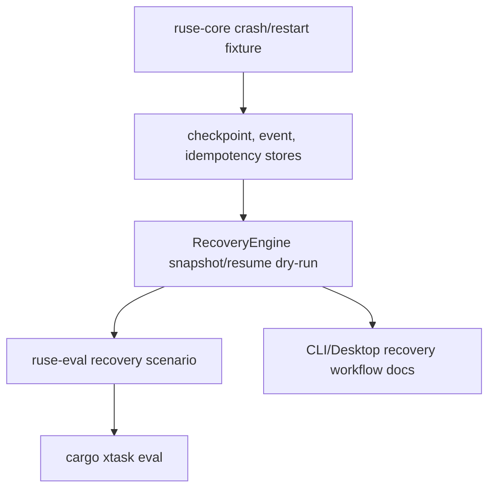

# M62-05 Crash Smoke, Docs, and Closeout Spec

## Purpose

Prove that M62 recovery behavior survives a deterministic interruption/restart path and close the reliability milestone with user-facing workflow docs, eval evidence, and final status updates. This slice turns the recovery contracts from M62-01 through M62-04 into an end-to-end product smoke: checkpointed work can be inspected after restart, idempotent side effects are not duplicated, retry/conflict evidence remains visible, and CLI/Desktop-facing users have documented recovery actions.

## Product Context

M62 already exposes recovery snapshots, replay/resume/fork commands, idempotent recovery visibility, failed-command retry planning, and conflict diagnostics. The remaining product gap is confidence after process failure: a developer should be able to restart the product, see what happened, decide whether resume is safe, and inspect evidence without provider credentials or live external systems.

M62-05 is the closeout slice for M62 Reliability and Recovery Productization. It does not start M63 worktree/team workflows, M64 memory personalization, M65 packaging, or M66 extension hardening.

## Scope

This spec delivers:

- a deterministic crash/restart smoke fixture for recovery state
- runtime tests proving checkpoint resume, replay tail accounting, pending tool recovery, idempotent skip/reuse evidence, retry diagnostics, and conflict blocking after restart
- optional eval-suite integration so `cargo xtask eval` includes the recovery smoke without provider credentials
- CLI recovery workflow documentation for status, resume dry-run, replay inspect/fork, command retry dry-run, and conflict inspect
- Desktop recovery workflow documentation covering recovery readiness, task conflict summaries, approvals, retry, and restart expectations
- README, roadmap, milestone, and M62 plan status closeout updates
- final verification evidence for M62 focused and workspace-level gates

Out of scope:

- real OS process crash injection
- installer crash reporting or support bundle packaging, which belongs to M65
- merge resolution UI or worktree/team handoff, which belongs to M63
- provider transport retry policy hardening
- Desktop productization redesign

## Architecture

`ruse-core` owns the deterministic crash/restart fixture because recovery semantics belong in runtime crates. The fixture should simulate the important product condition: state is written before interruption, then a new runtime-facing recovery engine instance reads durable stores and reports safe recovery state.

`ruse-eval` may wrap the same fixture as a credential-free scenario so the default eval suite can prove M62 recovery behavior alongside the existing M04/M56/M58 scenarios. `xtask eval` should keep using `docs/eval/default.suite.json`; M62-05 only adds a new scenario if it can remain deterministic, bounded, and fast.

CLI, TUI, and Desktop do not implement crash logic. They document and render typed recovery contracts produced by runtime and bridge layers.



## File Layout

```text
crates/
  ruse-core/
    tests/
      crash_resume_smoke.rs
  ruse-eval/
    src/
      manifest.rs
      runner.rs
    tests/
      runner.rs
      corpus.rs
  ruse-cli/
    tests/
      recovery_commands.rs
docs/
  cli/
    recovery-workflows.md
  desktop/
    recovery-workflows.md
  eval/
    default.suite.json
    scenarios/
      m62-recovery-crash-smoke.eval.json
    goldens/
      default-m62-recovery-crash-smoke.golden.json
  milestones/
    README.md
  plans/
    M62-reliability-recovery-productization.plan.md
    M62-05-crash-smoke-closeout.plan.md
  roadmap/
    PRODUCT_ROADMAP.md
README.md
```

Exact eval/golden files may change if implementation chooses a Rust-only smoke first, but the closeout must leave an automated credential-free recovery gate.

## Public Contracts

If eval integration is implemented, add an eval scenario kind equivalent to:

```rust
#[serde(rename_all = "snake_case")]
pub enum EvalScenarioKind {
    RecoveryCrashSmoke,
}
```

The scenario expectation should be declarative and bounded:

```json
{
  "kind": "recovery_crash_smoke",
  "expectations": {
    "expected_status": "passed",
    "recovery": {
      "expected_readiness": "has_conflict",
      "min_replayed_event_count": 1,
      "min_idempotent_effect_count": 1,
      "min_pending_tool_count": 1,
      "min_conflict_count": 1,
      "requires_retry_plan": true
    }
  }
}
```

The runtime smoke should assert against existing public M62 contracts:

- `RecoverySnapshot`
- `ResumeDryRunReport`
- `IdempotentRecoverySummary`
- `CommandRetryPlan`
- `RecoveryConflictSummary`
- `RecoveryReadiness`

No new CLI command is required unless implementation discovers a missing closeout gap.

## State and Failure Handling

- The fixture records pre-crash state, drops runtime objects, then reconstructs recovery state from stores.
- Completed idempotent effects must be reported as reusable/skipped rather than duplicated.
- Pending tool calls remain pending unless a terminal tool event or idempotency effect exists.
- Conflicts block automatic readiness with `RecoveryReadiness::HasConflict`.
- Retryable command/test evidence must produce an explicit dry-run retry plan if the fixture includes a failed command.
- Any fixture setup error is a test failure, not a recoverable product diagnostic.
- Eval output must be bounded and redacted, with no raw command logs, tool inputs, provider prompts, or secret-like strings.

## Security and Privacy

- Fixture data must include at least one secret-like string and assert it does not appear in user-facing reports or eval artifacts.
- Docs must describe redaction and dry-run behavior without encouraging users to paste secrets into commands.
- Crash smoke must not require network, provider credentials, filesystem mutation outside temporary test/eval directories, or shell execution beyond standard test/eval runners.
- Support/evidence artifacts must be summaries, not raw logs.

## Testing Strategy

- `ruse-core/tests/crash_resume_smoke.rs`
  - checkpoint resume after simulated restart
  - idempotent effect reuse/skip visibility
  - pending tool count survives restart
  - conflict readiness blocks automatic resume
  - retry dry-run plan remains evidence-linked if included
  - secret-like fixture values are redacted
- `ruse-eval/tests/runner.rs` and `ruse-eval/tests/corpus.rs`
  - recovery crash smoke scenario validates and runs
  - default suite includes the new scenario if eval integration is selected
- CLI docs tests if this repository has doc-content assertions for CLI recipes.
- Final closeout gates:

```bash
cargo fmt --all -- --check
cargo clippy --workspace --all-targets -- -D warnings
cargo test --workspace
npm --prefix apps/desktop test
npm --prefix apps/desktop run build
cargo xtask eval
```

## Acceptance Criteria

- A deterministic crash/restart smoke proves recovery state can be inspected after interruption without provider credentials.
- The smoke proves checkpoint/replay, pending tools, idempotent effect reuse, retry evidence, and conflict blocking through typed M62 contracts.
- CLI and Desktop recovery workflow docs exist and describe actual available commands/surfaces.
- Default product evidence includes the M62 recovery smoke, either through `cargo xtask eval` or an explicitly documented Rust smoke command.
- README, roadmap, milestone index, and M62 plans mark M62 complete only after final gates pass.
- No M63-M66 implementation is mixed into this closeout slice.

## Completion Signal

M62-05 is complete when the crash/restart smoke, docs, eval or documented smoke gate, final verification commands, and status updates are committed. M62 is complete only after M62-05 passes the full closeout gate and the roadmap/milestone docs explicitly mark M62 complete while leaving M63-M66 pending.

