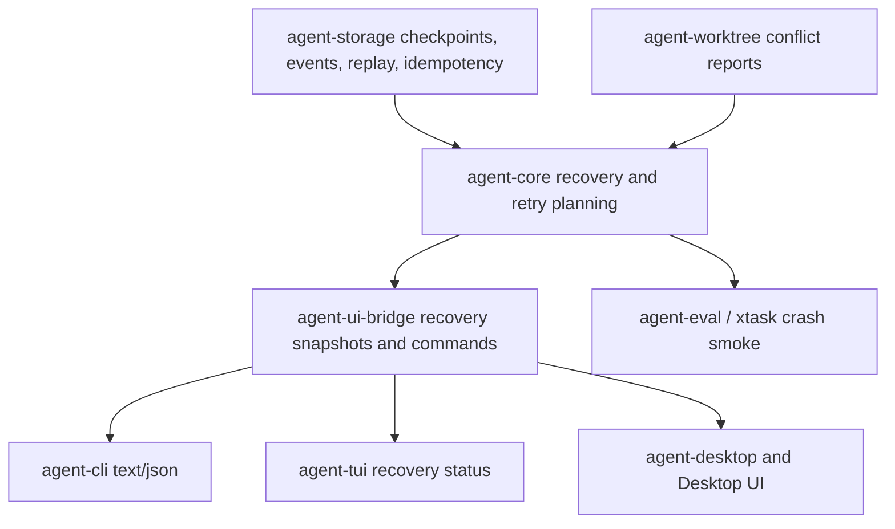

# M62 Reliability and Recovery Productization Spec

## Purpose

Make real coding work recoverable after interruptions, crashes, conflicts, and retryable command failures. M62 turns the existing checkpoint, replay, idempotency, approval-resume, and worktree conflict foundations into product-facing recovery workflows that CLI, JSON, TUI, and Desktop can expose without inventing presentation-layer recovery logic.

## Product Context

M56 proved the deterministic local coding golden path, M59 and M60 made terminal and Desktop workflows usable, and M61 made plan/todo/task progress visible across interactive and background work. The next product gap is trust after something goes wrong: a developer should be able to restart, inspect what will resume, avoid duplicated side effects, retry failed command/test steps with evidence, understand conflicts, and fork or replay work for review.

M04 already established checkpoint and replay foundations. M18 and M19 added tool idempotency and durable approvals. M26-M29 added observability, evals, and quality evidence. M62 productizes those runtime foundations rather than replacing them.

## Scope

This spec delivers:

- a typed recovery snapshot/report contract over checkpoint, replay, pending tool call, approval-wait, idempotency, task, and diagnostic state
- checkpoint resume UX for CLI/JSON and UI bridge consumers, including safe resume readiness and evidence summaries
- replay and fork commands that operate from typed replay/checkpoint inputs and produce bounded, redacted results
- idempotent tool recovery visibility that explains whether completed side effects were replayed, pending, skipped, or blocked
- failed command/test retry UX with typed retry classification, previous evidence, and new attempt linkage
- conflict diagnostics over worktree/file-change reports with safe path summaries and recommended next actions
- deterministic crash/restart smoke coverage for the local coding workflow without provider credentials

Owned by other specs:

- worktree team merge workflows, subagent handoff, reviewer roles, and team-level permission ceilings belong to M63
- long-term memory recovery and personalization after restarts belong to M64
- packaging, installer-level crash reporting, support bundle polish, and release-channel migration belong to M65
- plugin/MCP-specific recovery polish belongs to M66 unless it blocks the core coding workflow
- provider transport retry policy improvements belong to provider hardening unless needed for failed-command product UX

## Architecture

Runtime truth stays in shared Rust crates. `agent-storage` owns durable checkpoint, replay, event, and idempotency stores. `agent-core` owns recovery planning, resume validation, idempotent tool recovery, failed-command retry planning, and crash-smoke orchestration. `agent-worktree` owns conflict detection and conflict report contracts. `agent-ui-bridge` owns UI-safe recovery snapshots, commands, and frames. CLI, TUI, Desktop Rust, and Desktop TypeScript render or submit typed commands without duplicating recovery rules.



Dependency rules:

- Resume, replay, fork, retry, and conflict classification must be computed in runtime crates.
- UI bridge may sort, bound, redact, and summarize recovery state, but must not infer runtime safety.
- Recovery side effects must continue through policy, sandbox, tool execution, audit, checkpoint, and trace paths.
- Durable/public contracts must be serde-friendly, bounded, redacted, and stable enough for JSON and Desktop bridge consumers.

## File Layout

```text
crates/
  agent-types/
    src/
      recovery.rs
      event.rs
      lib.rs
  agent-core/
    src/
      recovery.rs
      idempotency.rs
      command_retry.rs
      lib.rs
    tests/
      recovery_snapshot.rs
      crash_resume_smoke.rs
      failed_command_retry.rs
  agent-storage/
    src/
      checkpoint.rs
      replay.rs
      idempotency.rs
    tests/
      checkpoint_store.rs
      replay_integration.rs
  agent-worktree/
    src/
      conflict.rs
    tests/
      conflict_detection.rs
  agent-ui-bridge/
    src/
      command.rs
      frame.rs
      event.rs
    tests/
      recovery_bridge.rs
  agent-cli/
    src/
      command.rs
    tests/
      recovery_commands.rs
  agent-tui/
    src/
      task_panel.rs
    tests/
      recovery_panel.rs
  agent-desktop/
    src/
      recovery.rs
      task.rs
    tests/
      recovery_view.rs
apps/
  desktop/
    src/
      types.ts
      state/
      components/
      __tests__/
docs/
  cli/
  desktop/
  eval/
```

Exact files may change during slice implementation, but ownership boundaries must stay aligned with shared runtime contracts.

## Public Contracts

Final names may change by slice, but M62 should support typed contracts like:

```rust
pub struct RecoverySnapshot {
    pub conversation_id: ConversationId,
    pub turn_id: Option<TurnId>,
    pub checkpoint_id: Option<CheckpointId>,
    pub replay_from: EventSeq,
    pub replayed_event_count: usize,
    pub pending_tool_calls: Vec<RecoveredToolCall>,
    pub idempotent_effects: Vec<RecoveredToolEffect>,
    pub pending_approvals: Vec<RecoveredApprovalWait>,
    pub command_retries: Vec<FailedCommandRetrySummary>,
    pub conflicts: Vec<RecoveryConflictSummary>,
    pub diagnostics: Vec<RecoveryDiagnostic>,
}

#[serde(rename_all = "snake_case")]
pub enum RecoveryReadiness {
    Ready,
    NeedsApproval,
    HasConflict,
    CorruptCheckpoint,
    MissingEvents,
    Blocked,
}
```

Resume, replay, fork, and retry commands should stay explicit:

```rust
pub struct ResumeRequest {
    pub conversation_id: ConversationId,
    pub turn_id: Option<TurnId>,
    pub checkpoint_id: Option<CheckpointId>,
    pub dry_run: bool,
}

pub struct ReplayForkRequest {
    pub conversation_id: ConversationId,
    pub source_turn_id: Option<TurnId>,
    pub checkpoint_id: Option<CheckpointId>,
    pub fork_label: String,
}

pub struct FailedCommandRetryRequest {
    pub command_run_id: String,
    pub reason: String,
    pub reuse_approval: bool,
}
```

CLI and bridge surfaces should expose stable user actions such as:

```text
agent-cli recovery status --conversation <id>
agent-cli recovery resume --conversation <id> [--turn <id>] [--dry-run]
agent-cli replay inspect --conversation <id> [--from-checkpoint <id>]
agent-cli replay fork --conversation <id> --label <name>
agent-cli command retry <command-run-id> --reason <text>
agent-cli conflict inspect --task <task-id>
```

## State and Failure Handling

- Recovery starts from the latest valid checkpoint when available and replays from the next event sequence; if no checkpoint exists, recovery starts at sequence 1.
- Corrupt checkpoint state becomes a typed blocking diagnostic and must not silently fall back to replay unless an explicit future command requests that behavior.
- Pending tool calls exclude terminal tool events and idempotent completed effects so recovery does not duplicate side effects.
- Idempotency conflicts are terminal until user or runtime state changes, and reports include the key and safe hash metadata without raw tool input.
- Pending approvals resume as approval waits with request ids and safe summaries, not as implicit approval grants.
- Failed command/test retry uses previous command evidence, failure classification, and policy state to plan a new attempt; retry attempts are linked to prior evidence.
- Conflict diagnostics summarize relative paths, conflict kind, changed sides, and suggested next action; raw file contents are not embedded.
- Missing replay events, missing idempotency records, checkpoint/event sequence gaps, and stale retry targets produce typed diagnostics.

## Security and Privacy

- Recovery snapshots may expose ids, relative paths, statuses, counts, hashes, and redacted summaries; they must not expose secrets, raw command output, raw tool input, provider credentials, env values, or unbounded traces.
- Resume and retry side effects must pass through the existing policy, sandbox, tool execution, approval, audit, checkpoint, and trace paths.
- Fork and replay commands must be read-only unless they explicitly create a new durable fork/session record through storage contracts.
- Desktop/Tauri and TypeScript code must not gain direct filesystem, process, or checkpoint mutation authority outside typed bridge commands.
- Crash smoke fixtures must be deterministic, credential-free, and safe to run in CI.

## Testing Strategy

- `agent-core` unit/integration tests for recovery snapshot construction, corrupt checkpoint diagnostics, pending tool call filtering, idempotent effect visibility, approval-wait resume, and failed-command retry planning
- `agent-storage` tests for checkpoint/replay/idempotency behavior used by recovery snapshots
- `agent-worktree` tests for conflict diagnostic mapping and relative path validation
- `agent-ui-bridge` snapshot tests for recovery commands, frames, bounded summaries, and stable JSON shape
- `agent-cli` tests for text and JSON recovery status, resume dry-run, replay inspect/fork, retry, and conflict inspection commands
- `agent-tui`, `agent-desktop`, and Vitest tests for recovery status surfaces using typed fixtures
- deterministic crash/restart smoke coverage in the default eval or xtask gate
- final M62 gates: `cargo fmt --all -- --check`, `cargo clippy --workspace --all-targets -- -D warnings`, `cargo test --workspace`, `npm --prefix apps/desktop test`, `npm --prefix apps/desktop run build`, and `cargo xtask eval`

## Acceptance Criteria

- CLI/JSON can inspect recovery readiness, resume from checkpoint/replay state, and report what will be replayed, skipped, pending, or blocked.
- Replay and fork commands produce stable, bounded, redacted output with trace/audit/replay evidence.
- Idempotent tool recovery is visible enough that users can tell completed side effects were not duplicated.
- Failed command/test retry is explicit, evidence-linked, and policy-backed.
- Conflict diagnostics are typed, safe, actionable, and available to CLI/Desktop-facing consumers.
- A deterministic crash smoke proves a coding workflow can recover after interruption without provider credentials.
- Existing M56-M61 product behavior continues to pass.

## Completion Signal

M62 is complete when recovery snapshots, checkpoint resume UX, replay/fork commands, idempotent recovery visibility, failed-command retry, conflict diagnostics, crash smoke coverage, docs, final verification gates, roadmap status updates, and focused commits are complete.
