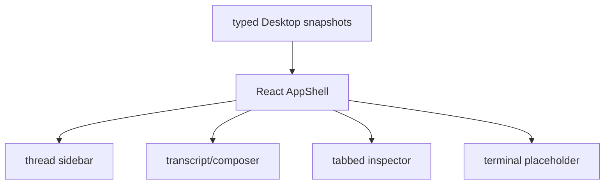

# M62A-01 Desktop App Shell and Navigation Spec

## Purpose

Refactor the Desktop shell from route-centric dashboard pages into a modern coding workspace layout: left project/thread sidebar, center transcript and composer, right inspector, bottom terminal drawer, command palette, and keyboard shortcuts.

## Product Context

M60 created the initial Desktop daily-driver views. M62A-01 reshapes those views into the product frame that later slices can fill. This slice is UI shell/navigation only; it does not add new runtime behavior or recovery features.

## Scope

This spec delivers:

- three-column `AppShell` layout with collapsible left sidebar, center workspace, right inspector, and bottom drawer
- left sidebar with workspace/project switcher placeholder, new thread action, thread search, and recent/pinned/archived sections
- right inspector tabs for Context, Changes, Approvals, Tasks, Artifacts, and Trace
- bottom integrated terminal placeholder that can be toggled without executing commands
- command palette skeleton opened by Cmd/Ctrl+K
- keyboard shortcut model for new thread, toggle sidebar, toggle inspector/diff, toggle terminal, settings, and find in thread
- shadcn/Radix-like local component patterns for Button, Sidebar, Tabs, Badge, Dialog, Command, Tooltip, ScrollArea, Separator, and DropdownMenu surfaces

Owned by other specs:

- thread lifecycle and composer semantics belong to M62A-02
- provider/model settings implementation belongs to M62A-03
- inspector panel data depth belongs to M62A-04
- product smoke and docs belong to M62A-05

## Architecture

React owns presentation state for shell visibility, active inspector tab, command palette open state, terminal drawer open state, and keyboard shortcut routing. Typed runtime state still comes from existing Desktop snapshots and bridge frames.



## File Layout

```text
apps/desktop/
  package.json
  src/
    App.tsx
    app.css
    types.ts
    components/
    state/
    __tests__/app-shell.test.tsx
```

## Public Contracts

No new durable Rust runtime contract is required in this slice. TypeScript view-state shapes may be added for:

```ts
export type DesktopInspectorTab =
  | 'context'
  | 'changes'
  | 'approvals'
  | 'tasks'
  | 'artifacts'
  | 'trace';

export interface DesktopShellUiState {
  sidebarOpen: boolean;
  inspectorOpen: boolean;
  terminalOpen: boolean;
  commandPaletteOpen: boolean;
  activeInspectorTab: DesktopInspectorTab;
}
```

## State and Failure Handling

- Missing workspace or bridge data renders empty shell regions with disabled actions.
- Keyboard shortcuts are scoped to the shell and ignore text input composition where appropriate.
- Command palette actions dispatch typed UI actions only when implemented; placeholders are visibly disabled.
- Terminal drawer is non-executing and cannot run shell commands in this slice.

## Security and Privacy

- Shell placeholders must not introduce direct filesystem/process/network access.
- Command palette actions must route through existing typed UI commands when they perform side effects.
- The terminal placeholder must not capture or render raw process output.

## Testing Strategy

- Vitest coverage for shell regions, sidebar sections, inspector tabs, terminal toggle, command palette toggle, and keyboard shortcuts
- Build check to catch TypeScript and Vite regressions

## Acceptance Criteria

- Desktop opens into a real workspace shell, not a dashboard-first layout.
- Sidebar, center transcript/composer, inspector tabs, and terminal drawer placeholder coexist without layout overlap.
- Cmd/Ctrl+K opens a command palette skeleton.
- Shortcut model can toggle sidebar, inspector, terminal, settings, find, and new-thread actions.
- UI uses neutral dense styling, stable dimensions, visible focus states, and no marketing layout.

## Completion Signal

M62A-01 is complete when focused app-shell tests and `npm --prefix apps/desktop run build` pass.
