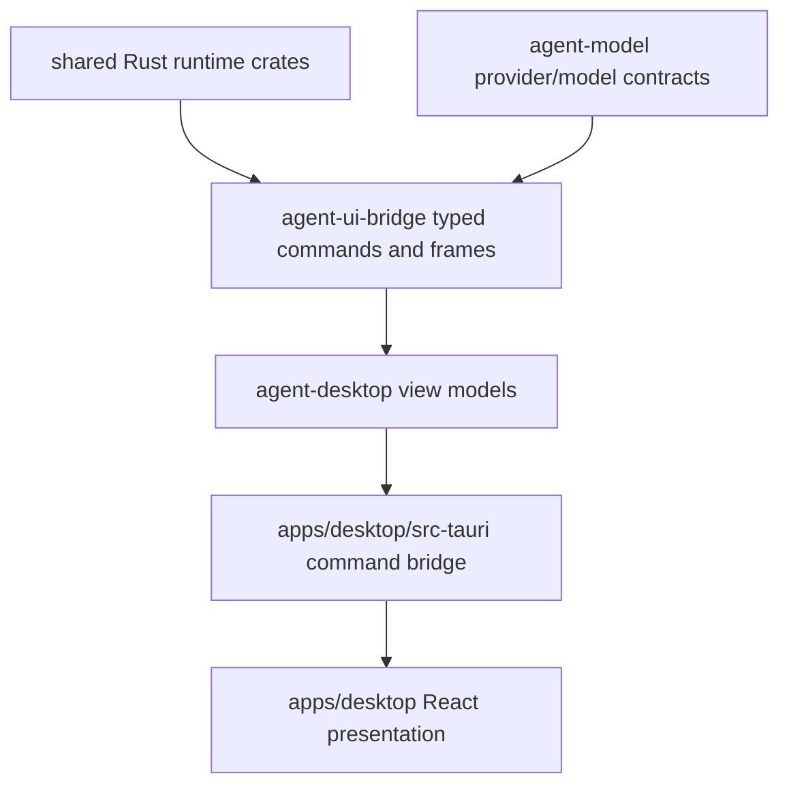

# M62A Desktop Productization Spec

## Purpose

Turn `apps/desktop` from a functional engineering shell into a polished local coding-agent workspace. M62A keeps the existing Rust runtime, Tauri 2 bridge, React/TypeScript frontend, and typed Desktop contracts, but reshapes the product surface around dense thread navigation, a primary composer, command-first interactions, inspector panels, provider/model management, and a deterministic Desktop smoke path.

## Product Context

M60 proved that Desktop can consume shared runtime state for dashboard, conversation, approvals, diffs, settings, tasks, logs, and smoke coverage. M61 made plan/todo/task state first-class across surfaces. M62 recovery work continues separately. M62A is an independent Desktop Productization lane that improves the Desktop product shape without advancing recovery implementation and without duplicating runtime truth in React or Tauri.

This work references public, observable coding-agent Desktop product patterns: project/thread navigation, parallel threads, composer-first interaction, slash commands, command palette, approvals, diffs, inspectors, settings, terminal drawer, and keyboard-first flows. It does not depend on or claim knowledge of any private Codex Desktop implementation.

## Scope

This spec delivers:

- a modern three-column Desktop app shell with project/thread navigation, center transcript/composer, right inspector tabs, and bottom terminal drawer placeholder
- command palette and keyboard shortcut model for common workspace, thread, inspector, terminal, settings, and find actions
- thread lifecycle and composer UX for create/resume/switch/pin/archive/search, provider/model selection, local/worktree mode, slash command hints, skill hints, send/stop/retry states, and goal/progress visibility
- provider/model configuration contracts and settings surfaces that support multiple providers, per-provider model lists, diagnostics, defaults, and per-thread overrides without exposing secret values
- inspector panels for context, changes, approvals, tasks, artifacts, and trace using typed bridge/Desktop snapshots
- Desktop product smoke fixture and docs covering workspace open, thread creation, provider/model choice, prompt submit, typed frames, approvals, diffs, task progress, settings, and secret redaction

Owned by other specs:

- checkpoint resume, replay/fork, retry recovery, conflict recovery, and crash smoke implementation remain in M62
- worktree/subagent team workflows remain in M63
- memory review and personalization remain in M64
- installer, updater, release packaging, and OS-level onboarding remain in M65
- plugin/MCP marketplace management remains in M66 unless required for the Desktop shell

## Architecture

Runtime truth remains in Rust crates. `agent-core`, `agent-storage`, `agent-policy`, `agent-tool`, `agent-model`, `agent-context`, and `agent-scheduler` own runtime behavior. `agent-ui-bridge` owns typed commands, frames, slash command descriptors, config snapshots, and UI-safe protocol contracts. `agent-desktop` owns Desktop view models and redacted product snapshots. `apps/desktop/src-tauri` exposes a narrow Tauri command bridge with validation and redaction. `apps/desktop/src` owns React view state, reducers, components, and presentation only.



Dependency rules:

- React reducers consume typed snapshots and bridge frames; they do not parse CLI text or create runtime truth.
- Tauri commands validate, redact, and forward typed requests; they do not own provider, policy, task, diff, approval, or recovery semantics.
- Provider/model capability negotiation belongs in shared contracts and Rust model/config crates, then appears in Desktop as diagnostics and UI hints.
- UI libraries may be introduced only when the plan records build impact and the resulting components stay local, typed, and testable.

## File Layout

```text
docs/
  specs/
    M62A-desktop-productization.spec.md
    M62A-01-desktop-app-shell-navigation.spec.md
    M62A-02-thread-composer-experience.spec.md
    M62A-03-provider-model-configuration.spec.md
    M62A-04-inspector-panels.spec.md
    M62A-05-desktop-product-smoke-docs.spec.md
  plans/
    matching implementation plans
  desktop/
    desktop-productization.md
crates/
  agent-model/
  agent-ui-bridge/
  agent-desktop/
apps/
  desktop/
    package.json
    src/
      App.tsx
      app.css
      components/
      state/
      types.ts
    src-tauri/
      src/
```

Exact module names may change by slice, but ownership must stay aligned with these boundaries.

## Public Contracts

M62A should evolve the existing typed contracts toward shapes like:

```rust
pub struct DesktopWorkspaceShellSnapshot {
    pub workspace: DesktopWorkspaceSummary,
    pub threads: Vec<DesktopThreadSummary>,
    pub active_thread_id: Option<ConversationId>,
    pub inspector: DesktopInspectorSnapshot,
    pub terminal: DesktopTerminalDrawerSnapshot,
    pub command_palette: DesktopCommandPaletteSnapshot,
}

pub struct ProviderProfile {
    pub id: String,
    pub kind: ProviderKind,
    pub display_name: String,
    pub endpoint: Option<String>,
    pub secret_ref: Option<String>,
    pub enabled: bool,
    pub default_model_id: Option<String>,
    pub models: Vec<ModelProfile>,
    pub diagnostics: Vec<ProviderDiagnostic>,
}

pub struct ModelProfile {
    pub id: String,
    pub display_name: String,
    pub enabled: bool,
    pub capabilities: ModelCapabilities,
    pub context_window: Option<u32>,
    pub output_limit: Option<u32>,
    pub supports_tools: bool,
    pub supports_streaming: bool,
    pub supports_vision: bool,
    pub cost_hint: Option<String>,
}
```

Provider kinds must cover OpenAI-compatible, Anthropic, Gemini, local/Ollama-style, and fake/test providers. Snapshots and tests must never contain raw secret values.

## State and Failure Handling

- Missing workspace, disconnected bridge, invalid thread id, stale approval id, or unavailable provider produces typed diagnostics and disabled controls rather than React exceptions.
- Thread navigation preserves active thread, pinned/archived filters, search text, and find-in-thread state as presentation state backed by typed snapshots.
- Command palette and slash command actions validate against typed descriptors before dispatch.
- Provider/model mismatch is surfaced as diagnostics before a turn starts where possible.
- Inspector panels handle empty, loading, stale, and redacted states consistently.
- Terminal drawer is a placeholder in the shell slice until a typed command stream surface owns real terminal execution.

## Security and Privacy

- No raw API keys, secret values, provider tokens, secret environment values, unbounded command output, raw prompt internals, or unredacted diffs may enter React state, logs, snapshots, tests, or smoke fixtures.
- Approval decisions remain explicit and policy-backed; Desktop UI cannot grant permissions outside typed bridge commands.
- Filesystem, process, network, Git, MCP, browser, and Desktop actions continue through policy, sandbox, audit, and runtime traces.
- UI screenshots, fixtures, and docs use deterministic redacted data.

## Testing Strategy

- `agent-model` tests for provider/model profile validation, capability diagnostics, and secret reference handling
- `agent-ui-bridge` snapshot tests for provider/model config, shell/thread/inspector frames, command palette descriptors, and redaction
- `agent-desktop` tests for shell snapshots, thread summaries, inspector view models, provider settings, approvals/diffs/tasks/artifacts, and trace summaries
- Tauri tests for command allowlist, validation, config snapshots, approval/diff/task/trace loading, and no-secret snapshots
- Vitest tests for app shell navigation, conversation/task UI, approval/diff UI, trace/settings UI, and Desktop smoke fixtures
- final M62A gates: `cargo fmt --all -- --check`, `cargo clippy --workspace --all-targets -- -D warnings`, `cargo test --workspace`, `npm --prefix apps/desktop test`, `npm --prefix apps/desktop run build`, `cargo xtask desktop-test`, and `cargo xtask eval`

## Acceptance Criteria

- Desktop opens directly into a real coding workspace, not a dashboard or marketing layout.
- Left navigation, center transcript/composer, right inspector, and terminal drawer create a dense daily-driver shell.
- Thread creation, switching, pin/archive/search, composer controls, slash hints, provider/model selection, approval review, diff preview, task progress, artifacts, trace, and settings are visible through typed state.
- Provider/model configuration supports multiple providers and per-provider model profiles without exposing secret values.
- UI style is modern, neutral, keyboard-first, light/dark ready, and consistent with shadcn/Radix-like component patterns without requiring an external generator.
- Runtime logic remains in Rust crates, Tauri remains a typed bridge, and React remains presentation state.
- Desktop product smoke proves the main workspace flow with deterministic, credential-free, redacted fixtures.

## Completion Signal

M62A is complete when all five Desktop Productization slices are implemented, focused checks pass per slice, final gates pass, `docs/desktop/desktop-productization.md` documents the product workflow, roadmap/milestone status is updated, and commits remain separated from M62 recovery implementation work.
