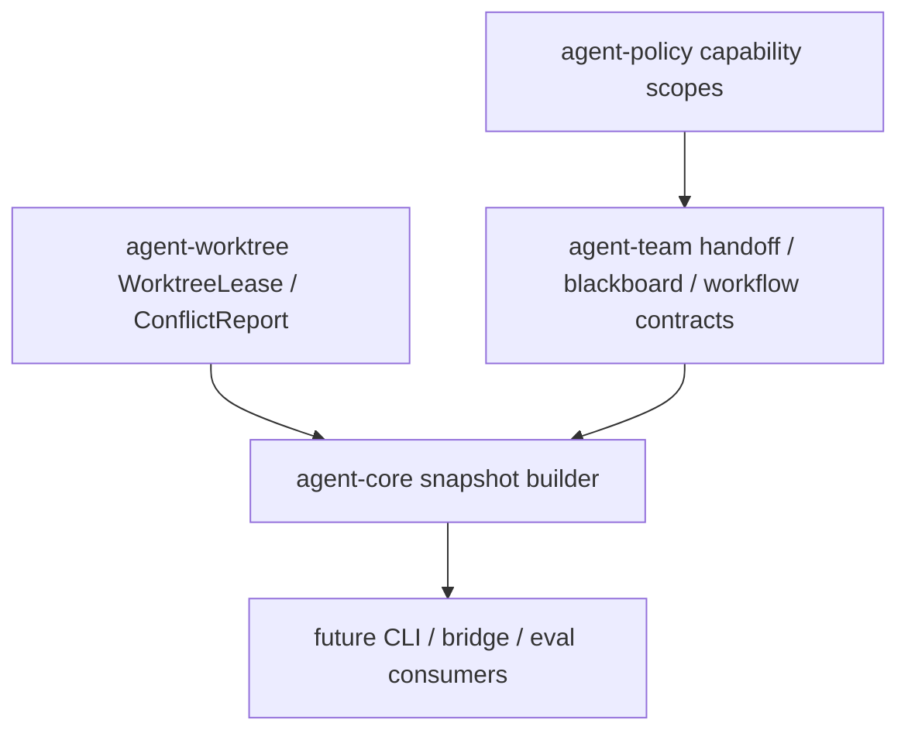

# M63-01 Team Workflow Snapshot and Readiness Contracts Spec

## Purpose

Define the first product-facing M63 contract: a typed team workflow snapshot that lets CLI, TUI, Desktop, and eval consumers inspect parallel work without spawning live subagents or executing merges. This slice composes existing M09 worktree/team contracts and M62 conflict readiness into one bounded runtime shape.

## Product Context

M63 needs to productize team workflows incrementally. Before adding commands or UI, the runtime must have a single truth for "what is this team doing, what is ready, what is blocked, and why?" M63-01 creates that state model so later slices can render or submit commands without inventing local readiness rules.

## Scope

This spec delivers:

- `TeamWorkflowSnapshot` and related summary/readiness/diagnostic types
- `TeamWorkflowReadiness` states for handoff, review, merge, conflict, policy, and blocked cases
- capability ceiling summary that proves a handoff cannot exceed parent, role, or task grants
- summary projections for worktree leases, handoffs, blackboard entries, reviewer votes, merge review, conflicts, and diagnostics
- deterministic fixture coverage in `agent-team` and/or `agent-core`

Owned by later M63 slices:

- CLI/JSON commands
- TUI/Desktop rendering
- live subagent spawning
- real Git worktree creation or merge execution
- eval/default-suite integration and workflow docs

## Architecture

`agent-team` should own workflow summary contracts that are independent of UI. `agent-core` may own fixture construction and runtime snapshot assembly because it can see `agent-worktree`, recovery conflict summaries, policy, task ids, and runtime evidence. If adding `agent-team` as an `agent-core` dependency is required, keep the dependency one-way from core to team.



## File Layout

```text
crates/
  agent-team/
    src/
      workflow.rs
    tests/
      team_workflow_snapshot.rs
  agent-core/
    src/
      team_workflow.rs
    tests/
      team_workflow_snapshot.rs
```

## Public Contracts

The implementation should add contracts equivalent to:

```rust
pub enum TeamWorkflowStatus {
    Planning,
    HandoffReady,
    InProgress,
    ReviewRequired,
    MergeReady,
    Blocked,
    Completed,
}

pub enum TeamWorkflowReadiness {
    ReadyForHandoff,
    WaitingOnSubagent,
    ReviewRequired,
    MergeReady,
    HasConflict,
    PolicyBlocked,
    Blocked,
}

pub struct TeamWorkflowSnapshot {
    pub team_id: TeamId,
    pub lead_agent_id: AgentId,
    pub workspace_id: WorkspaceId,
    pub task_id: TaskId,
    pub status: TeamWorkflowStatus,
    pub readiness: TeamWorkflowReadiness,
    pub worktrees: Vec<TeamWorktreeSummary>,
    pub handoffs: Vec<TeamHandoffSummary>,
    pub blackboard: TeamBlackboardSummary,
    pub merge_review: TeamMergeReviewSummary,
    pub capability_ceiling: TeamCapabilityCeilingSummary,
    pub conflicts: Vec<RecoveryConflictSummary>,
    pub diagnostics: Vec<TeamWorkflowDiagnostic>,
}
```

The exact names may change, but the contract must remain typed, serializable, bounded, and redacted.

## State and Failure Handling

- `HasConflict` beats merge-ready states.
- `PolicyBlocked` beats handoff-ready and merge-ready states.
- `ReviewRequired` applies when subagent work is complete but no approval/reviewer vote exists.
- `WaitingOnSubagent` applies when at least one handoff is accepted or created but not terminal.
- `MergeReady` requires completed handoffs, no blocking conflicts, required review approval, and no policy denial.
- Diagnostics explain missing worktree lease, stale lease, empty capability ceiling, missing artifacts, unsafe paths, conflicts, and policy blocks.

## Security and Privacy

- Snapshot summaries must not expose raw prompts, raw command logs, raw diffs, file contents, secret-like hashes, or unbounded artifact content.
- Capability summaries list action/scope shapes and counts, not secret values.
- Paths are relative and should be redacted if they contain secret-like tokens.
- The fixture must include at least one secret-like value and assert serialized snapshots do not leak it.

## Testing Strategy

Required focused tests:

- snapshot serializes with stable snake_case enum values
- capability ceiling never expands parent/task/role grants
- completed subagent plus approving review and no conflicts becomes `merge_ready`
- conflicts force `has_conflict`
- missing review forces `review_required`
- non-terminal handoff forces `waiting_on_subagent`
- serialized fixture output is redacted

Recommended commands:

```bash
cargo test -p agent-team --test team_workflow_snapshot
cargo test -p agent-core --test team_workflow_snapshot
cargo clippy -p agent-team -p agent-core --all-targets -- -D warnings
```

## Acceptance Criteria

- Team workflow state is inspectable through a single shared runtime/team contract.
- Readiness is deterministic and blocks unsafe merge/handoff states.
- Capability ceilings are represented and cannot expand permissions.
- Existing M09 worktree/team tests and M62 recovery/conflict tests remain green.
- No CLI, TUI, Desktop, or eval code needs to classify team readiness independently.

## Completion Signal

M63-01 is complete when the snapshot/readiness contracts, fixture tests, exports, focused checks, and status docs are committed.
