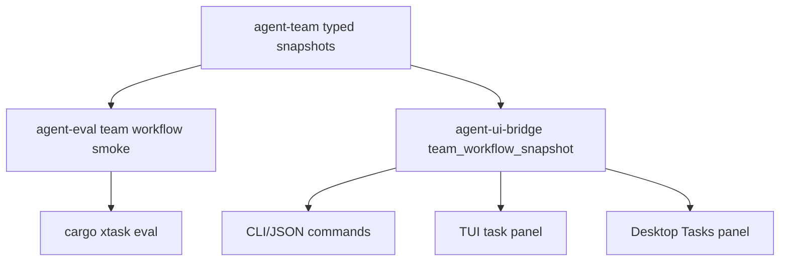

# M63-05 Team Workflow Smoke, Docs, and Closeout Spec

## Purpose

Prove the M63 team workflow path with deterministic, credential-free smoke evidence and close the M63 Worktree and Agent Team Workflows milestone with user-facing docs, eval coverage, and status updates.

M63-01 through M63-04 made team workflow snapshots, CLI/JSON commands, reviewer/merge readiness blockers, and TUI/Desktop bridge surfaces available. M63-05 turns those slices into a product closeout: users can inspect team status, dry-run handoffs and reviews, inspect blackboard evidence, understand blocked merge readiness, and rely on default smoke coverage.

## Scope

This slice delivers:

- a deterministic `team_workflow_smoke` eval scenario covering the M63 team workflow lifecycle
- eval tests and a default-suite golden proving handoff, blackboard, review, merge readiness, conflict blocking, policy blocking, and redaction
- CLI workflow docs for `team status`, handoff dry-runs, blackboard inspect, review dry-runs, and merge-readiness dry-runs
- Desktop workflow docs explaining the team workflow Tasks panel, readiness states, evidence, conflicts, diagnostics, and dry-run expectations
- milestone, roadmap, and M63 plan closeout updates after final gates pass

Out of scope:

- live provider calls
- real Git merge execution
- automatic conflict resolution
- broad Desktop redesign
- M64 memory, M65 packaging, or M66 extension hardening

## Architecture

`agent-team` remains the source of truth for readiness, blackboard summaries, capability ceilings, merge-review summaries, and merge blockers. `agent-eval` may construct deterministic typed team workflow snapshots for smoke evidence, but it must not duplicate product UI logic.

The smoke should validate the product-level contract:

- isolated worktree evidence exists
- reduced-capability handoff evidence exists
- blackboard output includes reviewer artifact evidence
- reviewer votes affect merge readiness
- conflicts block merge readiness
- policy ceiling blocks merge readiness
- all evidence is bounded and redacted

CLI, TUI, and Desktop keep rendering bridge/runtime contracts. They do not own readiness, policy, merge, or conflict rules.



## File Layout

```text
crates/
  agent-eval/
    src/
      manifest.rs
      runner.rs
    tests/
      runner.rs
      manifest.rs
      corpus.rs
docs/
  cli/
    team-workflows.md
  desktop/
    team-workflows.md
  eval/
    default.suite.json
    scenarios/
      m63-team-workflow-smoke.eval.json
    goldens/
      default-m63-team-workflow-smoke.golden.json
  milestones/
    README.md
  plans/
    M63-worktree-agent-team-workflows.plan.md
    M63-05-team-workflow-smoke-closeout.plan.md
  roadmap/
    PRODUCT_ROADMAP.md
README.md
```

## Public Contracts

If eval integration is implemented, add an eval scenario kind equivalent to:

```rust
#[serde(rename_all = "snake_case")]
pub enum EvalScenarioKind {
    TeamWorkflowSmoke,
}
```

The scenario should be fixture-free, deterministic, and declarative:

```json
{
  "kind": "team_workflow_smoke",
  "expectations": {
    "expected_status": "passed",
    "team_workflow": {
      "min_worktree_count": 4,
      "min_handoff_count": 4,
      "min_blackboard_entry_count": 8,
      "min_conflict_count": 1,
      "min_merge_blocker_count": 3,
      "require_capability_reduction": true,
      "require_policy_blocked": true,
      "require_conflict_blocker": true,
      "require_review_blocker": true,
      "require_redaction": true
    },
    "golden": "goldens/default-m63-team-workflow-smoke.golden.json"
  }
}
```

The smoke should assert against existing public M63 contracts:

- `TeamWorkflowSnapshot`
- `TeamMergeReadinessReport`
- `TeamWorkflowReadiness`
- `TeamCapabilityCeilingSummary`
- `TeamBlackboardSummary`
- `TeamMergeReviewSummary`
- `UiTeamWorkflowSnapshot`

## State and Failure Handling

- Missing worktree, handoff, blackboard, review, conflict, policy, or redaction evidence is a failed smoke diagnostic.
- The smoke must not depend on provider credentials, network, shell commands, or a live Git repository.
- Eval output must be bounded and redacted; raw secret-like strings must not appear in normalized reports or goldens.
- Merge readiness is proved by typed blockers, not by executing a merge.

## Testing Strategy

- `agent-eval/tests/runner.rs`
  - `team_workflow_smoke` validates and passes
  - missing expected evidence produces diagnostics when feasible
- `agent-eval/tests/manifest.rs`
  - manifest round-trips and validates `team_workflow_smoke`
- `agent-eval/tests/corpus.rs`
  - default suite includes the M63 smoke scenario and its golden
- `cargo xtask eval`
  - includes `default-m63-team-workflow-smoke`

Final closeout gates:

```bash
cargo fmt --all -- --check
cargo clippy --workspace --all-targets -- -D warnings
cargo test --workspace
npm --prefix apps/desktop test
npm --prefix apps/desktop run build
cargo xtask eval
git diff --check
```

## Acceptance Criteria

- Default eval coverage includes deterministic M63 team workflow smoke.
- The smoke proves isolated worktree, handoff, blackboard, reviewer vote, conflict-aware merge readiness, policy blocking, and redaction evidence.
- CLI and Desktop workflow docs describe actual available commands/surfaces.
- M63 status docs mark M63-05 and M63 complete only after final gates pass.
- M64 remains the next mainline milestone; M65 and M66 remain future work.
