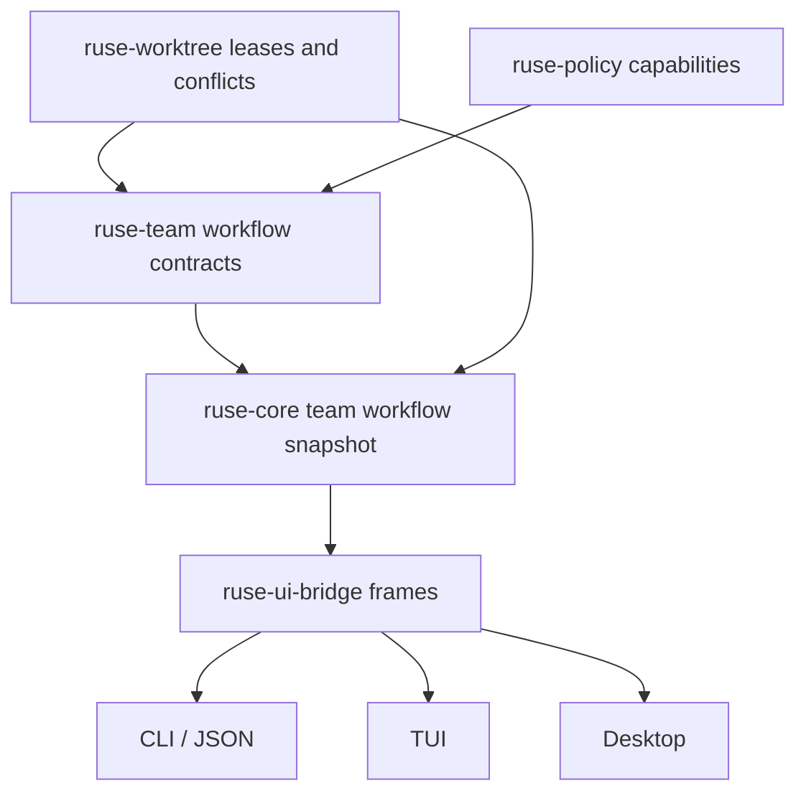

# M63 Worktree and Agent Team Workflows Spec

## Purpose

Productize safe parallel implementation and review workflows over the existing worktree and team foundations. M63 turns the M09 contracts for isolated worktrees, subagent handoff, capability reduction, conflict detection, and blackboard entries into one user-visible workflow that CLI, TUI, and Desktop can inspect without bypassing runtime policy or recovery.

## Product Context

The roadmap now has a reliable coding-agent core through M62: local coding turns are observable, provider-flexible, context-aware, task-aware, and recoverable after interruption. The next daily-driver gap is parallel work: a lead agent should be able to split work into isolated branches, delegate constrained subtasks, review subagent output, detect conflicts, and merge only when policy and readiness permit.

This milestone supports the PRD multi-agent journey:

1. A lead agent creates isolated work for one or more subtasks.
2. Worker agents run with reduced permissions and explicit objectives.
3. A reviewer inspects artifacts, diffs, traces, and blackboard findings.
4. The lead consolidates approved output or blocks on conflicts.

## Scope

This milestone delivers:

- a team workflow snapshot that composes worktree leases, handoff envelopes, blackboard entries, reviewer votes, conflict summaries, merge readiness, and capability ceilings
- CLI/JSON commands for team status, handoff planning, blackboard inspection, review recording, and merge-readiness dry-runs
- policy-backed team-level permission ceilings that never expand parent, role, task, or provider/tool capabilities
- reviewer role and merge review contracts with bounded diff/artifact summaries
- conflict-aware merge readiness that reuses `ruse-worktree` and M62 recovery-safe conflict summaries
- TUI/Desktop-safe bridge frames for team status, reviewer decisions, merge readiness, and conflict blocks
- deterministic product smoke coverage proving an isolated worktree/subagent/reviewer path without provider credentials
- user-facing docs for worktree/team workflows

Owned by later milestones or separate tracks:

- package/install release polish belongs to M65
- long-term memory of team preferences belongs to M64 unless needed for a typed influence trace
- broad Desktop redesign belongs to the separate Desktop productization track
- live autonomous multi-process scheduling is only included when the runtime and policy contracts are ready; M63 must first make dry-run and fixture-backed workflows safe and inspectable

## Architecture

M63 keeps ownership layered:

- `ruse-worktree` owns worktree lease lifecycle and conflict detection.
- `ruse-team` owns subagent handoff, capability reduction, team workflow summaries, blackboard entries, reviewer votes, and merge-review contracts.
- `ruse-policy` owns actions/scopes used by capability ceilings and merge decisions.
- `ruse-core` orchestrates runtime-facing team workflow snapshots, deterministic smoke fixtures, readiness calculations, and event emission.
- `ruse-ui-bridge` owns UI-safe command/frame contracts.
- CLI, TUI, Desktop Rust, and Desktop TypeScript render typed summaries and submit typed commands; they do not create merge policy, classify conflicts, or reduce capabilities independently.



## File Layout

```text
crates/
  ruse-team/
    src/
      workflow.rs
      merge_review.rs
  ruse-core/
    src/
      team_workflow.rs
  ruse-ui-bridge/
    src/
      team.rs
  ruse-cli/
    tests/
      team_workflow_commands.rs
docs/
  cli/
    team-workflows.md
  desktop/
    team-workflows.md
  eval/
    scenarios/
      m63-team-workflow-smoke.eval.json
    goldens/
      default-m63-team-workflow-smoke.golden.json
```

Exact file placement may adjust to match code ownership, but runtime/team logic must remain in crates and not in presentation layers.

## Public Contracts

M63 should introduce or productize contracts shaped like:

```rust
pub struct TeamWorkflowSnapshot {
    pub team_id: TeamId,
    pub lead_agent_id: AgentId,
    pub workspace_id: WorkspaceId,
    pub task_id: TaskId,
    pub status: TeamWorkflowStatus,
    pub readiness: TeamWorkflowReadiness,
    pub worktrees: Vec<TeamWorktreeSummary>,
    pub handoffs: Vec<TeamHandoffSummary>,
    pub blackboard: TeamBlackboardSummary,
    pub merge_review: TeamMergeReviewSummary,
    pub capability_ceiling: TeamCapabilityCeilingSummary,
    pub conflicts: Vec<RecoveryConflictSummary>,
    pub diagnostics: Vec<TeamWorkflowDiagnostic>,
}
```

Readiness should be explicit and stable:

- `ready_for_handoff`
- `waiting_on_subagent`
- `review_required`
- `merge_ready`
- `has_conflict`
- `policy_blocked`
- `blocked`

Merge review must be dry-run first. Any future merge execution must reference:

- source worktree lease id
- source branch and target branch
- reviewed artifact ids
- reviewer vote
- conflict summary
- policy decision or pending approval
- trace/audit evidence

## State and Failure Handling

- Worktree leases transition through planned, active, released, or cleanup-failed states.
- Handoffs transition through created, accepted, completed, failed, or cancelled states.
- Review votes are explicit and may approve, request changes, or block.
- Merge readiness is blocked when conflicts, pending approvals, missing reviewer decisions, missing artifacts, stale worktree leases, or policy denials are present.
- Dry-run commands must be available before execution commands.
- Any side-effecting future execution must be idempotent or guarded by leases, checkpoints, and audit records.

## Security and Privacy

- Capability ceilings are intersections of parent, role, task, workspace, and policy grants; they never add permissions.
- Team snapshots and docs must avoid raw prompts, raw command logs, raw diffs, secret values, and unbounded output.
- Artifact and path summaries remain relative, bounded, and redacted.
- Reviewer and merge decisions include policy rationale and trace/audit evidence.
- Provider credentials and live provider calls are not required for M63 smoke coverage.

## Testing Strategy

Required coverage:

- `ruse-team` tests for workflow summaries, merge-review readiness, reviewer vote handling, and capability ceiling reduction
- `ruse-worktree` tests for worktree conflict behavior reused by merge readiness
- `ruse-core` tests for a full deterministic team workflow snapshot fixture
- `ruse-ui-bridge` tests for UI-safe frames and command shapes
- `ruse-cli` tests for text/JSON command rendering
- eval or smoke coverage for an isolated worktree/subagent/reviewer path

Final M63 gates:

```bash
cargo fmt --all -- --check
cargo clippy --workspace --all-targets -- -D warnings
cargo test --workspace
npm --prefix apps/desktop test
npm --prefix apps/desktop run build
cargo xtask eval
```

## Acceptance Criteria

- A user can inspect team workflow status through CLI/JSON and UI bridge contracts.
- Handoff plans show reduced capabilities and cannot exceed the parent/task/team ceiling.
- Subagent output is represented as blackboard entries, artifacts, review votes, and trace links.
- Merge readiness blocks on conflicts, missing review, policy denial, stale leases, or incomplete handoff state.
- TUI/Desktop-facing consumers receive the same bounded team snapshot instead of reclassifying readiness locally.
- A credential-free smoke proves the product workflow shape from isolated worktree to review and merge-readiness dry-run.

## Completion Signal

M63 is complete when all slices ship with tests, docs, eval/smoke evidence, final gates pass, roadmap/milestone status is updated, and M64 remains the next unfinished milestone.
