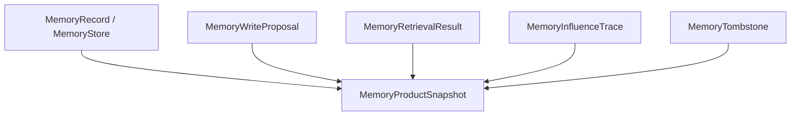

# M64-01 Memory Product Snapshot and Privacy Contracts Spec

## Purpose

Define shared, UI-safe memory product snapshots that make memory records, retrieval, proposals, retention, tombstones, and influence traces inspectable without exposing raw sensitive content.

## Product Context

M64 needs memory to be trusted by users. Before adding broader runtime or UI behavior, the product needs one typed snapshot contract that CLI/TUI/Desktop can render and tests can verify. Existing memory internals already support records, proposals, archives, tombstones, retrieval, reranking, and influence traces; M64-01 turns those pieces into a bounded product surface.

## Scope

This spec delivers:

- memory product snapshot contracts in `ruse-memory`
- record summaries with scope, sensitivity, confidence, source, preview, and redaction/truncation metadata
- proposal summaries with status, proposed scope, sensitivity, confidence, summary, review eligibility, and source event counts
- retrieval preview summaries with selected/rejected candidate counts and safe reasons
- influence trace summaries that explain prompt influence without raw sensitive memory text
- retention/import/export/tombstone summary fields suitable for UI display
- privacy diagnostics for disabled memory, sensitive exclusions, redaction, stale index state, and import/export policy
- focused tests for stable serialization, bounding, redaction, tombstone exclusion, and sensitive-memory handling

Owned by later slices:

- CLI command surfaces: M64-02
- runtime prompt influence and proposal creation: M64-03
- TUI/Desktop rendering: M64-04
- eval smoke/docs/closeout: M64-05

## Architecture

`ruse-memory` owns the product snapshot because it owns memory privacy, proposal, tombstone, retrieval, and influence semantics. `ruse-ui-bridge` may mirror this contract later, but M64-01 should avoid UI-specific rendering. `ruse-core` can use the contract after runtime integration begins.



## Public Contracts

Expected contract shape:

```rust
pub struct MemoryProductSnapshot {
    pub scope_label: String,
    pub records: Vec<MemoryRecordSummary>,
    pub proposals: Vec<MemoryProposalSummary>,
    pub retrieval: Option<MemoryRetrievalPreview>,
    pub influence: Option<MemoryInfluenceSummary>,
    pub retention: MemoryRetentionControlSummary,
    pub tombstone_count: u32,
    pub diagnostics: Vec<MemoryPrivacyDiagnostic>,
}
```

Supporting contracts should be public when needed by CLI/bridge tests:

- `MemoryRecordSummary`
- `MemoryProposalSummary`
- `MemoryRetrievalPreview`
- `MemoryInfluenceSummary`
- `MemoryRetentionControlSummary`
- `MemoryPrivacyDiagnostic`

All text fields must be bounded and redacted. Durable or bridge-facing enums must use stable serde names.

## State and Failure Handling

- Empty memory stores produce valid empty snapshots.
- Sensitive records are summarized without raw text unless policy explicitly allows content.
- Tombstoned record ids are counted and excluded from active record summaries.
- Retrieval previews include selected and rejected counts, but rejected reasons must be safe summaries.
- Proposal summaries show review state but do not commit memory.
- Invalid snapshot inputs produce `MemoryError` with redacted diagnostics.

## Security and Privacy

- Secret-like strings are redacted from previews, summaries, reasons, source descriptions, and diagnostics.
- Sensitive memory previews default to a placeholder instead of raw content.
- Snapshot serialization must not leak private raw memory, embeddings, or archive payloads.
- Influence summaries must explain why memory was selected without exposing sensitive memory text.

## Testing Strategy

- `crates/ruse-memory/tests/memory_product_snapshot.rs`
  - stable serialization shape
  - public record preview renders bounded text
  - sensitive record preview is hidden by default
  - proposal summaries include status and review eligibility
  - retrieval preview counts selected and rejected candidates
  - influence summary redacts secret-like values
  - tombstoned records are excluded from active summaries
  - diagnostics are bounded and redacted

Focused checks:

```bash
cargo test -p ruse-memory --test memory_product_snapshot
cargo test -p ruse-memory
cargo clippy -p ruse-memory --all-targets -- -D warnings
```

## Acceptance Criteria

- `ruse-memory` exposes a stable memory product snapshot contract.
- Snapshot output is bounded, redacted, and safe for CLI/TUI/Desktop.
- Tests prove sensitive memory and secret-like text do not leak.
- No CLI/TUI/Desktop behavior is required in this slice.

## Completion Signal

M64-01 is complete when product snapshot contracts and tests pass, M64 status docs mark the slice complete, and M64-02 CLI/JSON memory review planning becomes the next implementation focus.
