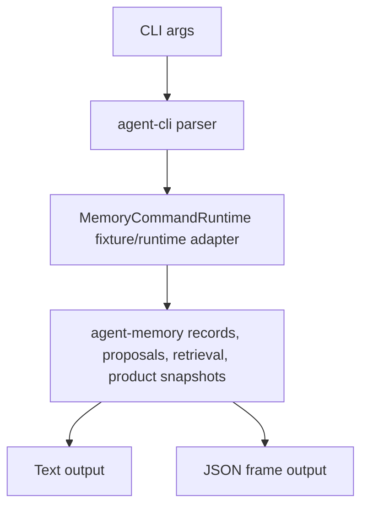

# M64-02 CLI and JSON Memory Review Commands Spec

## Purpose

Productize memory review in `agent-cli` so users and UI callers can inspect memory state, preview retrieval influence, review proposed writes, delete/tombstone records, import/export archives, and rebuild indexes through stable text and JSON commands.

## Product Context

M64-01 added UI-safe `agent-memory` product snapshot contracts. M64-02 exposes those contracts through CLI/JSON without adding runtime prompt influence or Desktop rendering yet. The slice should make memory inspectable and reviewable from a credential-free command surface, using deterministic fixture-backed behavior until later runtime integration wires real stores.

## Scope

This spec delivers:

- CLI parsing for memory product snapshot and retrieval preview commands
- CLI parsing for memory proposal list/inspect/approve/reject/expire/commit commands
- text output for review-oriented memory workflows
- JSON output with stable `type` frames and shared `agent-memory` product contracts
- safe summaries for records, proposals, retrieval candidates, influence summaries, import/export, deletion/tombstones, and rebuild reports
- deterministic tests proving sensitive memory and secret-like text do not leak
- M64-02 status docs and command documentation

Existing commands remain in scope:

- `memory list`
- `memory inspect <id>`
- `memory delete <id> --reason <reason>`
- `memory export`
- `memory import <path>`
- `memory rebuild-index`

New commands in scope:

- `memory snapshot`
- `memory retrieve --query <text> [--max-selected <n>]`
- `memory proposal list`
- `memory proposal inspect <id>`
- `memory proposal approve <id>`
- `memory proposal reject <id> --reason <reason>`
- `memory proposal expire <id> --reason <reason>`
- `memory proposal commit <id>`

Out of scope:

- real persistent memory store wiring beyond the existing deterministic CLI fixture runtime
- runtime prompt assembly changes
- model-generated proposal creation
- TUI/Desktop rendering
- remote sync or organization memory controls

## Architecture

`agent-cli` owns command parsing and rendering only. Memory privacy, product snapshots, proposal status, retention, tombstones, retrieval, reranking, and redaction remain in `agent-memory`.



## Public Contracts

JSON frames should be stable and snake_case:

- `memory_list`
- `memory_snapshot`
- `memory_inspect`
- `memory_retrieval_preview`
- `memory_proposal_list`
- `memory_proposal_inspect`
- `memory_proposal_decision`
- `memory_proposal_commit`
- `memory_deleted`
- `memory_export`
- `memory_import`
- `memory_rebuild`
- `memory_error`

Where possible, JSON payloads should include shared `agent-memory` product contracts:

- `MemoryProductSnapshot`
- `MemoryRecordSummary`
- `MemoryProposalSummary`
- `MemoryRetrievalPreview`
- `MemoryInfluenceSummary`
- `MemoryTombstone`
- `MemoryArchive`
- `MemoryImportReport`
- `MemoryIndexRebuildReport`

## State and Failure Handling

- Unknown memory ids return status code 2 and a redacted `memory_error`.
- Unknown proposal ids return status code 2 and a redacted `memory_error`.
- `reject` and `expire` require `--reason`.
- Retrieval requires non-empty `--query`.
- Invalid `--max-selected` values are rejected before execution.
- Sensitive record content remains hidden in text and JSON.
- Secret-like values are redacted in ids, summaries, reasons, diagnostics, and errors.
- Proposal decisions follow `agent-memory` state transitions and report invalid transitions instead of silently succeeding.

## Security and Privacy

- Default CLI output must not include raw sensitive memory content.
- JSON output must not include proposal `content`, raw sensitive record text, raw embeddings, or unbounded logs.
- Export continues to exclude sensitive records by default.
- Delete/tombstone reasons are redacted.
- Retrieval and influence previews show enough evidence to explain selection without exposing sensitive memory text.

## Testing Strategy

- Extend `crates/agent-cli/tests/memory_commands.rs`.
- Cover parse behavior for all new commands.
- Cover text and JSON snapshot output.
- Cover retrieval preview and influence redaction.
- Cover proposal list/inspect/approve/reject/expire/commit surfaces.
- Cover invalid transitions and redacted errors.
- Preserve existing import/export/delete/rebuild tests.

Focused checks:

```bash
CARGO_TARGET_DIR=target/m64-dev cargo test -p agent-cli --test memory_commands
CARGO_TARGET_DIR=target/m64-dev cargo clippy -p agent-cli --all-targets -- -D warnings
cargo fmt --all -- --check
git diff --check
```

## Acceptance Criteria

- Users can inspect memory state from text output and stable JSON.
- Users can preview retrieval selection/rejection counts and influence evidence without sensitive leaks.
- Users can inspect and decide memory write proposals.
- Existing import/export/delete/rebuild behavior remains stable.
- CLI memory JSON surfaces expose shared `agent-memory` product contracts.
- M64 remains in progress and M64-03 becomes the next active slice after M64-02 closeout.

## Completion Signal

M64-02 is complete when command parsing/rendering/tests/docs pass focused CLI checks, status docs mark the slice complete, and M64-03 Runtime Memory Influence and Proposal Loop is the next implementation focus.
