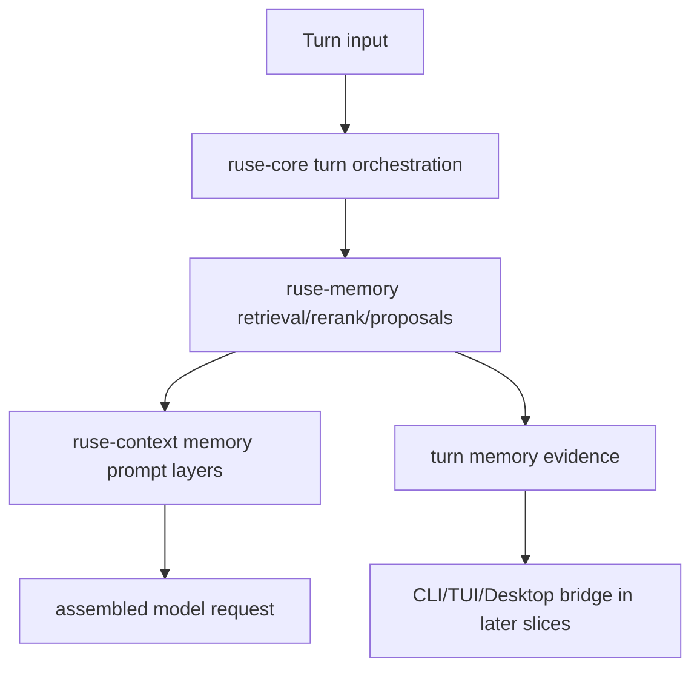

# M64-03 Runtime Memory Influence and Proposal Loop Spec

## Purpose

Integrate selected memories into runtime prompt assembly with explainable influence evidence, and create reviewable memory write proposals from turn evidence without silently committing new durable memory.

## Product Context

M64-01 made memory state safe to summarize. M64-02 exposed review workflows through CLI/JSON. M64-03 connects memory to actual turn execution: selected project/user memories should be able to affect context through bounded prompt layers, and useful turn evidence should become pending proposals that users can review in later CLI/TUI/Desktop surfaces.

## Scope

This spec delivers:

- typed runtime memory context input for candidate records, retrieval configuration, and proposal policy
- context assembly support that includes selected memories as `PromptLayerKind::Memory`
- influence evidence that reports selected/rejected memory counts and safe summaries
- turn-level memory output that can be serialized and rendered by later bridge/UI slices
- deterministic memory write proposal creation from bounded turn evidence
- focused `ruse-context` and `ruse-core` tests proving prompt influence, redaction, disabled-memory behavior, and proposal review state

Out of scope:

- persistent memory store wiring beyond deterministic in-memory/runtime inputs
- Desktop/TUI rendering
- final eval smoke and docs closeout
- automatic commitment of proposals without review
- model-specific extraction prompts or remote memory services

## Architecture

`ruse-memory` owns retrieval, reranking, product snapshots, proposal validation, and redaction. `ruse-context` owns prompt-layer assembly from selected memories. `ruse-core` owns turn-level orchestration and emits memory influence/proposal evidence as typed runtime results.



## Public Contracts

Expected `ruse-core` contract families:

- `RuntimeMemoryConfig`
- `RuntimeMemoryInput`
- `RuntimeMemoryInfluenceReport`
- `RuntimeMemoryProposalReport`
- `RuntimeMemoryTurnEvidence`
- `RuntimeMemoryProposalPolicy`

Expected behavior:

- memory can be disabled explicitly
- retrieval uses bounded max-selected and prompt-budget settings
- selected memories become prompt layers through `ruse-context`
- influence reports use safe summaries and do not expose raw sensitive text
- proposal reports contain `MemoryProposalSummary`, not raw proposal content
- proposal creation never commits memory

## State and Failure Handling

- Disabled memory returns an empty influence report with an info diagnostic.
- Empty memory candidates assemble a normal prompt without memory layers.
- Retrieval/rerank failures degrade to no-memory context unless the caller requests fail-closed behavior.
- Sensitive memory may be selected but remains hidden/private according to prompt-layer visibility and product snapshot rules.
- Proposal extraction failures do not fail the turn; they emit diagnostics unless fail-closed is configured.
- Duplicate proposal ids or invalid proposal content become redacted diagnostics.

## Security and Privacy

- Runtime evidence must not include raw sensitive memory text.
- Proposal summaries must not include proposal content.
- Secret-like values are redacted in influence summaries, proposal summaries, diagnostics, and errors.
- Sensitive memory prompt layers are hidden/user-private.
- Proposal auto-approval eligibility is reported but proposals remain reviewable.

## Testing Strategy

- `crates/ruse-context/tests/memory_prompt_layers.rs`
  - selected memories enter prompt layers with existing privacy semantics
  - selected memory layers can be assembled with user/system layers in priority order

- `crates/ruse-core/tests/runtime_memory_influence.rs`
  - disabled memory emits no layers and reports diagnostics
  - selected memory affects model request messages
  - influence report includes selected/rejected counts and redacted sensitive previews
  - proposal report creates pending summaries from turn evidence
  - proposal content is not present in serialized runtime evidence

Focused checks:

```bash
CARGO_TARGET_DIR=target/m64-dev cargo test -p ruse-context --test memory_prompt_layers
CARGO_TARGET_DIR=target/m64-dev cargo test -p ruse-core --test runtime_memory_influence
CARGO_TARGET_DIR=target/m64-dev cargo clippy -p ruse-context -p ruse-core --all-targets -- -D warnings
cargo fmt --all -- --check
git diff --check
```

## Acceptance Criteria

- Runtime inputs can enable or disable memory.
- Selected memories can enter prompt assembly through typed context layers.
- Turn evidence explains memory influence with safe selected/rejected summaries.
- Runtime can create pending memory proposals from bounded turn evidence.
- No raw sensitive memory or proposal content appears in serialized runtime evidence.
- M64 remains in progress and M64-04 TUI/Desktop Memory Surfaces becomes the next active slice after M64-03.

## Completion Signal

M64-03 is complete when runtime memory influence/proposal contracts, context/core tests, focused gates, and status docs are complete, with M64-04 as the next implementation focus.
