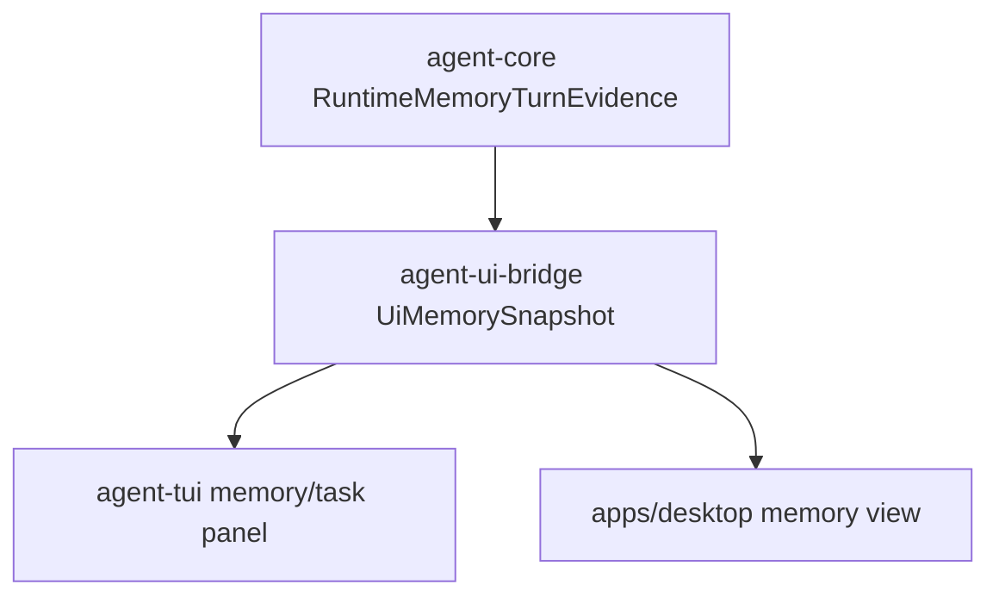

# M64-04 TUI/Desktop Memory Surfaces Spec

## Purpose

Expose memory review state in TUI and Desktop through bridge-safe snapshots so users can see active memories, proposals, retrieval influence, privacy diagnostics, retention state, import/export evidence, and disabled-memory states without presentation layers owning memory policy.

## Product Context

M64-01 created safe memory product snapshots. M64-02 exposed CLI review commands. M64-03 connected runtime memory influence and proposal evidence. M64-04 turns that shared evidence into user-visible TUI/Desktop surfaces while keeping broader Desktop productization separate.

## Scope

This spec delivers:

- `agent-ui-bridge` memory snapshot frame contracts
- TUI task/memory panel state that consumes memory frames
- TUI text rendering for records, proposals, retrieval influence, diagnostics, tombstones, and privacy/retention state
- Desktop TypeScript types for memory frames
- Desktop state reducer handling for `memory_snapshot`
- Desktop memory view/component rendering records, proposals, retrieval influence, diagnostics, and privacy state
- focused Rust and Vitest coverage using deterministic fixture frames

Out of scope:

- broad Desktop redesign or design-system migration
- side-effecting proposal decision buttons in Desktop
- runtime prompt influence changes
- eval smoke/docs closeout
- persistent memory store/keychain/packaging work

## Architecture

`agent-memory` and `agent-core` own memory state and evidence. `agent-ui-bridge` maps runtime evidence into bridge-safe, Eq-friendly UI structs. TUI/Desktop reduce bridge frames and render them without recalculating privacy, retrieval, proposal, retention, or influence decisions.



## Public Contracts

Expected bridge contracts:

- `UiMemorySnapshot`
- `UiMemoryRecordSummary`
- `UiMemoryProposalSummary`
- `UiMemoryRetrievalCandidateSummary`
- `UiMemoryInfluenceSummary`
- `UiMemoryDiagnostic`
- `UiJsonFrame::MemorySnapshot`

Bridge contracts should use Eq-friendly fields:

- ids and labels as strings
- counts as integers
- scores as bounded display strings if needed
- previews already redacted/bounded by memory product contracts
- no raw sensitive memory text or proposal content

## State and Failure Handling

- Empty snapshot renders an explicit empty state.
- Disabled memory renders a diagnostic/privacy state, not an error.
- Missing retrieval data renders records/proposals without influence counts.
- Missing proposal data renders "no proposals".
- Diagnostics are bounded and redacted before reaching TUI/Desktop.
- Unknown frames are ignored by existing reducers.

## Security and Privacy

- TUI/Desktop must not display raw sensitive memory text.
- TUI/Desktop must not display proposal content.
- TUI/Desktop must not derive sensitivity, review eligibility, proposal status, or retrieval reasons locally.
- Support fixtures and tests must assert secret-like text stays redacted.

## Testing Strategy

- `crates/agent-ui-bridge/tests/memory_snapshot.rs`
  - converts runtime memory evidence into safe bridge snapshot
  - serializes/deserializes `memory_snapshot` frame
  - redacts sensitive previews and proposal content

- `crates/agent-tui/tests/task_panel.rs`
  - reduces memory snapshot frames
  - renders memory counts, proposals, retrieval influence, diagnostics, and redacted previews

- `apps/desktop/src/__tests__/memory-ui.test.tsx`
  - reducer stores memory snapshot
  - component renders memory state
  - no raw sensitive text appears

Focused checks:

```bash
CARGO_TARGET_DIR=target/m64-dev cargo test -p agent-ui-bridge --test memory_snapshot
CARGO_TARGET_DIR=target/m64-dev cargo test -p agent-tui --test task_panel
npm --prefix apps/desktop test -- --run src/__tests__/memory-ui.test.tsx
npm --prefix apps/desktop run build
cargo fmt --all -- --check
git diff --check
```

## Acceptance Criteria

- TUI and Desktop can render memory state from a shared bridge frame.
- Memory records, proposals, retrieval influence, diagnostics, retention, and tombstone counts are visible.
- Sensitive memory and proposal content remain redacted.
- Presentation layers contain no local memory policy/retrieval/proposal decision logic.
- M64 remains in progress and M64-05 Memory Smoke, Docs, and Closeout becomes the next active slice.

## Completion Signal

M64-04 is complete when bridge/TUI/Desktop memory surfaces and focused checks pass, status docs mark the slice complete, and M64-05 becomes the next implementation focus.
