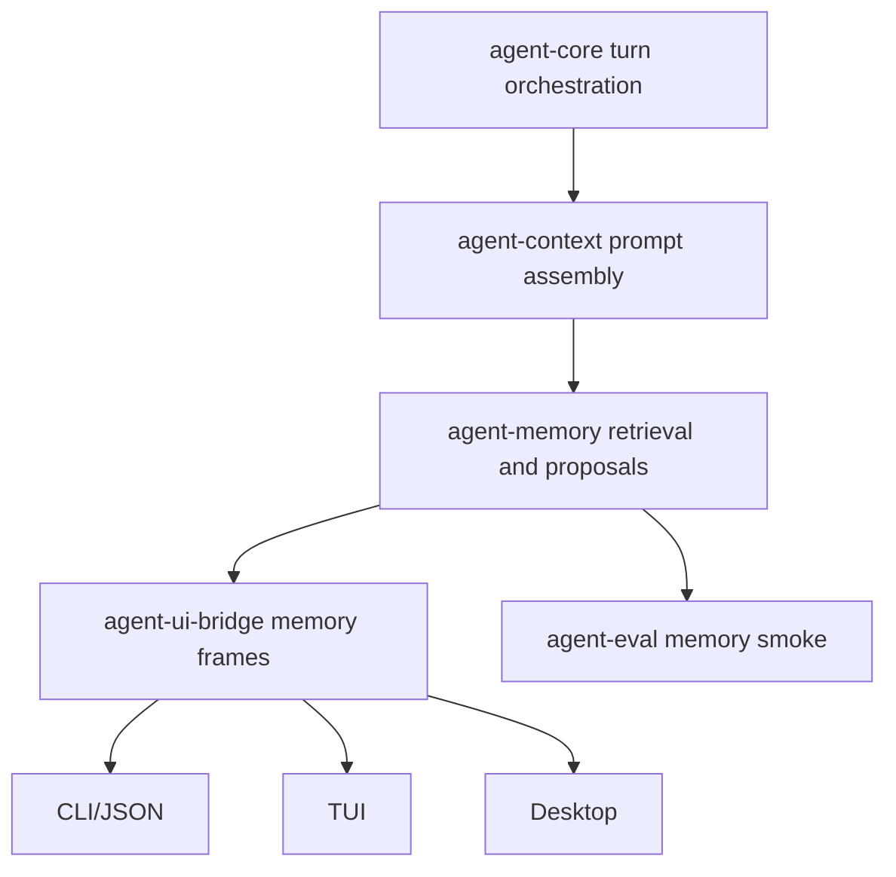

# M64 Memory and Personalization Spec

## Purpose

Productize memory so `agent` can recall useful project and user preferences across work while keeping every memory inspectable, reviewable, privacy-safe, and explainable in CLI/Desktop surfaces.

## Product Context

M05, M12, M23, and later product milestones already added scoped memory records, archives, hybrid retrieval, reranking, write proposals, editor contracts, deletion tombstones, and influence traces. The remaining M64 gap is product integration: memory should affect coding workflows through typed runtime/context contracts, users should see what was used and why, and memory writes should be proposed or approved rather than silently committed.

M64 follows M63 team workflow productization and precedes M65 packaging/beta. It must not start packaging work, cross-device sync, or broad Desktop redesign.

## Scope

This milestone delivers:

- shared product memory snapshots for records, proposals, retrieval, influence traces, retention controls, and privacy diagnostics
- runtime/context integration that can include selected project/user memories in prompt assembly with bounded influence evidence
- CLI/JSON commands for memory inspection, retrieval preview, proposal review, import/export, deletion, and index rebuild evidence
- TUI/Desktop-safe bridge frames and UI surfaces for memory review, proposal decisions, influence traces, and settings
- deterministic memory/personalization smoke coverage in the default eval path
- CLI/Desktop docs for memory behavior, review workflows, privacy controls, import/export, and redaction

Out of scope:

- remote managed memory service
- cross-device sync
- organization-wide shared memory governance
- automatic long-term sensitive memory writes without explicit review
- M65 installer/keychain/update packaging
- M66 plugin/MCP management hardening

## Architecture

`agent-memory` owns durable memory records, archives, proposal state, index/retrieval, reranking, tombstones, audit entries, and influence traces. `agent-context` asks memory for scoped candidates and turns selected records into bounded prompt layers. `agent-core` orchestrates memory retrieval/proposal events and attaches evidence to turns. `agent-ui-bridge` exposes UI-safe snapshots. CLI/TUI/Desktop render and command over typed contracts only.

## Milestone Slices

| Slice | Outcome |
|---|---|
| M64-01 Memory Product Snapshot and Privacy Contracts | Define UI-safe memory snapshots that compose records, proposals, retrieval candidates, influence traces, retention controls, tombstones, and diagnostics. |
| M64-02 CLI and JSON Memory Review Commands | Productize memory list/inspect/retrieve/proposal/decision/import/export/rebuild commands over shared contracts. |
| M64-03 Runtime Memory Influence and Proposal Loop | Integrate selected memory into context assembly and create reviewable memory write proposals from turn evidence. |
| M64-04 TUI/Desktop Memory Surfaces | Render memory influence, proposals, privacy controls, import/export state, and settings from bridge snapshots. |
| M64-05 Memory Smoke, Docs, and Closeout | Add deterministic default eval smoke, CLI/Desktop docs, final gates, and M64 closeout status. |

## Public Contracts

Expected contract families:

- `MemoryProductSnapshot`
- `MemoryRecordSummary`
- `MemoryProposalSummary`
- `MemoryRetrievalPreview`
- `MemoryInfluenceTrace`
- `MemoryRetentionControlSummary`
- `MemoryPrivacyDiagnostic`
- `UiMemorySnapshot`
- `UiMemoryProposalDecisionCommand`

Contracts must be typed, serializable when durable or bridge-facing, bounded, redacted, and stable for JSON tests.

## State and Failure Handling

- Memory retrieval failures degrade to no-memory context with diagnostics unless the user explicitly requires memory.
- Sensitive memory is excluded from prompt layers unless policy and scope allow it.
- Memory write proposals remain pending until explicitly approved, rejected, expired, or committed by policy.
- Deleted memory writes tombstones and must not reappear through import or index rebuild.
- Import/export reports accepted, skipped, rejected, sensitive, and tombstoned counts.
- Index rebuild reports stale embeddings and skipped tombstoned records.
- Influence traces must survive prompt assembly and be visible without raw sensitive memory text.

## Security and Privacy

- Raw sensitive memory content must not appear in default CLI/Desktop summaries, eval goldens, diagnostics, or support artifacts.
- Secret-like values are redacted in memory text, proposal summaries, deletion reasons, archive diagnostics, and influence traces.
- Memory proposals should favor explicit user review, especially for user, private, sensitive, or cross-project facts.
- Import cannot silently downgrade sensitivity.
- Export excludes sensitive memory by default and must make retention policy explicit.

## Testing Strategy

- focused `agent-memory` contract tests for snapshots, proposals, tombstones, retention, redaction, and influence traces
- `agent-context` and `agent-core` tests proving selected memory affects prompt assembly with evidence
- CLI/JSON tests for stable memory commands and proposal decisions
- UI bridge/TUI/Desktop tests for memory frames and rendering
- default eval scenario proving memory retrieval, proposal review, deletion/tombstone, import/export redaction, and influence trace evidence

## Acceptance Criteria

- Users can inspect which memories exist, which were selected, and why they influenced a turn.
- Users can approve/reject proposed memories before durable commitment.
- Memory retrieval contributes to prompts only through bounded, policy-safe context layers.
- Import/export, deletion, tombstones, and rebuild behavior are documented and test-covered.
- CLI/TUI/Desktop render memory state from shared bridge/runtime contracts.
- `cargo xtask eval` includes deterministic M64 memory smoke without provider credentials.

## Completion Signal

M64 is complete when all M64 slices are implemented, final workspace/Desktop/eval gates pass, roadmap and milestone docs mark M64 complete, and M65 Packaging, Release, and Beta Gate becomes the next active milestone.
