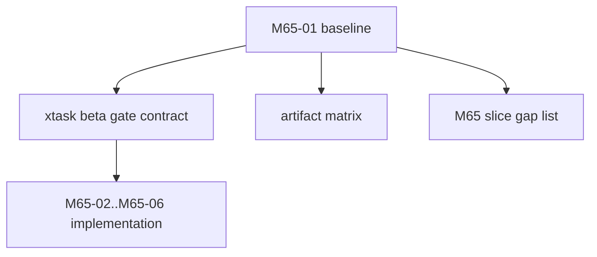

# M65-01 Release Baseline and Beta Gate Contracts Spec

## Purpose

Define the beta release baseline, artifact matrix, gate report contracts, support evidence shape, and implementation gaps before changing package behavior. This slice makes M65 execution measurable and prevents beta readiness from being declared from generic CI success alone.

## Product Context

M65 must turn existing packaging and quality foundations into a beta users can install and trust. M25 added local CLI/Desktop packaging foundations, M29 added quality gate evidence, and M56-M64 added product smokes. M65-01 connects those pieces into a release-specific contract and plan.

## Scope

This spec delivers:

- current packaging/release capability baseline
- beta artifact matrix for CLI and Desktop
- beta gate report contract proposal
- required release evidence sections
- support bundle section inventory
- isolated smoke root rules
- release gap list mapped to M65-02 through M65-06
- documentation and test strategy for later slices

Owned by later M65 slices:

- CLI package smoke implementation
- Desktop bundle/update smoke implementation
- settings/keychain/provider onboarding implementation
- support bundle generation implementation
- final release docs and closeout

## Architecture

M65-01 is design-first. It should not move release decisions into presentation layers.



## File Layout

```text
docs/
  specs/M65-01-release-baseline-beta-gate.spec.md
  plans/M65-01-release-baseline-beta-gate.plan.md
  release/
    beta-gate.md
    support-bundle.md
```

Implementation slices may later touch:

```text
xtask/
  src/lib.rs
  src/main.rs
  tests/
crates/
  ruse-core/
  ruse-model/
  ruse-storage/
  ruse-desktop/
  ruse-telemetry/
  ruse-ui-bridge/
```

## Public Contracts

M65-01 should propose contract shapes without requiring all code to exist immediately.

Candidate beta gate contract:

```rust
pub struct BetaGateReport {
    pub schema_version: u32,
    pub channel: ReleaseChannel,
    pub status: BetaGateStatus,
    pub started_at_unix_ms: u64,
    pub finished_at_unix_ms: u64,
    pub artifacts: Vec<BetaGateArtifact>,
    pub checks: Vec<BetaGateCheck>,
    pub support_bundle: Option<SupportBundleSummary>,
    pub diagnostics: Vec<BetaGateDiagnostic>,
}

pub struct BetaGateArtifact {
    pub kind: BetaGateArtifactKind,
    pub name: String,
    pub path: String,
    pub target_triple: String,
    pub checksum_sha256: Option<String>,
}

pub enum BetaGateArtifactKind {
    CliPackage,
    DesktopBundle,
    DesktopUpdateManifest,
    EvalReport,
    SupportBundle,
}
```

Final implementation may reuse existing `xtask` release structs when they provide the same evidence.

## Artifact Matrix

M65 should track at least:

| Artifact | Owner | Required For Beta | Notes |
|---|---|---:|---|
| CLI binary/package manifest/checksum | `xtask`, `ruse-cli` | Yes | Existing `package-cli` baseline exists. |
| Desktop bundle or bundle plan | `xtask`, Tauri app, `ruse-desktop` | Yes | Existing `package-desktop` can plan and validate update manifest. |
| Desktop update manifest | `ruse-desktop`, `xtask` | Yes | Local manifest validation exists; hosted signing is out of scope. |
| Default eval report | `ruse-eval`, `xtask` | Yes | Must include M56, M62, M63, M64 product smokes. |
| Startup/migration diagnostics | `ruse-core`, `ruse-storage` | Yes | Must be release-local and safe. |
| Provider/keychain diagnostics | `ruse-model`, CLI/Desktop surfaces | Yes | No raw secrets. |
| Support bundle | `ruse-core`/`ruse-telemetry`/`xtask` | Yes by M65-05 | Must be bounded and redacted. |

## State And Failure Handling

- baseline docs must distinguish existing capabilities from missing beta requirements
- beta gate must fail when required package, eval, migration, provider diagnostic, or support evidence is missing
- dev channel may accept Desktop bundle plan artifacts, but beta closeout must state exactly what is installable versus planned
- every smoke must use isolated config/data roots
- support evidence must be generated even when optional sections fail, with diagnostics

## Security And Privacy

- release roots must not read user production config unless explicitly requested by a future command
- support bundle sections must be allowlisted
- raw API keys, tokens, passwords, prompts, tool inputs, sensitive memory, embeddings, and unbounded logs are forbidden
- update manifest URLs and checksums must be validated before any update action

## Testing Strategy

M65-01 itself is documentation-first and should run:

```bash
git diff --check
```

If code contracts are added in this slice, also run focused `xtask` tests and the standard Rust checks for touched crates.

Later slices should add:

- `xtask` beta gate planning tests
- package CLI/Desktop smoke tests
- support bundle redaction tests
- migration/provider diagnostic tests
- final package/eval/Desktop gates

## Acceptance Criteria

- M65 milestone spec/plan exists.
- M65-01 slice spec/plan exists.
- Milestone index marks M65 as planned and active.
- The release artifact matrix and gap list clearly map remaining work to M65-02 through M65-06.
- No broad Desktop redesign or extension/MCP hardening enters M65-01.

## Completion Signal

M65-01 planning is complete when the baseline, artifact matrix, report shape, gap list, and M65 slice plan are documented and `git diff --check` passes.
