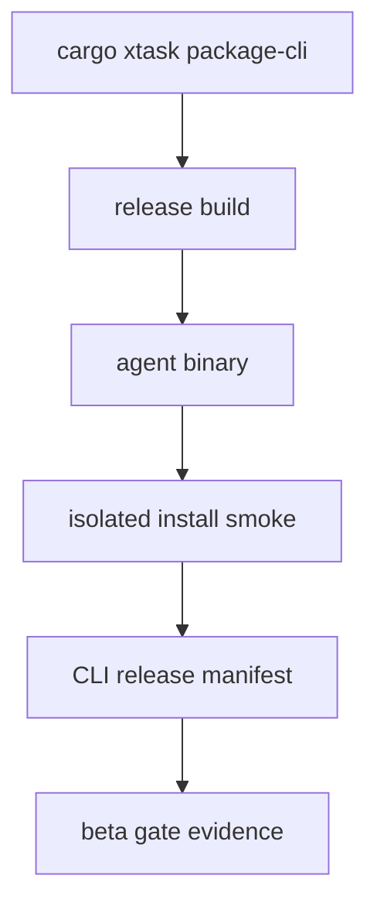

# M65-02 CLI Package and Install Smoke Spec

## Purpose

Upgrade the existing `cargo xtask package-cli` path from a local packaging helper into beta-grade CLI install smoke evidence. The packaged `agent` binary should prove version, isolated config roots, startup checks, provider diagnostics, fake-provider prompt execution, manifest/checksum integrity, and redacted release evidence.

## Product Context

M25-04 added repeatable CLI artifact generation, checksums, release manifests, and basic smoke commands. M65-02 builds on that foundation for beta readiness: a release reviewer should be able to inspect one CLI package manifest and know what artifact was built, where it ran, what isolated root was used, what commands passed, and whether provider/config diagnostics were safe.

## Scope

This spec delivers:

- beta-grade CLI release manifest fields for install smoke evidence
- deterministic isolated smoke root metadata
- explicit smoke check records for version, config, startup, provider readiness, and fake-provider prompt
- checksum/manifest consistency validation
- focused tests for release manifest shape and smoke command planning
- CLI release documentation updates

Owned by other M65 slices:

- Desktop bundle/update smoke: M65-03
- settings/keychain/migration onboarding across surfaces: M65-04
- support bundle generation: M65-05
- final install/upgrade docs and beta closeout: M65-06

## Architecture

`xtask` continues to own packaging orchestration. The packaged CLI binary owns actual command behavior. Runtime/provider crates own config and provider diagnostics.



## File Layout

```text
xtask/
  src/lib.rs
  src/main.rs
  tests/package_cli.rs
  tests/xtask_plan.rs
docs/
  cli/
  release/beta-gate.md
  specs/M65-02-cli-package-install-smoke.spec.md
  plans/M65-02-cli-package-install-smoke.plan.md
```

## Public Contracts

Extend or wrap the existing `CliReleaseManifest` with install smoke evidence.

Candidate additive fields:

```rust
pub struct CliReleaseManifest {
    pub schema_version: u32,
    pub channel: ReleaseChannel,
    pub artifact: CliReleaseArtifact,
    pub smoke_checks: Vec<String>,
    pub install_smoke: Option<CliInstallSmokeSummary>,
}

pub struct CliInstallSmokeSummary {
    pub smoke_root: PathBuf,
    pub config_path: PathBuf,
    pub checks: Vec<CliInstallSmokeCheck>,
}

pub struct CliInstallSmokeCheck {
    pub id: String,
    pub command: String,
    pub required: bool,
}
```

If the existing manifest shape must remain stable for compatibility, add a schema-versioned sibling report instead of changing existing fields.

## Required Smoke Checks

M65-02 should cover:

- `agent --version`
- `agent --config-check --config <release-local config>`
- `agent startup-check`
- `agent --json --prompt "release smoke"`
- provider readiness diagnostics using fake provider or missing-credential fixtures that fail before network access

All commands must run with release-local `HOME` and `USERPROFILE` values.

## State And Failure Handling

- packaging fails if any required smoke command fails
- manifest/checksum files are written only after required smoke checks pass
- incomplete artifacts should not be presented as beta-ready
- unsupported target triples must fail with clear diagnostics
- provider credential failures must be redacted and pre-network

## Security And Privacy

- smoke config must not include raw user secrets
- release manifests must not include environment dumps
- smoke command evidence should include command shapes, not raw output logs
- secret-like values in diagnostics must be redacted before durable evidence
- release-local roots must avoid production user config/data

## Testing Strategy

Focused tests:

```bash
CARGO_TARGET_DIR=target/m65-dev cargo test -p xtask package_cli
CARGO_TARGET_DIR=target/m65-dev cargo test -p xtask xtask_plan package_cli
```

If CLI commands or diagnostics are touched:

```bash
CARGO_TARGET_DIR=target/m65-dev cargo test -p ruse-cli startup_check
CARGO_TARGET_DIR=target/m65-dev cargo test -p ruse-cli live_provider_registration
```

M65 final gates remain in the milestone plan.

## Acceptance Criteria

- `package_cli_plan` exposes deterministic artifact, manifest, checksum, smoke root, config path, and required smoke commands.
- CLI release manifest or companion report records install smoke evidence in a stable schema.
- All smoke commands use isolated roots.
- Focused `xtask` tests prove beta-grade CLI package evidence.
- Docs explain the CLI package/install smoke workflow and privacy expectations.

## Completion Signal

M65-02 is complete when CLI package smoke evidence is implemented, tests pass, docs are updated, and M65 status advances to M65-03 Desktop Bundle and Update Smoke.
