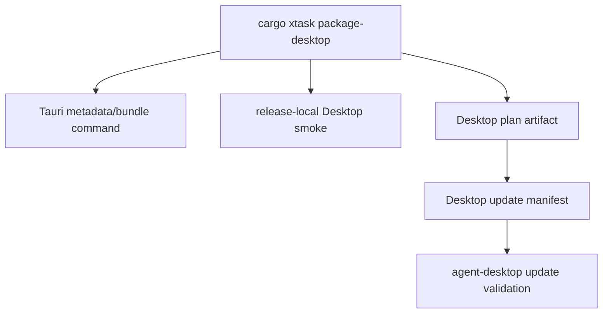

# M65-03 Desktop Bundle and Update Smoke Spec

## Purpose

Upgrade the existing `cargo xtask package-desktop` path into beta-grade Desktop bundle/update smoke evidence. The Desktop release path should prove Tauri metadata, bundle command planning, release-local startup diagnostics, update manifest validation, smoke check metadata, and bundle-vs-plan behavior without requiring live provider credentials.

## Product Context

M25-05 added Desktop bundle planning and update manifest validation. M60 made Desktop a daily-driver product surface. M65-03 connects those foundations so a beta release reviewer can inspect Desktop release evidence and understand whether the local run produced a real bundle or a dev-channel plan artifact, which update manifest was validated, and which smoke checks passed.

## Scope

This spec delivers:

- beta-grade Desktop release plan/update evidence
- stable Desktop smoke summary metadata for release-local roots and required smoke checks
- Tauri bundle metadata validation evidence
- update manifest validation evidence with checksum and artifact URL
- tests for Desktop package plan smoke ids and manifest/report shape
- Desktop release packaging docs

Owned by other M65 slices:

- CLI package/install smoke: M65-02
- settings/secrets/migration onboarding across CLI/Desktop: M65-04
- support bundle generation: M65-05
- final install/upgrade docs and closeout: M65-06

## Architecture

`xtask` owns Desktop release orchestration. `apps/desktop/src-tauri` owns bundle metadata. `agent-desktop` owns update manifest validation contracts. Desktop frontend should not own update policy.



## File Layout

```text
xtask/
  src/lib.rs
  tests/package_desktop.rs
crates/
  agent-desktop/src/update.rs
  agent-desktop/tests/update_manifest.rs
apps/
  desktop/src-tauri/tauri.conf.json
docs/
  desktop/
  release/
  specs/M65-03-desktop-bundle-update-smoke.spec.md
  plans/M65-03-desktop-bundle-update-smoke.plan.md
```

## Public Contracts

M65-03 should add or reuse Desktop release evidence contracts owned by `xtask`.

Candidate additive fields:

```rust
pub struct DesktopReleaseSmokeSummary {
    pub smoke_root: PathBuf,
    pub tauri_config_path: PathBuf,
    pub bundle_requested: bool,
    pub checks: Vec<DesktopReleaseSmokeCheck>,
}

pub struct DesktopReleaseSmokeCheck {
    pub id: String,
    pub command: String,
    pub required: bool,
}
```

This summary can be written into the plan artifact, update manifest companion report, or future beta gate report. The update manifest itself should stay focused on update metadata.

## Required Smoke Checks

M65-03 should cover:

- Tauri config metadata validation
- `cargo test -p agent-desktop update_manifest`
- `cargo test -p agent-desktop settings`
- optional `npm --prefix apps/desktop run tauri -- build` when `--bundle` is requested
- update manifest checksum and URL validation

All smoke checks must run with release-local `HOME` and `USERPROFILE` values.

## State And Failure Handling

- invalid Tauri metadata fails before writing beta-ready Desktop evidence
- invalid update manifest fails before update actions
- dev-channel runs may produce a plan artifact instead of a real bundle, but evidence must state `bundle=false`
- `--bundle` failures must not write misleading success evidence
- failed Desktop smoke checks must stop package success

## Security And Privacy

- Desktop release smokes must not embed local config, keychain values, memory, logs, or provider secrets
- release evidence should contain command shapes and metadata, not raw command output
- update manifest signatures can remain optional for local dev but must not be confused with stable-channel signing
- Desktop frontend must not implement update validation policy

## Testing Strategy

Focused checks:

```bash
CARGO_TARGET_DIR=target/m65-dev cargo test -p xtask --test package_desktop
CARGO_TARGET_DIR=target/m65-dev cargo test -p agent-desktop update_manifest
CARGO_TARGET_DIR=target/m65-dev cargo clippy -p xtask -p agent-desktop --all-targets -- -D warnings
```

Optional package smoke:

```bash
cargo xtask package-desktop --channel dev
```

M65 final gates remain in the milestone plan.

## Acceptance Criteria

- `package_desktop_plan` exposes deterministic plan artifact, update manifest, smoke root, Tauri config, bundle command, and required smoke commands.
- Desktop release evidence records smoke root, Tauri config path, bundle requested state, and stable check ids.
- Update manifest validation remains in `agent-desktop`.
- Focused tests prove Desktop package/update smoke evidence.
- Docs explain Desktop bundle/update smoke and privacy expectations.

## Completion Signal

M65-03 is complete when Desktop package/update smoke evidence is implemented, tests pass, docs are updated, and M65 status advances to M65-04 Settings, Secrets, and Migration Onboarding.
