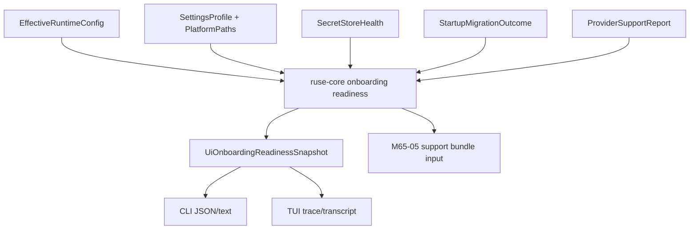

# M65-04 Settings, Secrets, and Migration Onboarding Spec

## Purpose

Add beta-grade onboarding readiness diagnostics for installed or release-local `agent` builds. A beta user should be able to run config diagnostics and understand whether settings, platform paths, secret storage, startup migrations, and provider/model readiness are safe enough to start work.

## Product Context

M65-02 and M65-03 prove CLI and Desktop release artifacts can be packaged or planned with release-local smoke evidence. M65-04 connects those release artifacts to first-run and upgrade readiness: config is valid, secret storage is understood, migrations are allowed, and the selected provider/model can support the coding-agent workflow.

## Scope

This spec delivers:

- a typed `OnboardingReadinessSnapshot` contract in `ruse-core`
- readiness summaries for settings, platform paths, secret store health, startup migrations, and provider support
- stable status values: `ready`, `degraded`, and `blocked`
- stable diagnostics and next-action ids suitable for CLI/Desktop/support rendering
- CLI `--config-check` text and JSON readiness output
- UI bridge and TUI rendering for the new readiness frame
- deterministic tests proving redaction and bounded machine-consumable output

Owned by later M65 slices:

- support bundle collection and release evidence integration: M65-05
- final install/upgrade/support docs and M65 closeout: M65-06

## Architecture

`ruse-core` owns readiness decisions. `ruse-ui-bridge`, CLI, TUI, and Desktop render typed snapshots only. Secret, migration, and provider policy stays in runtime/model crates.



## Public Contracts

`ruse-core` exposes:

```rust
pub struct OnboardingReadinessSnapshot {
    pub schema_version: u32,
    pub status: OnboardingReadinessStatus,
    pub settings: OnboardingSettingsSummary,
    pub paths: OnboardingPathSummary,
    pub secrets: OnboardingSecretStoreSummary,
    pub migrations: OnboardingMigrationSummary,
    pub providers: OnboardingProviderSummary,
    pub diagnostics: Vec<OnboardingDiagnostic>,
    pub next_actions: Vec<OnboardingNextAction>,
}
```

Readiness status:

- `ready`: required settings, migrations, secrets, and selected provider readiness have no warnings or blockers.
- `degraded`: runtime can continue, but keychain fallback, provider capability gaps, or migration diagnostics need user attention.
- `blocked`: runtime startup or provider setup is not safe enough to proceed.

Machine-stable fields:

- diagnostic `code`
- diagnostic `severity`
- diagnostic `surface`
- next-action `id`
- next-action `target`

Messages and labels are human-facing and redacted before crossing runtime, CLI, bridge, or durable evidence boundaries.

## CLI And Bridge Behavior

CLI text `--config-check` includes:

- onboarding readiness status
- onboarding diagnostic count
- onboarding next-action count

CLI JSON emits `onboarding_readiness_snapshot` after the existing `config_snapshot`. Existing config frames remain additive and stable for current consumers.

TUI consumes the bridge frame as a runtime/progress summary. Desktop may consume the same bridge frame when a product surface needs first-run or settings readiness.

## Security And Privacy

- no raw API keys, token values, passwords, or secret-like values
- no raw keychain values
- no raw migration text that contains secret-like content
- stable diagnostic codes are preserved even when they contain words such as `secret_store`
- diagnostic messages are redacted and bounded
- support bundles must reuse this snapshot rather than collecting raw config or environment dumps

## Testing Strategy

Focused checks:

```bash
CARGO_TARGET_DIR=target/m65-dev cargo test -p ruse-core onboarding
CARGO_TARGET_DIR=target/m65-dev cargo test -p ruse-cli --test config_diagnostics
CARGO_TARGET_DIR=target/m65-dev cargo test -p ruse-ui-bridge -p ruse-tui --lib
CARGO_TARGET_DIR=target/m65-dev cargo clippy -p ruse-core -p ruse-ui-bridge -p ruse-cli -p ruse-tui --all-targets -- -D warnings
cargo fmt --all -- --check
git diff --check
```

## Acceptance Criteria

- `OnboardingReadinessSnapshot` is typed, serializable, bounded, and redacted.
- CLI config diagnostics include readiness in text and JSON modes.
- UI bridge has an additive readiness frame for presentation layers.
- TUI handles the new frame without owning readiness logic.
- Tests prove keychain fallback/provider gap degradation and migration-blocked redaction.
- Docs explain how M65-04 feeds M65-05 support bundle evidence.

## Completion Signal

M65-04 is complete when the readiness contract is implemented, CLI/bridge/TUI rendering is additive, redaction tests pass, focused gates pass, docs/status are updated, and M65 advances to M65-05 Support Bundle and Release Evidence.
