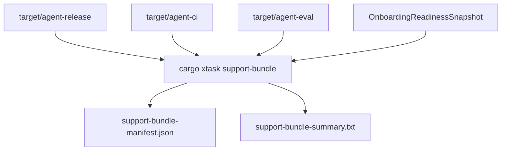

# M65-05 Support Bundle and Release Evidence Spec

## Purpose

Generate bounded, redacted support bundle evidence for beta troubleshooting. The bundle is an allowlisted manifest and summary, not a debug dump: it references package, eval, quality-gate, Desktop, and onboarding evidence without copying raw logs, raw prompts, raw environments, keychain values, or workspace files.

## Product Context

M65-02 and M65-03 create CLI/Desktop release artifacts. M65-04 adds onboarding readiness. M65-05 turns those outputs into a support artifact that beta users can attach when install, upgrade, provider setup, migration, or release smoke behavior fails.

## Scope

This spec delivers:

- `cargo xtask support-bundle`
- typed `SupportBundleManifest`
- typed `SupportBundleSummary`
- allowlisted support sections with `included`, `omitted`, `failed`, or `not_applicable` status
- artifact reference discovery for CLI manifests, Desktop update manifests, Desktop release plans, quality gate reports, and eval reports
- stable redaction diagnostics
- focused `xtask` tests

Owned by M65-06:

- final install/upgrade/support docs and beta closeout evidence
- final M65 all-gates verification

## Architecture

`xtask` owns bundle orchestration and durable support evidence. Runtime crates own source diagnostics. CLI/Desktop may later render support summaries, but they must not assemble raw support data themselves.



## Public Contracts

Support bundle manifest:

```rust
pub struct SupportBundleManifest {
    pub schema_version: u32,
    pub channel: ReleaseChannel,
    pub sections: Vec<SupportBundleSection>,
    pub redaction_diagnostics: Vec<String>,
}
```

Support bundle summary:

```rust
pub struct SupportBundleSummary {
    pub manifest_path: PathBuf,
    pub summary_path: PathBuf,
    pub included_section_count: u32,
    pub omitted_section_count: u32,
    pub failed_section_count: u32,
    pub redaction_diagnostics: Vec<String>,
}
```

Stable section ids:

- `release_metadata`
- `onboarding_readiness`
- `cli_release_manifest`
- `desktop_update_manifest`
- `desktop_release_plan`
- `quality_gate_report`
- `quality_gate_summary`
- `eval_report`

## Security And Privacy

The support bundle must not include:

- raw API keys, tokens, passwords, cookies, SSH keys, or keychain values
- raw environment dumps
- raw prompts or model responses
- raw tool input JSON
- raw sensitive memory text
- embeddings
- unbounded logs or command output
- arbitrary workspace files

The first implementation records paths and checksums for allowlisted artifacts. It does not copy artifact contents.

## Testing Strategy

Focused checks:

```bash
CARGO_TARGET_DIR=target/m65-dev cargo test -p xtask --test support_bundle
CARGO_TARGET_DIR=target/m65-dev cargo test -p xtask --test xtask_plan
CARGO_TARGET_DIR=target/m65-dev cargo clippy -p xtask --all-targets -- -D warnings
cargo fmt --all -- --check
git diff --check
```

Optional local smoke:

```bash
cargo xtask support-bundle --channel dev
```

## Acceptance Criteria

- `support-bundle` command writes manifest and summary files.
- Manifest is typed, serializable, and bounded.
- Section statuses explain included, omitted, and failed evidence.
- Redaction diagnostics explicitly state omitted raw secrets, environments, prompts, and unbounded logs.
- Tests prove artifact discovery, summary counts, parser behavior, and manifest writing.
- M65 status advances to M65-06 Beta Gate Docs and Closeout.

## Completion Signal

M65-05 is complete when support bundle generation is implemented, focused gates pass, docs/status are updated, and M65-06 becomes the next active slice.
