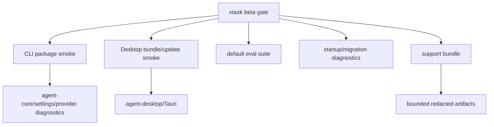

# M65 Packaging, Release, and Beta Gate Spec

## Purpose

Prepare `agent` for a beta that users can install, configure, smoke-test, diagnose, and support. M65 turns the M25 packaging foundations and M29 quality evidence into a product release gate that proves CLI and Desktop artifacts are usable with safe settings, secrets, migrations, provider diagnostics, and redacted support evidence.

## Product Context

M56-M64 made the core coding loop, providers, context, CLI/TUI/Desktop workflows, recovery, team workflows, and memory product-visible. M65 follows by making those capabilities installable and verifiable as a beta release. It precedes M66 extension/MCP hardening, so M65 should not restart extension work unless an installable workflow is blocked.

## Scope

This milestone delivers:

- beta release gate contracts and `xtask` orchestration for CLI, Desktop, eval, migration, and support evidence
- CLI package install/run smoke for dev and beta channels
- Desktop bundle/update smoke over Tauri 2 release metadata and update manifests
- config/settings migration validation and user-visible startup diagnostics
- keychain/env secret setup diagnostics without storing raw secrets in config or support artifacts
- provider onboarding diagnostics for installed artifacts
- redacted support bundle generation for release triage
- release docs and final beta gate evidence

Owned by other milestones:

- broad Desktop redesign and visual productization
- hosted release signing, notarization, and public update service
- live-provider quality benchmarking that requires user credentials
- extension/MCP management hardening beyond release health evidence
- marketplace or account sync

## Architecture

`xtask` owns release gate orchestration and durable release evidence. Runtime crates own typed diagnostics and support data. CLI and Desktop invoke shared contracts and render summaries only.



## File Layout

```text
docs/
  specs/M65-packaging-release-beta-gate.spec.md
  plans/M65-packaging-release-beta-gate.plan.md
  specs/M65-01-release-baseline-beta-gate.spec.md
  plans/M65-01-release-baseline-beta-gate.plan.md
  release/
    beta-gate.md
xtask/
  src/lib.rs
  src/main.rs
  tests/
crates/
  agent-core/
  agent-desktop/
  agent-model/
  agent-storage/
  agent-ui-bridge/
```

## Public Contracts

M65 should prefer additive contracts that can be rendered by CLI/Desktop and written into release artifacts.

Candidate contracts:

```rust
pub struct BetaGateReport {
    pub schema_version: u32,
    pub channel: ReleaseChannel,
    pub status: BetaGateStatus,
    pub artifacts: Vec<BetaGateArtifact>,
    pub checks: Vec<BetaGateCheck>,
    pub support_bundle: Option<SupportBundleSummary>,
}

pub enum BetaGateStatus {
    Passed,
    Failed,
}

pub struct SupportBundleSummary {
    pub path: String,
    pub included_sections: Vec<String>,
    pub redaction_diagnostics: Vec<String>,
}
```

Final field names should follow existing `xtask` and crate conventions.

## State And Failure Handling

- release gates must fail closed when required artifacts, manifests, checksums, migrations, or support evidence are missing
- package smoke roots must use temporary or release-local config/data roots, never the developer's real config
- migration failures must stop startup before runtime side effects
- support bundle generation must continue with diagnostics when optional sections are unavailable
- Desktop update failures must preserve the current app state
- provider diagnostics must fail before network calls when required credentials are missing

## Security And Privacy

- release artifacts and support bundles must not contain raw API keys, tokens, passwords, raw prompts, raw tool input JSON, raw sensitive memory, embeddings, or unbounded logs
- keychain diagnostics may name missing secret references but must not expose secret values
- support bundles should include redaction diagnostics so release reviewers can see what was omitted
- update manifests and checksums must be validated before use
- release commands must be deterministic and safe for local and hosted CI

## Testing Strategy

- `xtask` planning tests for beta gate composition and artifact paths
- focused CLI package smoke tests using release-local roots
- focused Desktop package/update manifest smoke tests
- startup migration and settings diagnostics tests
- support bundle redaction tests
- default eval suite as product smoke evidence
- final workspace and Desktop gates before M65 closeout

## Slices

| Slice | Outcome |
|---|---|
| M65-01 Release Baseline and Beta Gate Contracts | Define current packaging baseline, beta gate contract, artifact matrix, support evidence shape, and implementation-ready plan. |
| M65-02 CLI Package and Install Smoke | Productize packaged CLI artifact smoke with release-local config, provider diagnostics, startup checks, and checksum/manifest evidence. |
| M65-03 Desktop Bundle and Update Smoke | Productize Desktop bundle/update smoke, Tauri metadata validation, update manifest checks, and Desktop startup diagnostics. |
| M65-04 Settings, Secrets, and Migration Onboarding | Validate config migrations, keychain/env secret setup diagnostics, and provider onboarding across CLI/Desktop surfaces. |
| M65-05 Support Bundle and Release Evidence | Generate redacted support bundles and beta gate reports with bounded logs, diagnostics, eval, and package evidence. |
| M65-06 Beta Gate Docs and Closeout | Document install/upgrade/support workflows, run final gates, and mark M65 complete with M66 as next active milestone. |

## Acceptance Criteria

- `agent` has documented beta release commands for CLI and Desktop.
- CLI and Desktop package smokes use isolated roots and produce redacted release evidence.
- The default eval suite is part of beta gate evidence.
- Settings, secrets, migrations, provider diagnostics, and support bundles are covered by deterministic tests.
- M65 status is marked complete only after final Rust, Desktop, eval, package, and whitespace gates pass.

## Completion Signal

M65 is complete when CLI/Desktop release gates produce installable or plan-equivalent beta artifacts, support evidence is redacted and durable, user docs explain install/upgrade/diagnostics/support workflows, final gates pass, and M66 Extensions and MCP Hardening becomes the next active milestone.
