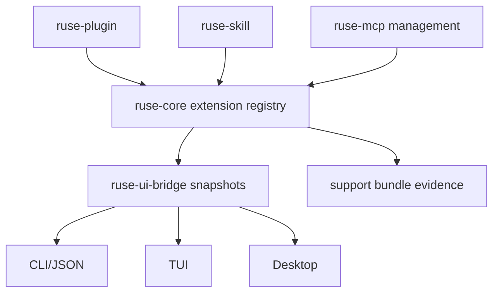

# M66 Extensions and MCP Hardening Spec

## Purpose

Return to extension and MCP polish after the beta packaging path is credible. M66 should improve installable user workflows for plugins, skills, and MCP servers through health, compatibility, diagnostics, support evidence, and only the MCP OAuth work needed by those workflows.

## Product Context

M65 closed the beta release gate: CLI/Desktop package smoke, onboarding readiness, and support bundle evidence are now documented and verified. M66 can safely revisit extension depth because the core coding-agent and release paths are credible.

M30-M54 and MX01 delivered a deep MCP foundation. M66 should not restart protocol expansion for its own sake. It should convert existing extension/MCP capabilities into user-visible management and troubleshooting workflows.

## Scope

This milestone delivers:

- extension health baseline across plugins, skills, and MCP servers
- compatibility checks with stable diagnostics
- CLI/JSON extension management smoke coverage
- Desktop/bridge-safe extension health snapshots where supported
- support bundle evidence for extension health
- MCP OAuth completion only when required for installable server workflows
- docs for plugin, skill, and MCP server management

Out of scope:

- marketplace/account sync
- hosted extension registry
- broad Desktop redesign
- arbitrary MCP protocol expansion without user workflow acceptance
- replacing existing plugin/skill/MCP foundations

## Architecture

Runtime crates own extension state, compatibility, capability reviews, policy, and health. CLI/TUI/Desktop render typed snapshots and command results. Support bundle generation records bounded extension health evidence rather than raw manifests or logs.

## Product Workflows

M66 should make these workflows reliable:

- inspect installed plugins, skills, and MCP servers
- understand enabled/disabled/degraded/unhealthy states
- see compatibility blockers before enablement
- review extension capability exposure
- install/enable/disable/remove plugins or skill roots through safe CLI paths
- inspect MCP server health and exported tools/resources/prompts
- collect support evidence without raw secrets, raw manifests with credentials, or unbounded logs

## Public Contracts

M66 should prefer additive contracts:

- `ExtensionHealthSmokeReport`
- `ExtensionCompatibilityReport`
- `ExtensionSupportEvidence`
- bridge-safe extension/MCP health snapshots
- stable diagnostic ids for missing manifest, incompatible API, disabled extension, unhealthy MCP server, policy blocked capability, and missing OAuth setup

Final names should follow existing crate conventions.

## Security And Privacy

- no raw tokens, OAuth codes, refresh tokens, API keys, or keychain values
- no raw environment dumps
- no raw extension process logs
- no unbounded MCP server output
- no automatic enablement without capability acceptance
- no Desktop/CLI local policy duplication
- support evidence must be allowlisted and redacted

## Testing Strategy

- focused `ruse-plugin`, `ruse-skill`, `ruse-mcp`, `ruse-core`, `ruse-cli`, `ruse-ui-bridge`, and Desktop tests as touched
- deterministic extension health smoke without credentials
- JSON frame tests for bridge-safe extension snapshots
- support bundle redaction tests for extension evidence
- final M66 closeout gates matching repo standard gates

## Slices

| Slice | Outcome |
|---|---|
| M66-01 Extension Health Baseline and Smoke | Define typed extension health evidence and deterministic smoke over plugin, skill, and MCP health. |
| M66-02 Plugin and Skill Management Hardening | Strengthen install/enable/disable/remove flows, capability acceptance, compatibility diagnostics, and CLI/JSON docs. |
| M66-03 MCP Management and Compatibility Health | Productize MCP server management snapshots, compatibility diagnostics, exported capability summaries, and support-safe evidence. |
| M66-04 OAuth Completion for Installable MCP Workflows | Complete only OAuth pieces required by user-installable MCP server workflows and support diagnostics. |
| M66-05 CLI/Desktop Extension Surfaces and Support Evidence | Render shared extension health snapshots and include extension evidence in support bundles. |
| M66-06 Hardening Docs and Closeout | Document workflows, run final gates, and close M66. |

## Acceptance Criteria

- A user can inspect extension health and compatibility without reading raw manifests or logs.
- Plugin/skill/MCP management diagnostics are typed, bounded, redacted, and test-covered.
- Extension support evidence is included in support bundles without raw secrets or unbounded output.
- OAuth work is limited to installable MCP workflows that need it.
- M66 final gates pass before marking the milestone complete.

## Completion Signal

M66 is complete when extension management, health, compatibility, support evidence, and required MCP OAuth workflow docs are implemented, verified, documented, and marked complete.
