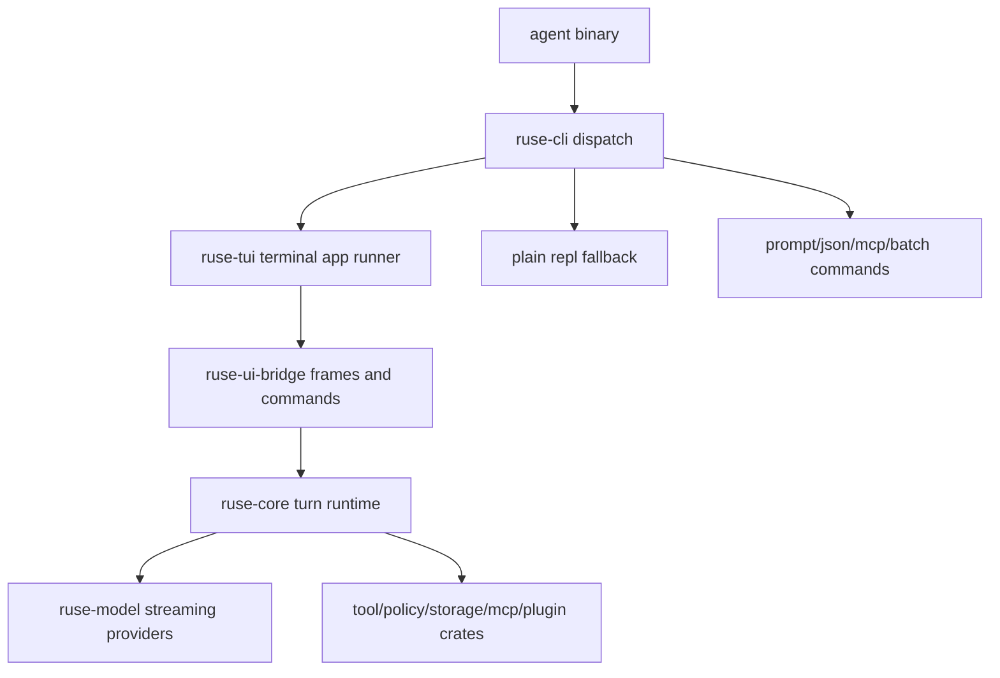

# M67 Production Terminal Agent Spec

## Purpose

Make `agent` with no arguments open a production terminal application comparable to Codex CLI and Claude Code instead of a toy line loop. M67 productizes the terminal surface around the existing shared runtime, UI bridge, and `ruse-tui` state so interactive coding turns can be streamed, inspected, approved, recovered, and tested from one terminal-first shell.

## Product Context

The PRD requires a CLI and terminal TUI that can run complete agent turns with model streaming, tool use, permission gating, recovery, memory, and persistence. M20 and M59 built the terminal UI foundation and daily-driver panels, while M56-M66 built runtime, provider, context, recovery, memory, plugin, and MCP foundations. External benchmark products show the bar: Codex CLI documents fullscreen terminal use, approvals, sandboxing, slash commands, noninteractive automation, and MCP; Claude Code documents terminal-first coding, permission modes, plan mode, slash commands, sessions, MCP, background tasks, and cross-surface handoff; Gemini CLI emphasizes built-in tools, checkpointing, MCP, and scriptable noninteractive runs; Aider emphasizes repo maps, git integration, lint/test feedback, and provider breadth; OpenCode emphasizes a TUI with build/plan agents and subagents.

## Benchmark Matrix

| Product | Reference signal | Production terminal pattern | Current `agent` status |
|---|---|---|---|
| Codex CLI | [openai/codex README](https://github.com/openai/codex), [Codex docs](https://developers.openai.com/codex) | Local fullscreen coding agent with streaming turns, approval/sandbox controls, MCP/configuration, noninteractive automation, transcripts, slash-style controls, prompt history, queued input, copy, review, diff, and JSON/exec paths. | M67 routes interactive TTY startup into `ruse-tui`, streams typed turn frames, preserves JSON/prompt/MCP stdio, and has slash, copy, diff, command, approval, retry, recovery, extension/MCP, and session panels. Remaining gaps are broader coding-loop UX depth such as review-first workflows and multi-root/web-search affordances, not the terminal shell foundation. |
| Claude Code | [Claude Code docs index](https://code.claude.com/docs/llms.txt), [overview](https://code.claude.com/docs/en/overview) | Terminal-first agent shared with IDE/Desktop/web surfaces, permission modes, plan mode, skills, commands, MCP, sessions, hooks, scheduled tasks, remote/desktop handoff, and durable session workflows. | `agent` matches the shared-runtime direction through `ruse-core` plus `ruse-ui-bridge`, with terminal sessions, plan/task, memory, MCP, recovery, and plugin snapshots. Remaining gap is live hook/scheduled-task control from the terminal shell. |
| Gemini CLI | [google-gemini/gemini-cli README](https://github.com/google-gemini/gemini-cli) | Terminal-first CLI with built-in search/file/shell/web fetch tools, MCP, checkpoint/resume, multi-directory context, noninteractive automation, and stream/JSON oriented scriptability. | `agent` keeps `--prompt` and `--json --prompt` machine paths, MCP stdio, checkpoint/recovery frames, and local-first tool/policy foundations. Remaining gap is broader first-class terminal affordances for multi-root context and web/search tool UX. |
| Aider | [Aider README](https://github.com/Aider-AI/aider), [docs](https://aider.chat/docs/) | Repo map, Git-centric edit workflow, lint/test feedback loop, broad model backends, image/web context, and deterministic developer control. | `agent` has project-context retrieval, command/test snapshots, edit diff/final review, multi-provider runtime, and JSON fixtures. Remaining gap is a more opinionated coding-loop surface that continuously explains repo map, Git, lint, and test evidence in the TUI. |
| OpenCode | [OpenCode README](https://github.com/sst/opencode), [docs](https://opencode.ai/docs) | Full TUI, build/plan agent modes, read-only plan mode, subagent affordances, permissions, and desktop companion. | `ruse-tui` has chat, status, trace, task, session, approval, diff, and command panels, with plan/task and team snapshots. Remaining gap is switching explicit build/plan/subagent modes from the terminal shell with runtime-enforced capability scopes. |

The product conclusion is that the fullscreen terminal app is not decoration. It is the primary command surface, and the plain line REPL must stay an explicit fallback and test harness only.

## Scope

This spec delivers:

- `agent` interactive TTY default entry into a fullscreen `ruse-tui` terminal app
- preserved `agent --prompt`, `--json --prompt`, MCP stdio, non-TTY, and explicit `agent repl --plain` behavior
- terminal lifecycle with alternate screen, raw mode, resize, panic/drop restore, and focused input handling
- bottom composer, transcript records, status bar, side panels, and local M1 diagnostics
- streaming turn bridge from `ConfiguredTurnRunner` / `TurnEventStream` into `ruse-ui-bridge` frames
- model delta, thinking/progress, tool call, tool result, approval, diff, command/test, task, recovery, and error rendering
- slash command contract for status, model, permissions, plan, diff, tools, MCP, memory, compact, retry, clear, and exit
- cancellation, retry, recovery, and provider health diagnostics visible in the terminal surface
- PTY, rendering, streaming, resize, panic restore, non-TTY, and provider fallback regression coverage

Owned by other specs:

- Desktop-specific shell polish stays in MX02 and later Desktop productization specs
- long-running cloud or hosted agents stay outside this local-first terminal milestone
- new provider protocols or model API semantics stay in `ruse-model` specs unless needed for terminal display

## Architecture

`ruse-cli` owns argument parsing, TTY detection, and mode dispatch. `ruse-tui` owns terminal lifecycle, event input, app state, rendering, and UI-only reducer behavior. `ruse-ui-bridge` owns UI-safe frames and commands. `ruse-core` owns turn execution, cancellation, checkpointing, recovery, tool policy, and durable runtime events. `ruse-model`, `ruse-tool`, `ruse-policy`, `ruse-storage`, `ruse-mcp`, and plugin crates keep their existing runtime responsibilities.

The selected approach is to productize `ruse-tui`, not continue expanding `plain_repl.rs`. `plain_repl.rs` remains a fallback and test harness for constrained terminals and script fixtures.



## File Layout

```text
crates/
  ruse-cli/
    src/
      bin/agent.rs
      bin/ruse-cli.rs
      command.rs
  ruse-tui/
    src/
      terminal_app.rs
      terminal.rs
      app.rs
      render.rs
      composer.rs
      transcript.rs
    tests/
      terminal_app.rs
      shell_render.rs
      shell_state.rs
  ruse-ui-bridge/
    src/
      frame.rs
      slash.rs
  ruse-core/
    src/
      turn.rs
```

Exact module names may evolve, but runtime logic must not move into CLI or TUI presentation layers.

## Public Contracts

M67 uses and extends typed, serde-friendly contracts already present in the repository:

```rust
pub struct TuiApp {
    pub status: StatusBarState,
    pub composer: ComposerState,
    pub transcript: TranscriptState,
    pub should_quit: bool,
}

pub enum TuiAction {
    Tick,
    QuitRequested,
    CancelTurnRequested,
    Resize { width: u16, height: u16 },
    ClearTranscript,
    TogglePanelExpansion,
    Composer(ComposerAction),
    BridgeFrame(Box<UiJsonFrame>),
}

pub enum TuiEffect {
    SubmitPrompt(String),
    RunSlashCommand(SlashCommand),
    LocalDiagnostic(String),
    ResolveApproval { /* typed fields */ },
    ApprovalAborted(String),
    CommandRetryPlan { /* command id, reason, dry-run */ },
    SwitchSession { /* typed ids */ },
}

pub enum UiJsonFrame {
    Event(UiEvent),
    ApprovalQueueSnapshot(UiApprovalQueueSnapshot),
    EditDiffSnapshot(UiEditDiffSnapshot),
    CommandTestSnapshot(UiCommandTestSnapshot),
    RecoverySnapshot(UiRecoverySnapshot),
    Error { code: String, message: String, recoverable: bool },
    Done { event_count: u64 },
}
```

Terminal app runner contracts:

```rust
pub struct TerminalAppConfig {
    pub status: StatusBarState,
    pub theme: TerminalTheme,
    pub tick_rate: Duration,
    pub startup_frames: Vec<UiJsonFrame>,
}

pub fn run_terminal_app_stdio(config: TerminalAppConfig) -> Result<(), TerminalAppError>;
```

The M2 streaming bridge should translate `TurnEventStream` into `UiJsonFrame` without parsing terminal text. The TUI consumes frames and emits bridge commands; it does not own model, tool, policy, approval, or storage semantics. Runtime-facing panel commands are routed through a terminal command runtime interface so presentation code can emit typed effects without mutating policy/session state directly.

For production tool turns, terminal mode uses the comprehensive runner in `ruse-core`, not a CLI-owned loop. `ComprehensiveTurnRunner::run_with_resources_streaming` accepts `ComprehensiveTurnResources`, `ComprehensiveTurnStreamOptions`, and a typed runtime-event sink. The sink emits model, tool, approval, observation, and guard-failure events as they happen while the runner still returns an `AgentLoopOutcome` for recovery and tests. `ruse-model::ModelRequest` carries provider-neutral tool definitions so OpenAI-compatible, Anthropic, Gemini, and local providers can receive real tool schemas instead of relying on prompt text. Providers that do not advertise `tool_calls` must fall back to the model-only `ConfiguredTurnRunner` stream with a recoverable diagnostic rather than breaking interactive chat.

Approval interaction must also remain runtime-owned. Comprehensive turns expose a suspended approval record and continuation before the corresponding `ApprovalRequested` frame is streamed, allowing the terminal command runtime to register it with `ApprovalCoordinator`. TUI allow/deny effects then resolve through `ApprovalCoordinator::resume_tool_approval`, persist the resulting typed events, feed the approved or denied observation back into the comprehensive turn continuation, and stream subsequent model/tool frames back into the UI. The TUI never executes a tool directly and must keep the turn active until the continuation reaches a final state or another approval.

Approval abort controls are not presentation-only escapes. They route to the same terminal approval resolution path as a deny decision with a bounded reason, so aborting a focused pending approval still persists typed approval resolution/error frames and does not bypass `ApprovalCoordinator`.

Slash command descriptors are owned by `ruse-ui-bridge` and shared by TUI and explicit plain REPL fallback. The catalog must include `/status`, `/model`, `/permissions`, `/plan`, `/diff`, `/tools`, `/mcp`, `/memory`, `/compact`, `/retry`, `/resume`, `/sessions`, `/copy`, `/theme`, `/clear`, `/exit`, and `/help`. Commands may open local panels or emit typed runtime commands, but they must never bypass policy, sandbox, approval, or audit checks.

`/tools` and `/mcp` open a typed extension/MCP panel, not a generic trace fallback. Terminal startup should hydrate that panel from `ExtensionSnapshot` frames so plugin, skill-root, and MCP-server health is visible before the first turn; live extension frames continue to update the same panel.

M67 also tracks the product-grade interactive affordances from benchmark CLIs in the same typed catalog. `/resume` opens the terminal sessions workflow and emits a core-owned recovery resume report instead of relying on an out-of-band command or local-only dry run, `/copy` targets the latest completed assistant output instead of in-progress stream text and emits a terminal clipboard effect through OSC52 plus platform clipboard fallback where available, `/compact` emits a typed `ConversationCompaction` frame built from the current terminal conversation event store through `ruse-core` context compaction, `/retry` targets the latest non-succeeded `CommandTestSnapshot.command_run_id` plus UI-safe snapshot evidence instead of a hard-coded placeholder, and `/theme` cycles terminal themes through a typed terminal command runtime effect. Command retry evidence must preserve structured `program`, `args`, and `timeout_ms` in typed command/test and retry summaries; terminal code must not reconstruct argv by parsing display text. With live command evidence, `/retry` may execute through the core command retry executor and emit a new `CommandTestSnapshot`; without evidence it must emit a typed missing-evidence plan. Compaction reports must include source, summary, dropped-message, and estimated-token counts plus a bounded redacted summary preview; the terminal UI must render the report in transcript and trace without owning compaction semantics. The initial theme is read from the typed runtime config `terminal.theme`; `/theme` updates the active session immediately and asks the terminal command runtime to persist the selected `terminal.theme` to the configured `config.yaml` through a core-owned atomic YAML mutation helper, reporting success or recoverable failure as typed config diagnostics. Explicit legacy TOML config files remain writable through the same typed helper.

Recovery resume reports may include a core-owned `RecoveryContinuation` with a bounded redacted summary, a next-prompt payload, readiness counts, and a `can_start_turn` flag. The terminal UI may render and explicitly schedule that continuation, but it must not synthesize the continuation prompt in presentation code or auto-start a recovered turn outside the TUI active-turn queue and cancellation model. `Ctrl+R` starts the pending recovered continuation only after `/resume` has produced one; if another turn is active, it is queued through the same prompt queue.

Tool display contracts use `UiEventPayload::ToolCall`, `ToolStarted`, `ToolObservation`, and `ToolResult` keyed by `call_id`. The transcript should merge lifecycle updates into one visible tool card. UI-safe summaries may include exit code, resource/path, stdout/stderr excerpts, truncation, redaction, and timeout state. `ToolExecutionStarted` carries policy decision/action/resource and sandbox profile metadata, while terminal tool results carry elapsed milliseconds; UI bridge exposes those fields in typed frames and transcript/trace render them without reconstructing runtime semantics.

## State and Failure Handling

- `agent` with no args enters TUI only when stdin and stdout are TTYs.
- non-TTY no-arg invocation prints stable help and exits non-zero.
- `agent repl --plain` remains explicit and script-testable.
- terminal raw mode and alternate screen are restored on normal quit, read/render errors, and panic unwinding.
- resize events update `TuiApp.terminal_size` and trigger a redraw without losing composer text.
- submitted user messages move from composer into transcript immediately.
- interactive terminal turns share one stable workspace/conversation identity for the lifetime of the terminal app, while each submitted prompt receives a fresh turn id and correlation id; `--prompt`/batch mode keeps one fresh conversation per invocation.
- submitted prompts during an active turn are queued visibly and started in FIFO order after the active turn reaches `Done`.
- `/copy` and `Ctrl+O` ignore streaming assistant text, record only the latest completed assistant output, emit an OSC52 terminal clipboard sequence, and report a local diagnostic when no completed output exists.
- `/resume` opens the sessions panel and uses the same typed session switching path as the panel keyboard affordances.
- `/status` emits a typed recovery snapshot for the current interactive conversation, and `/resume` emits a typed recovery resume report plus optional core-owned continuation evidence through `RecoveryEngine.resume` for the persistent terminal SQLite event store while still opening the sessions panel. `Ctrl+R` explicitly starts a startable recovery continuation via the normal terminal turn queue. Explicit dry-run commands remain available for scriptable CLI recovery inspection.
- `/compact` emits a typed redacted `ConversationCompaction` report for the current interactive conversation through `ruse-core::compact_conversation_events`.
- `/theme` opens status/theme state, cycles the current terminal session theme, and persists the selected theme to `config.yaml` when a writable config path exists; missing or failed writes remain recoverable diagnostics and must not corrupt the terminal. Explicit legacy TOML paths keep TOML write-back for compatibility.
- `terminal.theme` in `config.yaml` initializes the terminal app theme; supported values are `system`, `light`, `dark`, and `high-contrast`.
- M1 local diagnostics explain that live streaming is not attached yet; M2 replaces this with real turn execution.
- provider/config load failures are visible as recoverable diagnostics where possible and never leave the terminal corrupted.
- terminal startup emits a full typed config snapshot when config evaluation succeeds, including provider support, fallback compatibility, and config diagnostics; the status panel renders this as provider health instead of requiring users to inspect raw JSON or transcript errors.
- a new empty interactive session renders a welcome/workbench view instead of an empty Transcript panel. The view uses typed status/config/extension/session state to show the Agent brand, selected provider/model, connection or health summary, plugin/MCP summary, current directory, session state, and pending or known context window. The transcript replaces the welcome view after the first user message or runtime frame.
- the composer renders as a lightweight prompt line with `❯`, no placeholder text, no left/right input box borders, and no form-like title.
- live turn failures and runtime diagnostics update the status panel as runtime diagnostics, including transport, invalid stream event, fallback, rate-limit, and timeout classifications when the terminal runner can infer them from typed/runtime errors. Runtime outcomes carry provider/model invocation attempts from core, including comprehensive tool-loop fallback success paths; terminal mode emits typed `ModelInvocationAttempts` frames with bounded redacted diagnostics plus UI-safe request id and elapsed-time metadata so the status panel, trace, and transcript can show which provider/model attempts were tried and how they behaved.
- `Ctrl+C` cancels an active turn once M2 is connected; before then it exits cleanly.
- failed turns retain transcript, error frame, retry affordance, and recovery hints.
- `/retry` emits a typed command-retry request for the latest failed, timed-out, denied, waiting-approval, or tool-failed command snapshot and renders a `CommandRetryPlan` frame. With structured argv evidence it executes through core-owned retry execution and renders the retry command evidence; missing local evidence must be represented as a typed missing-evidence plan rather than a local string-only error.
- long command and diff output starts folded and can be expanded without corrupting transcript layout.
- expired or resolved approvals remain visible as read-only decisions; only focused pending approvals can emit typed allow/deny commands.
- session startup rebuilds the session directory from the persistent event store before the first user command; first user messages generate bounded redacted titles, and switching replays the selected conversation after process restart.
- switching or creating a session cancels the previous active turn and filters late events from superseded conversations so histories cannot interleave.
- tool continuation requests preserve typed message order (`user`, assistant tool call, tool result), execute all tool calls from one model response in proposal order, carry queued calls across approval suspension, and persist the top-level user input only once.

## Security and Privacy

- TUI renders only UI-safe frames from `ruse-ui-bridge`; hidden prompts, raw secrets, and unbounded command output must stay out of presentation state.
- tool approvals, diffs, and command outputs use bounded redacted summaries.
- slash commands cannot bypass policy, sandbox, approval, or audit paths.
- permission mode display is descriptive; actual allow/deny/ask decisions remain in `ruse-policy` and `ruse-core`.
- noninteractive JSON output remains machine-readable and unaffected by TUI formatting.

## Testing Strategy

- pure reducer tests for key mapping, composer submit, clear, quit, resize, and transcript mutation
- render golden tests for transcript, composer, status bar, side panels, narrow layout, and help
- terminal guard tests for raw mode and alternate-screen restore order
- CLI dispatch tests proving interactive no-args selects terminal app and explicit plain REPL still works
- M2 streaming tests using fake provider events and `TurnEventStream`
- tool/approval/diff rendering tests using `UiJsonFrame` fixtures
- PTY or integration smoke for alternate-screen startup, resize, quit, and panic restore
- non-TTY regression tests for help, prompt, JSON, and MCP stdio
- provider fallback and invalid stream-event regression tests in `ruse-model` when terminal behavior depends on them

## Acceptance Criteria

- Typing `agent` in an interactive terminal opens a fullscreen terminal app, not the plain REPL.
- The terminal app restores the terminal after quit or failure.
- Submitted user text becomes a transcript record and the composer clears.
- The status bar shows only provider, model, current directory, and current/total context length. Connection, permission, theme, and mode details are available through `/status`.
- `agent --prompt`, `agent --json --prompt`, MCP stdio, non-TTY no-arg help, and `agent repl --plain` remain compatible.
- Streaming model deltas, progress, tool calls, approvals, diffs, command/test output, recovery, and final responses render through typed frames by M2-M4.

## Completion Signal

M67 is complete when the new spec and plan exist, M1-M6 terminal app slices are implemented and tested, and standard Rust verification for touched crates passes without moving runtime behavior into presentation layers.
