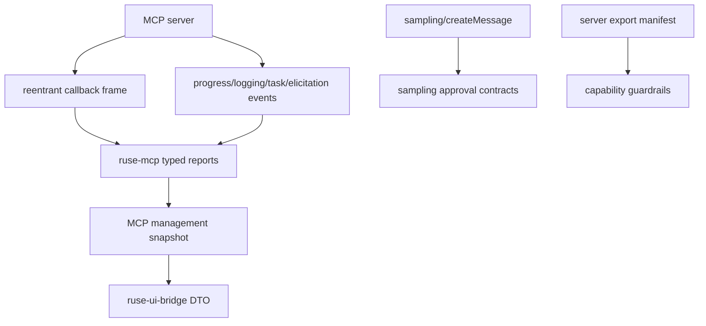

# MX01 MCP Epilogue Runtime Spec

## Purpose

Close the remaining P1-P3 MCP protocol and productization gaps after M54 without moving the product roadmap away from M55-M66. MX01 is an epilogue track for typed MCP contracts, safe bridge snapshots, sampling approval semantics, and server export guardrails. It explicitly does not complete the P0 OAuth/Auth product loop.

## Product Context

M54 completed MCP HTTP OAuth authorization-code token exchange into token leases. The main roadmap now returns to M55-M66 product work. MX01 records and implements the remaining MCP hardening that is valuable before that handoff: reentrant callbacks, protocol event summaries, sampling review contracts, Desktop/bridge management snapshots, and export safety guardrails.

## Scope

This milestone delivers:

- reentrant client callback contracts and fixture dispatch reports
- typed MCP progress, logging, task, and elicitation event summaries
- sampling approval request/decision contracts and task metadata
- Desktop/bridge-consumable MCP management snapshots
- server export capability declarations, policy previews, and dangerous export default-deny guardrails
- docs, milestone status, and final verification evidence

Owned by later product milestones:

- browser/device login
- localhost callback server
- Desktop account picker UX
- durable encrypted token vault
- refresh-token persistence
- provider refresh execution
- token revocation execution
- dynamic client registration execution
- OS keychain integration
- full Desktop MCP management UI

## Architecture

`ruse-mcp` owns MCP protocol contracts, validation, redaction, policy previews, and safe management snapshots. `ruse-ui-bridge` owns bridge-consumable snapshot DTOs without depending on `ruse-mcp`. CLI/Desktop can render these contracts later without owning protocol parsing or policy semantics.



## Public Contracts

MX01 introduces contracts shaped like:

```rust
pub struct McpClientCallbackReport {
    pub server_id: McpServerId,
    pub transport_kind: McpClientCallbackTransportKind,
    pub method: String,
    pub outcome: McpClientCallbackOutcome,
    pub diagnostics: Vec<McpClientCallbackDiagnostic>,
}

pub struct McpProtocolEventReport {
    pub server_id: McpServerId,
    pub event_kind: McpProtocolEventKind,
    pub ui_summary: McpProtocolEventSummary,
    pub diagnostics: Vec<McpProtocolEventDiagnostic>,
}

pub struct McpSamplingApprovalRequest {
    pub request_id: String,
    pub server_id: McpServerId,
    pub task: Option<McpSamplingTaskMetadata>,
    pub review: McpSamplingReviewSummary,
}

pub struct McpManagementSnapshot {
    pub servers: Vec<McpManagementServerSnapshot>,
}
```

Names may evolve during implementation, but contracts must remain typed, serializable when UI-safe or durable, bounded, and redacted.

## State and Failure Handling

- Unknown callbacks produce a typed safe rejection and do not call providers.
- `roots/list` callbacks return safe root metadata only through the existing root provider boundary.
- `sampling/createMessage` callbacks use existing sampling validation and do not grant local tools.
- Protocol event parsing accepts safe notification shapes, normalizes known methods, and summarizes unknown methods without exposing raw payloads.
- Sampling approval contracts default to waiting/denied unless a caller records an explicit allow decision.
- Tool-enabled sampling loops are default-deny.
- MCP management snapshots are bounded status reports, not permission leases.
- Server export manifests reject enabled dangerous side-effecting declarations by default.

## Security and Privacy

- No callback can bypass local policy, tool registry, sandbox, model boundary, or sampling validation.
- Reports and diagnostics never expose raw prompts, provider payloads, headers, bearer tokens, refresh tokens, secret refs, local tool arguments, resource contents, command strings, or remote failure bodies.
- Roots are explicit metadata, not filesystem permissions.
- Server export guardrails default-deny command, edit, git-write, browser, secret, and network side-effecting export classes.
- MX01 does not grant MCP servers filesystem, command, Git, browser, Desktop, local secret, or local tool permissions.

## Testing Strategy

- fixture callback tests for roots/list, sampling, unknown callbacks, and safe rejection
- protocol event parsing/redaction tests for progress, logging, task, elicitation, unknown event payloads, and UI summaries
- sampling approval tests for request/decision serde, task metadata, default-deny tool loops, and redaction
- management snapshot tests in `ruse-mcp` plus bridge-safe snapshot tests in `ruse-ui-bridge`
- manifest validation and policy preview tests for read-only exports and dangerous side-effecting export classes
- final `cargo fmt`, `cargo clippy`, `cargo test`, and `cargo xtask ci`

## Acceptance Criteria

- `cargo fmt --all -- --check`
- `cargo clippy --workspace --all-targets -- -D warnings`
- `cargo test --workspace`
- `cargo xtask ci`

## Completion Signal

MX01 is complete when the P1-P3 MCP epilogue capabilities are implemented, documented, marked complete in milestone docs and plans, and verified without implementing the P0 OAuth/Auth product closure or changing the M55-M66 roadmap priority.
