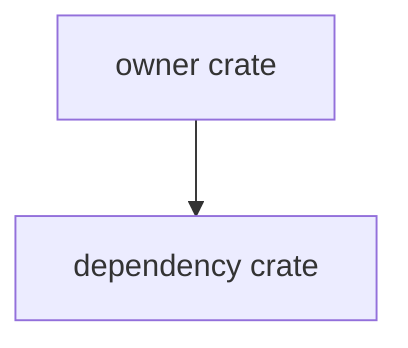

# Mxx-yy Topic Spec

## Purpose

State the concrete problem this spec solves in one paragraph.

## Product Context

Explain which PRD goal, milestone, and user journey this work supports.

## Scope

This spec delivers:

- capability or contract 1
- capability or contract 2
- capability or contract 3

Owned by other specs:

- capability owned elsewhere 1
- capability owned elsewhere 2

## Architecture

Describe the crates, modules, ownership boundaries, and dependency direction.



## File Layout

```text
crates/
  crate-name/
    src/
      lib.rs
```

## Public Contracts

List public structs, enums, traits, functions, schemas, and wire formats.

```rust
pub struct PublicContract {
    pub field: String,
}
```

## State and Failure Handling

- state transition rule 1
- recoverable failure behavior
- terminal failure behavior
- retry or idempotency behavior

## Security and Privacy

- capability requirements
- secret handling
- audit requirements
- untrusted inputs

## Testing Strategy

- unit test requirement
- integration test requirement
- replay or snapshot requirement
- security or concurrency requirement

## Acceptance Criteria

- observable completion criterion 1
- observable completion criterion 2
- verification command or artifact

## Completion Signal

State exactly what proves the spec is complete and ready for implementation or the next slice.
